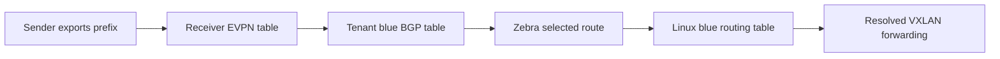

# EVPN Type 5 Route Missing: Check VRF Import and L3VNI Mapping

Author: [nawazdhandala](https://www.github.com/nawazdhandala)

Tags: VXLAN, BGP, Linux

Description: Trace an advertised EVPN prefix through route-target import, FRR VRF-to-L3VNI association, route selection, next-hop resolution, and the Linux routing table.

A remote leaf advertises a subnet, but the receiving tenant cannot reach it. The sender's advertisement is only the beginning of the evidence chain. The receiver must obtain the route, import it into the right tenant, resolve the forwarding information, and install a usable route.

This walkthrough targets **FRRouting 10.2.1** on Linux using VRF devices, IPv4 prefixes, and the interface-less IP-VRF-to-IP-VRF EVPN model. It uses a traditional bridge and VXLAN device for the L3VNI. It does not cover the separate network-namespace VRF backend or every vendor's EVPN routing model.

The examples are read-only inspection commands unless explicitly described as configuration context. No FRR or Linux network deployment was run for this article.

## Define what “not installed” means

EVPN Type 5 advertises an IP prefix. A VRF, or virtual routing and forwarding instance, separates a tenant's routing table from other tenants. An L3VNI identifies the VXLAN context used between those tenant routing instances. [EVPN IP prefix routing](https://www.rfc-editor.org/rfc/rfc9136.html).

Use one prefix throughout the investigation, such as `10.30.0.0/24` in tenant `blue`. Record the expected remote VTEP, the VXLAN tunnel endpoint, and the expected route targets. Then identify the first missing stage:



A screenshot of the sender's Type 5 route does not tell you which arrow failed. Likewise, a route in the receiver's BGP table may be valid but not selected over a better local route.

Keep an evidence sheet with one row per stage, including the capture time and exact tenant name. This avoids comparing a default-table route on one system with a tenant-table route on another.

## Confirm receipt on the receiving leaf

From an account authorized to use FRR's `vtysh` interface:

```bash
vtysh -c 'show bgp l2vpn evpn route detail type prefix'
vtysh -c 'show bgp vrf blue ipv4 unicast 10.30.0.0/24'
```

Replace `blue` and the prefix. The first command displays detailed Type 5 entries; the second inspects the tenant's IPv4 BGP route. These command forms are present in the tagged source. [FRR 10.2.1 EVPN commands](https://raw.githubusercontent.com/FRRouting/frr/frr-10.2.1/bgpd/bgp_evpn_vty.c), [FRR 10.2.1 BGP route commands](https://raw.githubusercontent.com/FRRouting/frr/frr-10.2.1/bgpd/bgp_route.c).

If the prefix is absent from the receiving EVPN table, return to advertisement propagation: session state, export policy, reflection, and inbound filtering. Do not change the tenant's Linux routing table to compensate for a route that never arrived.

If it appears in EVPN but not in tenant `blue`, record the route targets and local VRF association. That is a more focused starting point than restarting the routing service.

## Compare the IP-VRF route targets

A route target, or RT, is an import/export policy attribute. The receiver imports a route when the applicable policy matches; an RD, or route distinguisher, serves a different purpose by keeping otherwise similar routes distinct. Compare the IP-VRF's import policy for the prefix, not just the policy on a nearby Layer 2 segment. [EVPN route-target use](https://www.rfc-editor.org/rfc/rfc7432.html).

For an illustrative tenant:

| Item | Expected value |
| --- | --- |
| Prefix exported by remote tenant | `10.30.0.0/24` |
| RT attached to that route | `65000:100` |
| Local blue IP-VRF import RT | Includes `65000:100` |
| Local blue L3VNI | `100` |
| Linux routing table for blue | `1100` in this example |

These numbers identify different things. Linux table 1100 is not VNI 100. An RT ending in 100 is a policy choice, not a kernel table assignment. Do not repair a mismatch by making every number identical.

Check the actual received attribute, including whether extended communities survived intermediate BGP policy. An automatic RT derivation is not proof that two differently configured autonomous systems produced a compatible value. Apply the approved tenant policy explicitly where the design requires it; importing unrelated tenants is not an acceptable shortcut.

## Verify the VRF-to-L3VNI association

Inspect FRR's view:

```bash
vtysh -c 'show bgp vrfs'
vtysh -c 'show evpn vni 100'
```

The first command reports BGP VRF information, including L3VNI and router-MAC/interface information where available. The second inspects the VNI. Confirm that 100 is associated with the intended Layer 3 context rather than being treated as a Layer 2 segment. [FRR VRF display](https://docs.frrouting.org/en/stable-10.2/bgp.html), [Tagged Zebra VNI command](https://raw.githubusercontent.com/FRRouting/frr/frr-10.2.1/zebra/zebra_vty.c).

This is the relevant FRR configuration relationship, shown for comparison with your approved configuration rather than as a repair to paste blindly:

```text
vrf blue
 vni 100
exit-vrf
```

FRR documents that the `vni` statement under the VRF establishes its L3VNI association. Without that association, a VNI discovered from Linux is initially considered Layer 2. [FRR EVPN configuration](https://docs.frrouting.org/en/stable-10.2/evpn.html).

Now inspect the corresponding Linux devices:

```bash
ip -d link show dev blue
ip -d link show dev br100
ip -d link show dev vxlan100
```

For this example layout, expect VRF `blue` to use table 1100, bridge `br100` to belong to that VRF, and `vxlan100` to belong to the bridge with VXLAN ID 100. Replace all device names. FRR reads Linux interface state; it does not create this layout automatically. Its traditional L3VNI example uses an unnumbered bridge and tunnel attachment, so “interface-less” in the EVPN model does not mean deleting Linux's required devices. [FRR Linux interface model](https://docs.frrouting.org/en/stable-10.2/evpn.html).

## Separate BGP selection from kernel installation

Collect both the routing manager's view and Linux's view:

```bash
vtysh -c 'show ip route vrf blue'
ip route show vrf blue
ip route get 10.30.0.10 vrf blue
```

The first command reads Zebra's routing table. The second reads the VRF's kernel routes. The third asks Linux which route it would use for one destination in that VRF; it sends no probe and does not demonstrate remote delivery. [Zebra route management](https://docs.frrouting.org/en/stable-10.2/zebra.html), [Linux VRF tables](https://docs.kernel.org/networking/vrf.html), [Route lookup semantics](https://man7.org/linux/man-pages/man8/ip-route.8.html).

If the BGP path exists but another route wins, identify the selected route and why. A connected or static route may legitimately take precedence. If Zebra expects installation but the kernel lacks the route, inspect interface readiness and dataplane errors at the same time as the failed update.

The lookup result also helps expose a route that exists but is bypassed by a more specific route. Test the destination your application actually uses, and account for its source and ingress context when policy routing is involved.

## Inspect the routed tunnel's dependencies

For this L3VNI, inspect the remote router-MAC and next-hop state:

```bash
vtysh -c 'show evpn rmac vni 100'
vtysh -c 'show evpn next-hops vni 100'
```

These are documented in the tagged Zebra command definitions. Compare their remote endpoint information with the prefix's intended forwarding path. [FRR 10.2.1 EVPN forwarding displays](https://raw.githubusercontent.com/FRRouting/frr/frr-10.2.1/zebra/zebra_vty.c).

A router MAC identifies the remote routing function, not necessarily the destination workload's MAC. Symmetric integrated routing and bridging uses routing at both ends of the overlay. [EVPN symmetric routing](https://www.rfc-editor.org/rfc/rfc9135.html).

Do not assume every Type 5 route needs a separate host Type 2 route to resolve a gateway. RFC 9136 defines several models; the interface-less model differs from models that use an overlay index and recursive resolution. Diagnose the model actually deployed, including its VTEP reachability and router-MAC requirements. [Type 5 forwarding models](https://www.rfc-editor.org/rfc/rfc9136.html).

## Close the investigation with tenant traffic

After the approved correction, repeat the same table checks. Confirm the expected prefix in the intended tenant, the selected kernel route, and usable tunnel dependencies. Then test controlled application traffic and its return path before releasing ordinary traffic.

Keep the conclusion tied to evidence: missing advertisement, failed import, incorrect L3VNI association, route selection, or dataplane programming. Each points to a different correction. Local review verified the command definitions and shell syntax here; it did not verify route installation or forwarding on a live fabric.
