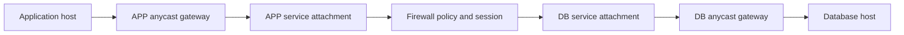

# Route EVPN VXLAN Traffic Through a Central Firewall

Author: [nawazdhandala](https://www.github.com/nawazdhandala)

Tags: VXLAN, BGP, Networking

Description: Keep distributed anycast gateways while steering selected traffic through a central firewall, with route checks that expose bypasses and return-path mistakes.

You add a default route toward a firewall, open a connection between two servers, and find no corresponding firewall session. The connection succeeds because the fabric already knows a more specific route to the destination. The default route never participates.

The answer is usually to align routing boundaries with inspection requirements. Moving every server's default gateway to a firewall is a different design, with different scaling and availability consequences. First decide which traffic must cross the firewall and which traffic may stay inside the fabric.

This article uses an illustrative two-zone design. Its read-only Linux examples are checked against iproute2 6.12.0 documentation; the small route-selection model was executed locally. No firewall or EVPN fabric was deployed for this article.

## Keep the first hop separate from the inspection boundary

A distributed anycast gateway lets a host use a gateway address available on multiple leaf switches. Integrated Routing and Bridging, or IRB, combines switching within a subnet with routing between subnets. The ingress leaf can route a packet rather than sending every packet to a central router. [RFC 9135](https://www.rfc-editor.org/rfc/rfc9135.html)

A VRF, or Virtual Routing and Forwarding instance, provides a separate routing context. Put two subnets in the same VRF and the fabric may route between them directly. Putting them in different VRFs establishes a useful boundary, but that boundary disappears wherever you deliberately provide direct cross-VRF routing.

For its Layer 3 firewall integration model, Cisco maps security zones to separate VRFs, with the fabric routing within a zone and the firewall routing between zones. This is a documented design option, not a universal requirement for every service-insertion technology. [Cisco NX-OS 10.1(x) services integration](https://www.cisco.com/c/en/us/td/docs/dcn/nx-os/nexus9000/101x/configuration/vxlan/cisco-nexus-9000-series-nx-os-vxlan-configuration-guide-release-101x/m_configuring_layer_4-layer_7_network_services_integration.html)

For the example, assume these requirements:

| Traffic | Required handling |
| --- | --- |
| Application subnet to another application subnet | Fabric routing permitted inside APP |
| Application subnet to database subnet | Firewall inspection required between APP and DB |
| Database reply to application | Return through the approved firewall state domain |
| Two hosts on the same database subnet | Outside this routed inspection design |

The last row matters. Same-subnet hosts can communicate by bridging without using a routed gateway. If those connections need inspection, use an appropriate isolation or service-insertion design rather than assuming VRF routing covers them.

## Draw both directions through the service

This diagram represents logical routing contexts. The two service-side contexts might be on the same physical border switch, but they must remain separate unless the intended path crosses the firewall.



The reply needs a compatible reverse path through the firewall. It does not necessarily need the same physical underlay links. What matters is that the firewall handling the reply has the required session state and policy context.

Use an address plan before choosing route commands. For example, APP contains `10.10.0.0/24`, DB contains `10.20.0.0/24`, and each firewall zone has a separate transit attachment. Specify transit addressing, the active firewall next hop, and how the border advertises reachability toward it. Those details depend on the platform and high-availability design; the diagram is not a configuration template.

## Find the route that can bypass inspection

A default route is a fallback. Under ordinary destination-based routing, a matching `/24` route wins over a matching `/0` route. Administrative distance is not a mechanism for making a default route override a more specific destination prefix.

Run this Python 3 example locally to make the bypass visible. It models only longest-prefix selection among already-installed routes, not BGP path selection, policy-based routing, or firewall behavior.

```python
from ipaddress import ip_address, ip_network

routes = [
    (ip_network("0.0.0.0/0"), "firewall path"),
    (ip_network("10.20.0.0/24"), "direct fabric path"),
]
destination = ip_address("10.20.0.12")
matches = [(prefix, path) for prefix, path in routes
           if destination in prefix]
selected = max(matches, key=lambda route: route[0].prefixlen)
print(f"{destination} uses {selected[0]} via {selected[1]}")
```

Expected output selects `10.20.0.0/24` through the direct fabric path. This demonstrates why a firewall-facing default is insufficient when the APP routing table also contains a direct DB route. RFC 9135 describes longest-prefix lookup in EVPN forwarding. [RFC 9135, section 4.2](https://www.rfc-editor.org/rfc/rfc9135.html#section-4.2)

Inspect the route's origin and next-hop resolution. A destination prefix is not inherently a bypass: it may legitimately lead through the firewall. The problem is a route whose resolved forwarding path reaches the destination without the required service.

Centralized route leaking also needs scrutiny. Cisco describes it as importing and exporting routes at a designated leaking point. A central leaking switch is not automatically a firewall, and routing there does not itself establish inspection. [Cisco NX-OS 10.4(x) route leaking](https://www.cisco.com/c/en/us/td/docs/dcn/nx-os/nexus9000/104x/configuration/vxlan/cisco-nexus-9000-series-nx-os-vxlan-configuration-guide-release-104x/m_configuring_external_vrf_connectivity_and_route_leaking_93x.html)

## Inspect installed routes without changing them

On a Linux-based routing node using VRF devices, these commands display the APP and DB tables. They require existing VRFs named `APP` and `DB`; replace names and addresses with your approved staging values. These are Linux commands, not Cisco NX-OS commands.

```bash
ip route show vrf APP
ip route get 10.20.0.12 vrf APP
ip route show vrf DB
ip route get 10.10.0.11 vrf DB
```

The two lookups should resolve toward the designed service path in their respective contexts. Follow intermediate next hops until you reach the firewall attachment. A remote VTEP next hop might be legitimate if that VTEP leads to the firewall; its presence alone is neither success nor failure.

`ip route get` asks the kernel for a route lookup. It does not send a test packet or prove hardware forwarding. These simplified lookups also omit ingress interface, source, marks, and transport fields that a policy-sensitive deployment might require. Check those inputs when comparing the lookup with an actual flow. [iproute2 6.12.0 route manual](https://raw.githubusercontent.com/iproute2/iproute2/v6.12.0/man/man8/ip-route.8.in)

On an appliance, use its supported route and forwarding-table inspection tools instead. Keep route evidence from the source leaf, service attachment, firewall, and destination side together for the same connection.

## Make return traffic and failure behavior explicit

For a stateful firewall, seeing only one direction can break inspection. Fortinet's routing documentation discusses asymmetric paths and the relationship between routing and firewall sessions. This does not mean all asymmetry is forbidden: clustered products can support specific arrangements, which must be verified for the chosen mode. [FortiOS 7.4.4 routing concepts](https://docs.fortinet.com/document/fortigate/7.4.4/administration-guide/139692/routing-concepts)

Record whether network address translation changes the addresses seen on either side. Check the return route against the address actually visible to the destination. Do not add translation solely to hide an unexplained routing mistake.

In staging, open a fresh permitted application connection and correlate its endpoints, ports, and time with the firewall session. Confirm a deliberately denied connection fails at the intended policy. Then test a connection within an allowed same-zone subnet pair so that the scope remains clear.

During a planned firewall failover, verify route withdrawal or next-hop movement, new connection recovery, and established-session behavior separately. A reachable firewall interface does not prove that its inspection service is healthy. Define whether failure must block traffic; do not let a backup route silently become an inspection bypass.

Keep the distributed gateway when it serves the workload well. Make the firewall unavoidable for the specific traffic requiring inspection by reviewing the complete forward and reverse paths, including every route import and fallback. The proof is a successful policy test with matching forwarding and session evidence, not simply a default route pointing in the right direction.
