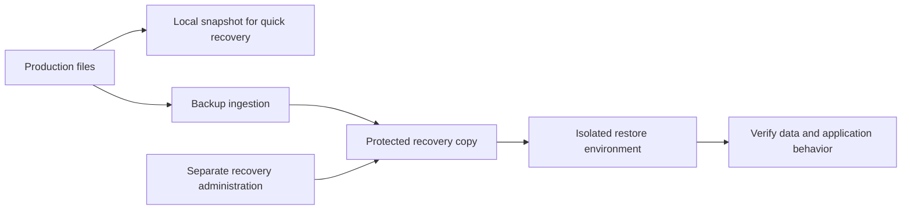

# Why a File-Storage Snapshot Alone Is Not a Ransomware-Safe Backup

Author: [nawazdhandala](https://www.github.com/nawazdhandala)

Tags: Backup, Ransomware Protection, File Storage

Description: Evaluate snapshots against ransomware threats using separate administration, protected retention, recoverable keys, and an isolated restore drill.

A snapshot can recover a file that someone accidentally overwrote. That does not establish that it will survive an attacker who controls the storage administrator account. The difference is who can change or destroy the recovery point, and which infrastructure it depends on.

Snapshots remain useful. The mistake is treating a snapshot schedule as evidence of an independent, recoverable backup. Assess the whole recovery path: data, permissions, encryption keys, backup catalog, restore tools, and the people authorized to use them.

## Read-only does not mean independently protected

OpenZFS describes a snapshot as a read-only copy that shares storage with the active dataset. As live data changes, the snapshot retains the older view. This is efficient and convenient, but it does not create a separate storage system or administrator boundary. [OpenZFS 2.3 snapshot concepts](https://openzfs.github.io/openzfs-docs/man/v2.3/7/zfsconcepts.7.html).

Ask three concrete questions about each recovery point:

- Can a compromised production administrator delete it or shorten its retention?
- Would losing the array, pool, account, or site also lose this recovery point?
- Can the recovery team read it if production identity services and key stores are unavailable?

A protected snapshot product may answer these questions well. A basic snapshot on the same device may not. Judge the implemented controls rather than the word “snapshot” or “backup” on the dashboard.

The joint October 2023 StopRansomware guide recommends offline, encrypted backups and regular testing of their availability and integrity. It also recognizes that attackers target backup access. Encryption helps protect confidentiality, but it does not stop an authorized identity from deleting the encrypted data. [Joint StopRansomware guide](https://www.ic3.gov/CSA/2023/231019.pdf).

## Draw the administration boundary

A second copy is weak protection if the same compromised credentials can erase both copies. Separate routine backup ingestion from retention administration and emergency recovery. Keep the recovery credentials and instructions available through a tested path that does not depend entirely on production.



The diagram describes responsibilities, not a guarantee of one-way networking. Review actual permissions and connectivity. A backup agent that can write new data may still possess a repository password, a cloud token, or a path that exposes more authority than intended.

Maintain an inventory of deletion rights, retention-bypass rights, account recovery access, and key-management permissions. Test those boundaries with disposable objects and approved accounts. Do not test destructive privileges against the only production recovery copy.

## Understand the protection you enable

Immutability means preventing specified changes for an enforced period or condition. Its scope matters. Amazon S3 Object Lock protects object versions, not an abstract application backup. Governance mode can be bypassed with the required permission and explicit request header. Compliance mode prevents deletion or overwrite of protected versions by users, including account root, during retention; AWS documents account deletion as an exceptional boundary. Neither mode prevents creating a newer version or a delete marker above a protected version. [S3 Object Lock semantics](https://docs.aws.amazon.com/AmazonS3/latest/userguide/object-lock.html).

Those details affect recovery. The team may need an older protected version rather than the current object view. The backup software must support the chosen storage and retention design, including its catalog and maintenance behavior. Do not add object locking to an arbitrary repository and assume pruning, locking, and restoration remain compatible.

Choose a retention window long enough to cover plausible detection delay and investigation time. A backup from last night may already contain encrypted files or corrupted application state. Retaining several historical points gives investigators options; it does not identify the clean point automatically.

Also retain recovery keys independently. Immutable ciphertext is unusable if the only decryption key is lost. Exercise the emergency access procedure with the actual recovery staff and record how long it takes.

## Rehearse restoration without overwriting production

Use a clean, isolated destination and a deliberately selected recovery point. Do not begin by restoring the newest backup over the affected share. Preserve evidence, determine the likely compromise window, and have the incident team approve the candidate point.

The following example uses restic 0.18.1 to inspect and restore an existing repository. It is a restore drill, not a recipe for immutable storage. Prerequisites are a compatible repository, its password file available through an approved recovery process, a trusted restic binary, and enough local space for the selected directory.

Replace every example value before running. The snapshot ID must come from your repository inventory, and the source directory must be the path stored inside that snapshot:

```bash
set -euo pipefail
umask 077
REPOSITORY='/replace/with/recovery-repository'
PASSWORD_FILE='/replace/with/protected-password-file'
SNAPSHOT_ID='REPLACE_WITH_REVIEWED_SNAPSHOT_ID'
SNAPSHOT_DIRECTORY='/replace/with/path/inside/snapshot'
r() {
  restic --repo "$REPOSITORY" --password-file "$PASSWORD_FILE" "$@"
}
r snapshots
r check --read-data
RESTORE_TARGET=$(mktemp -d "${TMPDIR:-/tmp}/restore-drill.XXXXXX")
r restore "$SNAPSHOT_ID:$SNAPSHOT_DIRECTORY" --target "$RESTORE_TARGET"
printf 'Restored into: %s\n' "$RESTORE_TARGET"
```

The fresh temporary directory prevents this example from targeting an existing live tree. Retain it for inspection and clean it up through your normal staging process afterward. The repository check verifies structure and, with `--read-data`, reads and verifies pack data. That can be expensive on a large remote repository; plan its bandwidth and duration. It does not certify that the files are malware-free or application-consistent. [restic 0.18.1 repository checking](https://restic.readthedocs.io/en/v0.18.1/045_working_with_repos.html).

The `snapshot:directory` form restores that directory's contents under the target. Selecting an explicit ID avoids silently changing the drill to a newer backup as scheduled jobs run. Repository access may create temporary locks; arrange the drill with the backup owner. [restic 0.18.1 restore syntax](https://restic.readthedocs.io/en/v0.18.1/050_restore.html).

These command forms were exercised against a local synthetic restic 0.18.1 repository. The full data check passed, and restoration of a selected snapshot directory produced 1,000 files whose paths and SHA-256 hashes matched the saved manifest. No ransomware, remote object locking, identity isolation, or production application recovery was tested. That local result establishes the restore mechanics only.

## Check more than a successful exit code

A restore acceptance record should distinguish these outcomes:

| Check | Evidence |
| --- | --- |
| Repository readable | Selected recovery identity can access data and keys |
| Correct recovery point | Explicit identifier and approved time window |
| Files complete | Expected paths, counts, and trusted content comparisons |
| Permissions usable | Intended users succeed and unauthorized users are denied |
| Application consistent | Application-specific recovery and read/write checks pass |
| Recovery timely | Time from incident decision to useful service, including setup |

Hash comparisons detect differences from a trusted manifest; they do not establish that the manifest itself predates compromise. Include application owners and incident responders when selecting the baseline. File presence alone cannot prove a database or multi-file application is consistent.

Do not reconnect the restored environment to compromised automation or synchronization jobs until the incident team approves that step. A good recovery point can be damaged again if the original access path remains available.

## Keep retention maintenance inside the design

Backup storage needs lifecycle management. For example, restic distinguishes removing snapshot references with `forget` from removing unreferenced data with `prune`. That maintenance authority belongs in the threat model, not just the capacity plan. [restic retention and pruning](https://restic.readthedocs.io/en/v0.18.1/060_forget.html).

Review the protection design after changing credentials, retention settings, software versions, or recovery destinations. Schedule drills that include unavailable production services and replacement recovery staff. A defensible backup plan can demonstrate a surviving recovery point, independent access to it, and a verified path back to useful service.
