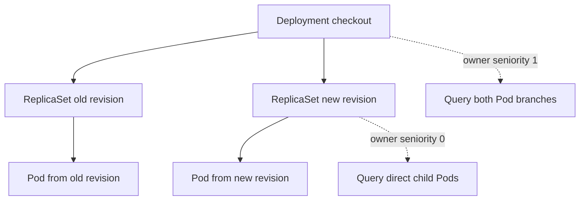

# Find a Deployment's Pods with Clusterpedia Owner Seniority

Author: [nawazdhandala](https://www.github.com/nawazdhandala)

Tags: Kubernetes, Multi-Cluster, Troubleshooting

Description: Follow Deployment-to-ReplicaSet-to-Pod ownership in Clusterpedia using owner UIDs, the correct seniority, and synchronized intermediate resources.

A Deployment usually does not directly own its Pods. It manages ReplicaSets, and each ReplicaSet manages Pods. That extra relationship explains why a query using a Deployment UID with the default owner setting can return no Pods even when the workload is running.

Clusterpedia's owner seniority option lets a search follow that intermediate relationship. This guide uses **Clusterpedia v0.9.0's internal storage backend**. The examples were checked against tagged source and local API-option tests; they were not executed against a live cluster.

## Count the ownership links correctly

Kubernetes records ownership in `metadata.ownerReferences`. Controller ownership is a particular relationship used by workload controllers; sharing an application label does not establish it. See the [Kubernetes ownership guide](https://kubernetes.io/docs/concepts/overview/working-with-objects/owners-dependents/).



Owner seniority **0** means the supplied owner is the direct parent of the objects being requested. Seniority **1** adds one intermediate generation. For Pods under a standard Deployment, use the Deployment as owner with seniority 1. For Pods directly under a ReplicaSet, use that ReplicaSet with seniority 0.

During a rolling update, more than one ReplicaSet can have Pods. Searching by Deployment ancestry can cover both revisions instead of guessing a single ReplicaSet name. Kubernetes documents the revision behavior in its [Deployment guide](https://kubernetes.io/docs/concepts/workloads/controllers/deployment/).

## Synchronize the intermediate resources

The owner traversal happens against Clusterpedia's stored resources. If you synchronize Pods but omit ReplicaSets, the database cannot reconstruct the normal Deployment-to-Pod path.

Review the effective selection for your imported member, including any shared policy. A suitable selection fragment is:

```yaml
syncResources:
  - group: ""
    resources: [pods]
  - group: apps
    resources: [deployments, replicasets]
```

This belongs under `spec` in your existing PediaCluster configuration. Preserve its other required fields and selections. The import identity needs the relevant read permissions, and all three resource types should show successful synchronization before you rely on the query.

In v0.9.0, the internal storage layer saves the UID from an object's **controller** owner reference. It is not a general graph over every possible owner reference. The [resource storage implementation](https://github.com/clusterpedia-io/clusterpedia/blob/v0.9.0/pkg/storage/internalstorage/resource_storage.go) uses `GetControllerOfNoCopy` when storing the owner UID.

This matters for custom controllers or manually constructed objects. Inspect their actual ownership model rather than assuming any two-level chain behaves like a Deployment.

## Obtain the Deployment UID from the correct member

Use the Deployment's UID when you want a particular object instance. Names can be reused after deletion, but the recreated Deployment has a different UID.

The following read-only commands use an ordinary member context. Replace `MEMBER_CONTEXT`, namespace `payments`, and Deployment `checkout`:

```bash
set -euo pipefail
deployment_uid=$(kubectl --context MEMBER_CONTEXT -n payments \
  get deployment checkout -o jsonpath='{.metadata.uid}')
: "${deployment_uid:?Deployment UID was empty}"
printf '%s\n' "$deployment_uid"
```

The guard stops this shell sequence if no UID was returned. Keep the variable in the same shell for the next command. The member context must correspond to the imported PediaCluster named `member-a` below; the two names need not be identical.

If you retrieve the Deployment through Clusterpedia instead, a single-object GET needs the member encoded in the Clusterpedia URL path. Do not assume a multi-cluster search context plus a positional object name has enough information to identify the member. The [single-cluster search documentation](https://clusterpedia.io/docs/usage/search/specified-cluster/) explains that distinction.

## Search one member with seniority 1

Use an already configured Clusterpedia search kubeconfig for this request:

```bash
kubectl --kubeconfig clusterpedia-search.yaml get pods -n payments \
  -l "search.clusterpedia.io/clusters=member-a,search.clusterpedia.io/owner-uid=${deployment_uid},search.clusterpedia.io/owner-seniority=1" \
  -o json
```

Expect stored Pods whose controller owner is a resource whose controller owner is the selected Deployment UID. For the usual workload chain, those intermediate resources are its ReplicaSets. Empty old ReplicaSets do not produce phantom Pods; only matching stored Pod objects can be returned.

Always restrict an owner query to **one member**. In the pinned internal-storage implementation, the owner filter is not applied when the cluster-name list does not contain exactly one entry. A multi-cluster request can therefore become broader than intended rather than safely failing. The tagged [owner-query application code](https://github.com/clusterpedia-io/clusterpedia/blob/v0.9.0/pkg/storage/internalstorage/resource_storage.go) makes this a critical precondition.

For an HTTP-path-oriented diagnostic, the equivalent request through the ordinary hosting context is:

```bash
kubectl --context HOST_CONTEXT get \
  --raw="/apis/clusterpedia.io/v1beta1/resources/clusters/member-a/api/v1/namespaces/payments/pods?ownerUID=${deployment_uid}&ownerSeniority=1"
```

Here the member is fixed in the URL itself. `HOST_CONTEXT` reaches the hosting Kubernetes API, not the already prefixed search endpoint. Do not prepend the Clusterpedia path twice.

## Use the name form deliberately

When the current Deployment name is the intended identity, specify its resource type as well:

```bash
kubectl --kubeconfig clusterpedia-search.yaml get pods -n payments \
  -l 'search.clusterpedia.io/clusters=member-a,search.clusterpedia.io/owner-name=checkout,search.clusterpedia.io/owner-gr=deployments.apps,search.clusterpedia.io/owner-seniority=1'
```

`deployments.apps` is resource followed by API group, not a Kind name such as `Deployment`. The namespace also narrows the lookup. This form requires the named Deployment to be available in Clusterpedia's stored view.

Do not send contradictory UID and name criteria expecting them to be combined. The UID takes precedence in the owner lookup. Use one identity strategy and record it with the result, especially during deletion and recreation incidents.

The [tagged owner-query builder](https://github.com/clusterpedia-io/clusterpedia/blob/v0.9.0/pkg/storage/internalstorage/json_builder.go) shows the intermediate UID queries and the resource/group restriction for name-based lookup.

## Verify an unexpected result before acting

For one returned Pod, inspect its controller owner on the member, then inspect that ReplicaSet's controller owner:

```bash
kubectl --context MEMBER_CONTEXT -n payments get pod POD_NAME \
  -o jsonpath='{.metadata.ownerReferences}{"\n"}'
kubectl --context MEMBER_CONTEXT -n payments get replicaset REPLICASET_NAME \
  -o jsonpath='{.metadata.ownerReferences}{"\n"}'
```

Replace both names using the actual response. Confirm the ReplicaSet UID in the Pod reference and the Deployment UID in the ReplicaSet reference. Check `controller: true` rather than merely noticing a familiar name.

If no Pods are returned, distinguish a scaled-to-zero Deployment from an incomplete synchronization chain. Check the member and namespace mapping, current Deployment UID, selected seniority, and ReplicaSet synchronization. A rollout can temporarily expose differences between the member and the stored view, so repeat a narrow comparison after synchronization catches up.

If too many Pods appear, first verify the single-member constraint. Then consider whether the result legitimately includes old and new rollout revisions. Owner ancestry is not a readiness, traffic, or current-revision filter. Inspect those properties separately before using the list for an operational action.

Finally, account for pagination when building an inventory. "Every Pod" means every matching object in a complete result, not merely the first response page or the desired replica count. Preserve the selected member, namespace, Deployment UID, and observation time so another engineer can reproduce the investigation.
