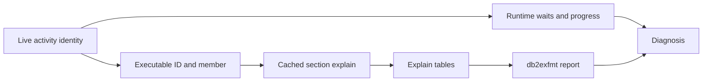

# Find and Explain Long-Running Db2 SQL Without Losing Its Plan

Author: [nawazdhandala](https://www.github.com/nawazdhandala)

Tags: Database, SQL, Performance

Description: Identify a live Db2 SQL activity, preserve its executable identity, and use db2expln or db2exfmt to investigate the right access plan before tuning.

A query has been running for ten minutes. Copying its SQL into an explain tool sounds like the obvious next step, but it can answer the wrong question. The new compilation might use different statistics, parameter values, or settings from the execution that is currently slow.

Start by identifying the live activity, then capture its existing compiled section where possible. A section is Db2's executable representation of a statement. An access plan describes how that section reads, joins, sorts, and modifies data.

The examples below target Db2 LUW 11.5 and assume a single-member database with member number `0`. Replace `APPDB`, example identifiers, and schema names before use. An authorized administrator must have the necessary monitor, explain-routine, and explain-table privileges. These examples were reviewed against documentation; no Db2 server was used to execute them.

## Find the execution, not just familiar SQL text

Connect to the affected database through the Db2 command line processor, then run:

```sql
SELECT CURRENT TIMESTAMP AS CAPTURED_AT,
       COORD_MEMBER, APPLICATION_HANDLE, UOW_ID, ACTIVITY_ID,
       APPLICATION_NAME, SESSION_AUTH_ID,
       ELAPSED_TIME_SEC, ACTIVITY_STATE,
       VARCHAR(SUBSTR(STMT_TEXT, 1, 500), 500) AS SQL_PREVIEW
FROM SYSIBMADM.MON_CURRENT_SQL
WHERE ELAPSED_TIME_SEC >= 60
ORDER BY ELAPSED_TIME_SEC DESC
FETCH FIRST 20 ROWS ONLY;
```

The 60-second cutoff is an investigation filter, not a universal performance objective. Expected rows identify activities that have not completed. An activity still queued before execution can have a null elapsed time and will not appear under this filter; inspect queued work separately when the application is waiting but this list looks empty. IBM describes those semantics in [MON_CURRENT_SQL](https://www.ibm.com/docs/en/db2/11.5.x?topic=mv-mon-current-sql-retrieve-key-metrics-all-activities-all-members).

Save the capture time and the complete identity: application handle, unit-of-work ID, activity ID, and coordinating member. A unit of work is the transaction context. One connection can run many activities, so its handle alone does not identify the slow execution forever.

The SQL preview is deliberately truncated. It helps recognize a statement, but it is not suitable as input for recompilation or as a unique identifier. SQL text may contain confidential literals; protect diagnostic files accordingly.

## Capture the section while it still exists

Suppose the selected row shows application handle `12345`, unit of work `8`, and activity `3`. Substitute the actual values:

```sql
SELECT CURRENT TIMESTAMP AS CAPTURED_AT,
       MEMBER, COORD_MEMBER, APPLICATION_HANDLE, UOW_ID, ACTIVITY_ID,
       ACTIVITY_STATE, HEX(EXECUTABLE_ID) AS EXECUTABLE_ID_HEX,
       PACKAGE_SCHEMA, PACKAGE_NAME, PACKAGE_VERSION_ID, SECTION_NUMBER,
       TOTAL_CPU_TIME, ROWS_READ, ROWS_RETURNED,
       TOTAL_ACT_WAIT_TIME, LOCK_WAIT_TIME
FROM TABLE(SYSPROC.MON_GET_ACTIVITY(BIGINT(12345), -2)) AS A
WHERE UOW_ID = 8 AND ACTIVITY_ID = 3
ORDER BY MEMBER;
```

`-2` requests all active members. Preserve member identity even though this walkthrough uses a single-member database. The returned executable ID identifies the compiled section; it is not the application handle or section number. The function and fields are documented in [MON_GET_ACTIVITY](https://www.ibm.com/docs/en/db2/11.5.x?topic=routines-mon-get-activity-return-list-activities).

Repeat the observation after a short interval if the activity remains present. An activity disappearing means the live observation window ended, not that the query necessarily succeeded. Obtain the outcome from the application or an already configured activity event monitor.

Interpret metrics in their units. CPU time is in microseconds; activity wait time is in milliseconds. Compare like-for-like deltas for the same execution. Zero metrics can also reflect collection settings. Changing `MON_ACT_METRICS` does not retroactively populate existing activities, as IBM explains in the [activity metrics configuration](https://www.ibm.com/docs/en/db2/11.5.x?topic=parameters-mon-act-metrics-monitoring-activity-metrics).

| Evidence | Next question |
|---|---|
| Increasing lock wait | Which transaction holds the needed lock? |
| Increasing CPU and rows read | Is the plan doing excessive work for the result? |
| High elapsed time with little visible progress | Is work queued, blocked, or waiting on another resource? |
| Activity already finished | Is its section still cached, or was execution evidence captured elsewhere? |

An access plan alone cannot identify every runtime wait. Collecting it complements the activity evidence.

## Explain the cached section into review tables

The explain tables store the captured plan information. Have the DBA prepare a dedicated schema such as `SQLREVIEW`, with tables matching the installed Db2 level. If those tables do not yet exist, an authorized setup call is:

```sql
CALL SYSPROC.SYSINSTALLOBJECTS(
  'EXPLAIN', 'C', CAST(NULL AS VARCHAR(128)), 'SQLREVIEW'
);
COMMIT;
```

This creates database objects; it is not a read-only monitoring query. Do it once through the approved setup process, rather than recreating shared tables during an incident. IBM notes that explain-table formats can change between modification levels in its [explain-table documentation](https://www.ibm.com/docs/en/db2/11.5.x?topic=sql-explain-tables).

Next, replace `REPLACE_WITH_CAPTURED_HEX` with the complete hexadecimal value returned above. This placeholder is intentionally not a valid executable ID. Run the call in the Db2 command line processor, where question marks receive output parameters:

```sql
CALL SYSPROC.EXPLAIN_FROM_SECTION(
  X'REPLACE_WITH_CAPTURED_HEX', 'M', NULL, 0, 'SQLREVIEW',
  ?, ?, ?, ?, ?
);
COMMIT;
```

`M` selects the in-memory package cache; `0` identifies the member holding the section in this example. The routine writes explain rows without rerunning the original business statement. Save its output, including explain time and source identifiers. IBM's [section explain example](https://www.ibm.com/docs/en/db2/11.5.x?topic=gcsei-example-investigating-query-performance-using-explain-information-obtained-from-section) demonstrates this workflow; the [routine reference](https://www.ibm.com/docs/en/db2/11.1?topic=er-explain-from-section-procedure-explain-statement-using-package-cache-package-cache-event-monitor-information) details the parameters.

If the section was evicted, the identifier does not reconstruct it. Check whether a package-cache event monitor already retained it. Do not flush the cache or rebind packages before preserving the evidence you need.



## Format the exact explain request

Use the returned identifiers to select the captured request. The timestamp and names below are placeholders illustrating the shape of a command; replace them with the call's output:

```bash
db2exfmt -d APPDB -e SQLREVIEW \
  -w '2026-11-20-14.30.00.000000' \
  -n SQLC0001 -s NULLID -v '' \
  -g -# 0 -o incident-plan.txt
```

The `-w` option selects explain time, `-n` and `-s` identify the source, and `-v` supplies its version, empty only when the returned value is empty. `-g` includes the plan graph; `-# 0` requests all sections for the selected source. These flags are described in the [Db2 11.5 command reference](https://public.dhe.ibm.com/ps/products/db2/info/vr115/pdf/en_US/db2_commands_115.pdf).

Avoid relying on “latest explain” in a shared schema: another operator may capture something between your call and formatting step. Check the report header against your saved identifiers and statement text.

## Use db2expln for a compact static-package view

For a genuine static statement, use its package schema, name, version, and section from the activity evidence. For example:

```bash
db2expln -database APPDB -schema BILLING -package INVOICE \
  -version V1 -section 7 -output static-section.txt
```

Every identifier here is illustrative. This package-based form explains static sections; do not feed it a dynamic SQL package name and assume it has captured the slow dynamic statement. `db2expln` also supports dynamic-cache identifiers obtained through `db2pd -dynamic`, but those identifiers are a different interface from the executable ID used above. See the [db2expln command reference](https://www.ibm.com/docs/en/db2/11.5.x?topic=commands-db2expln-sql-xquery-explain).

## Turn the evidence into a specific hypothesis

Read the plan alongside the measured waits and progress. A table scan is not automatically wrong, and an index scan is not automatically efficient. Look for unexpectedly large intermediate results, repeated inner-side lookups, sorts, and predicates that discard most rows after expensive work.

Estimated row counts are estimates. Per-execution operator actuals require appropriate collection; a cached plan does not magically provide them. IBM's [section explain guidance](https://www.ibm.com/docs/en/db2/11.5.x?topic=facility-guidelines-capturing-section-explain-information) distinguishes the available capture paths.

Record one testable explanation, then validate a targeted change against representative inputs. Preserve the original execution identity, plan, statistics context, and application outcome. That gives you a useful before-and-after comparison instead of an attractive new plan with no demonstrated connection to the original delay.
