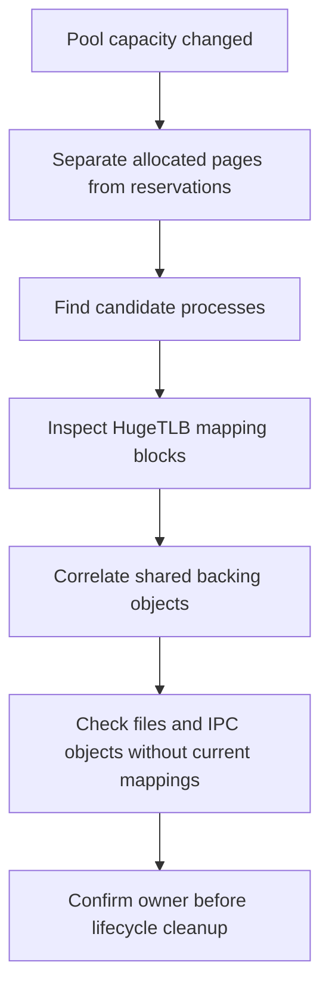

# Find the Processes and Mappings Consuming Your HugeTLB Pool

Author: [nawazdhandala](https://www.github.com/nawazdhandala)

Tags: Linux, HugePages, Troubleshooting

Description: Trace missing HugeTLB capacity from pool counters to process mappings, shared backing objects, and outstanding reservations without double-counting memory.

A shrinking HugeTLB free count does not immediately tell you which service owns the pages. Ordinary RSS rankings can miss the relevant memory, several processes can map the same backing object, and a reservation can consume future capacity before pages appear in a process's working set.

Investigate in layers: first identify the affected page-size pool, then locate candidate processes, and finally examine the mappings and backing objects. The goal is an ownership explanation that supports safe cleanup, not a list of large processes to terminate.

This guide follows **Linux 6.12** procfs and HugeTLB documentation. Run the inspection on the host with appropriate permission to read the relevant processes. A container's process and IPC views can omit consumers elsewhere on the machine.

## Establish whether pages are allocated or promised

Take a size-specific snapshot before inspecting processes:

```bash
for pool in /sys/kernel/mm/hugepages/hugepages-*; do
    [ -d "$pool" ] || continue
    printf '\n%s\n' "$pool"
    for field in nr_hugepages free_hugepages resv_hugepages surplus_hugepages; do
        printf '%s=' "$field"
        cat "$pool/$field"
    done
done
```

The directories separate sizes such as 2 MiB and 1 GiB. `free_hugepages` counts pages not allocated, while `resv_hugepages` represents commitments to future allocation. Record both. A rising reserved count with little change in free pages points toward mappings or objects promising memory that has not yet been touched. The [HugeTLB counter documentation](https://www.kernel.org/doc/html/v6.12/admin-guide/mm/hugetlbpage.html) defines these distinctions.

Do not compare snapshots taken hours apart without accounting for deployments, restarts, pool resizing, or other consumers. Capture timestamps and workload changes alongside the numbers.



## Find candidates without relying on RSS

The `HugetlbPages` field in `/proc/PID/status` provides a useful first pass. This read-only scan prints visible processes with a nonzero value:

```bash
for status in /proc/[0-9]*/status; do
    [ -r "$status" ] || continue
    awk '/^Name:/ {name=$2}
         /^Pid:/ {pid=$2}
         /^HugetlbPages:/ && $2>0 {print pid, name, $2, "kB"}' "$status"
done
```

Use it as a candidate list, not a reconciliation total. Processes can exit during the scan, access checks can prevent inspection, and the short name is only a label. Confirm the PID's identity before taking action.

Linux accounts `Shared_Hugetlb` and `Private_Hugetlb` separately from the ordinary `RSS` and `PSS` fields in smaps. PSS normally apportions shared memory, but it does not solve HugeTLB double-counting here. See the [Linux procfs accounting documentation](https://www.kernel.org/doc/html/v6.12/filesystems/proc.html).

A zero status value also does not rule out responsibility for reservations or an unmapped backing object. Keep likely services in the investigation even if this first filter does not list them.

## Extract the actual HugeTLB mapping blocks

Save this Python 3 helper as `huge-maps.py`. It accepts a live smaps path or a saved snapshot and prints only mappings with the `ht` flag:

```python
import argparse
import re

parser = argparse.ArgumentParser()
parser.add_argument("smaps_file")
args = parser.parse_args()
header = re.compile(r"^[0-9a-f]+-[0-9a-f]+\s")
wanted = {"Size:", "KernelPageSize:", "Shared_Hugetlb:",
          "Private_Hugetlb:", "VmFlags:"}


def emit(block):
    flags = next((line.split()[1:] for line in block
                  if line.startswith("VmFlags:")), [])
    if "ht" not in flags:
        return
    print(block[0], end="")
    for line in block[1:]:
        if line.split() and line.split()[0] in wanted:
            print(line, end="")
    print()


block = []
with open(args.smaps_file) as stream:
    for line in stream:
        if header.match(line):
            emit(block)
            block = []
        block.append(line)
    emit(block)
```

Run it for a candidate PID, replacing `12345`:

```bash
python3 huge-maps.py /proc/12345/smaps
```

Expected output includes the address-range header, mapping size, page size, HugeTLB accounting fields, and flags. The [smaps manual](https://man7.org/linux/man-pages/man5/proc_pid_smaps.5.html) defines `ht` as HugeTLB backing. This avoids confusing Transparent Huge Pages, reported through fields such as `AnonHugePages`, with the explicit pool.

Retaining zero-accounted `ht` mappings is intentional. An allocated virtual range can exist before its pages are faulted in. Its `Size` is not proof that all those bytes are physically resident, nor a precise per-mapping reservation count.

For example, a mapping of 64 MiB with only 2 MiB in the HugeTLB accounting fields suggests that the entire virtual range is not currently represented by mapped huge pages. Investigate allocation and first-touch behavior before calling it a leak.

## Correlate shared objects before adding numbers

The mapping header provides the range, permissions, offset, device, inode, and optional pathname. The [maps interface](https://man7.org/linux/man-pages/man5/proc_pid_maps.5.html) describes these fields and notes that an unlinked file can carry a `(deleted)` suffix.

Compare device/inode identity and overlapping file-offset ranges across candidates. Two workers may map the same 1 GiB object, so two process reports do not necessarily mean 2 GiB of physical allocation. Conversely, matching paths alone do not prove that two mappings share identical backing after files are replaced or namespaces differ.

Also avoid treating `Private_Hugetlb` as proof that the mapping was created with `MAP_PRIVATE`. Accounting reflects page sharing, and a shared mapping currently used by just one process can be accounted as private.

Record a small ownership table:

| Evidence | Record |
|---|---|
| Process identity | PID, service, deployment or job |
| Mapping identity | Address range, device, inode, file offset |
| Capacity | Page size, virtual size, HugeTLB accounting |
| Sharing | Other processes mapping the same object range |
| Lifecycle | Who creates, closes, unmaps, and removes the object |

This is an investigation record, not a mathematically exact physical-page census. Concurrent changes, shared aliases, and inaccessible processes limit what a procfs snapshot can establish.

## Investigate backing objects that outlive a mapping

If mapped pages do not explain the pool, inspect the service's open descriptors and the relevant hugetlbfs mounts:

```bash
app_pid=12345
ls -l "/proc/$app_pid/fd"
findmnt --types hugetlbfs --output TARGET,FSTYPE,OPTIONS
```

The descriptor directory contains links to open files, as documented in [proc_pid_fd](https://man7.org/linux/man-pages/man5/proc_pid_fd.5.html). However, an application may close a descriptor while retaining its mapping, so absence from `fd` does not invalidate mapping evidence. Conversely, a backing object can remain referenced without a current application mapping.

Named hugetlbfs files, System V shared memory, and anonymous memory-file objects have different lifetimes. `memfd_create()` can create HugeTLB-backed objects with `MFD_HUGETLB`; their debug names are not persistent filesystem paths. See [memfd_create](https://man7.org/linux/man-pages/man2/memfd_create.2.html). Inspect files only on verified HugeTLB mounts; an ordinary large file is unrelated evidence.

For System V shared memory in the relevant IPC namespace, inspect identifiers and ownership:

```bash
ipcs -m
ipcs -m -p
ipcs -m -i 32768
```

Replace `32768` with a segment ID from the first listing. The commands show segment details and creator/last-operation PIDs, not every attached process. They do not establish HugeTLB backing by themselves; correlate them with application configuration and mappings. See [ipcs](https://man7.org/linux/man-pages/man1/ipcs.1.html).

System V segments can persist independently of their creator. Removal has attachment-dependent semantics documented by [shmctl](https://man7.org/linux/man-pages/man2/shmctl.2.html). Do not remove a segment solely because its original PID no longer exists.

## Close the investigation with a controlled lifecycle test

Ask the owning service to release the specific object through its supported shutdown or cleanup path. In staging, compare pool counters before allocation, after touching the working set, and after all expected references are released. If the reservation remains, examine which mapping or object still owns that commitment.

Avoid deleting every file in a HugeTLB mount or removing every IPC segment to make the counter recover. That destroys the evidence and can interrupt active users.

The parser was tested against synthetic ordinary, Transparent Huge Page, resident HugeTLB, and unfaulted HugeTLB blocks. Shell examples were syntax-checked. No live Linux process inventory or page-release test was performed for this article; the procedure deliberately avoids claiming that process sums can exactly reconstruct the physical pool.
