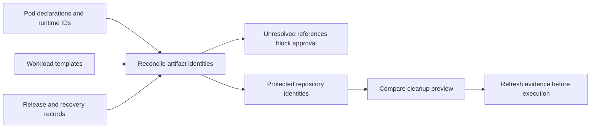

# Find Production Artifacts Before a Cleanup Job Deletes Them

Author: [nawazdhandala](https://www.github.com/nawazdhandala)

Tags: Artifact Management, Kubernetes, CI/CD, Disaster Recovery

Description: Build an evidence-based artifact inventory from running workloads, desired configuration, and release records before approving repository cleanup.

A repository reports that an image has not been downloaded for months. Meanwhile, several production containers still run from that image, and their nodes have cached copies. The repository's usage timestamp describes requests it observed. It does not describe everything production may need after a restart.

Before approving cleanup, gather evidence from the systems that consume artifacts. The result should identify both current use and future obligations: scaled-down services, scheduled jobs, rollback releases, and recovery procedures.

The example below inventories common Kubernetes workloads. It uses API fields checked against Kubernetes **1.34** and a Python **3.9-compatible** extractor. The parsing tests ran locally against fixtures; no live cluster was queried.

## Define what a complete scan must cover

Maintain an expected list of clusters, accounts, regions, namespaces, and non-Kubernetes deployment platforms. For each source, record whether collection succeeded, when it ran, and which identity performed it. An inaccessible cluster is a failed source, not evidence that no artifacts are used there.

Separate these three questions:

| Evidence | Question answered | Important gap |
|---|---|---|
| Running workload state | What is running or starting now? | Dormant and future workloads |
| Desired workload configuration | What might the scheduler start? | External releases and recovery tooling |
| Release and recovery records | What must remain deployable or auditable? | Whether the live environment matches the record |

Reconcile all three. A mismatch is something to investigate, not a reason to discard one source automatically.

## Collect Kubernetes objects without changing them

Use a kubectl client supported for your cluster, read-only list permissions across the intended namespaces, and an explicit context. The [kubectl get reference](https://kubernetes.io/docs/reference/kubectl/generated/kubectl_get/) documents context selection, all-namespace listing, JSON output, and request timeouts.

Run this in a new, access-restricted working directory. Set `CONTEXT` to the approved context name:

```bash
set -euo pipefail
: "${CONTEXT:?Set the Kubernetes context to inventory}"
umask 077
kubectl --context "$CONTEXT" --request-timeout=60s \
  get pods -A -o json > pods.json
kubectl --context "$CONTEXT" --request-timeout=60s \
  get deployments,replicasets,statefulsets,daemonsets,jobs,cronjobs,replicationcontrollers \
  -A -o json > workloads.json
```

Proceed only if both commands succeed. Keep the context name and collection timestamps with the files. These are separate list operations, not one transactionally consistent snapshot of the whole cluster. Repeat the scan before deletion if deployments can change meanwhile.

Treat the raw JSON as sensitive operational data: pod specifications can contain configuration and literal environment values. Do not paste it into public tickets. It does not fetch Secret objects, but that does not make the output safe to publish.

## Extract declared references and runtime identities

Save the following as `extract.py`. It preserves the source filename, resource kind, namespace, object name, container group, and container name. That context lets an owner explain why an image appears in the report.

```python
import json
import sys

for filename in sys.argv[1:]:
    with open(filename) as f:
        document = json.load(f)
    if document.get('metadata', {}).get('continue'):
        raise ValueError('Incomplete paginated response')
    for item in document['items']:
        kind = item['kind']
        metadata = item['metadata']
        identity = [filename, kind, metadata.get('namespace', ''), metadata['name']]
        if kind == 'Pod':
            spec = item['spec']
        elif kind == 'CronJob':
            spec = item['spec']['jobTemplate']['spec']['template']['spec']
        elif kind in {'Deployment', 'ReplicaSet', 'StatefulSet', 'DaemonSet', 'Job', 'ReplicationController'}:
            spec = item['spec']['template']['spec']
        else:
            raise ValueError('Unhandled resource kind: ' + kind)
        for group in ('containers', 'initContainers', 'ephemeralContainers'):
            for container in spec.get(group, []):
                print(json.dumps(identity + [group, container['name'], 'declared', container['image']]))
        if kind == 'Pod':
            for group in ('containerStatuses', 'initContainerStatuses', 'ephemeralContainerStatuses'):
                for status in item.get('status', {}).get(group, []):
                    print(json.dumps(identity + [group, status['name'], 'runtime', status.get('imageID', '')]))
```

The declared references come from pod specifications and workload templates. Runtime identities come from the corresponding status arrays. Kubernetes's [v0.34.0 API definitions](https://github.com/kubernetes/api/blob/v0.34.0/core/v1/types.go) describe `imageID` as runtime-resolved information that may differ from the image in the pod specification. Preserve it verbatim; do not assume every runtime supplies an interchangeable registry reference.

Write output to a temporary report and publish it only on success:

```bash
set -euo pipefail
python3 extract.py pods.json workloads.json > references.pending.jsonl
mv references.pending.jsonl references.jsonl
```

Each line is a JSON array, so embedded whitespace does not break columns. A missing runtime ID remains an empty string for investigation. An error can leave partial output in the pending file; never use that file as an approved inventory.

## Include workloads that currently have no pods

A [Deployment](https://v1-34.docs.kubernetes.io/docs/concepts/workloads/controllers/deployment/) can retain a pod template while scaled to zero. Old ReplicaSets can also preserve rollout history. A [CronJob](https://v1-34.docs.kubernetes.io/docs/concepts/workloads/controllers/cron-jobs/) keeps a job template between executions and can be suspended. These are reasons to inspect controller objects as well as pods.

The extractor does not filter by phase, replica count, or suspension. That intentionally produces conservative candidates for protection. An owner may later retire an obsolete ReplicaSet or completed job, but absence of a running container is insufficient by itself.

Custom controllers, operator-managed resources, GitOps repositories, serverless platforms, and virtual-machine services require additional collectors. The standard workload list above does not cover every system that can create a pod or download a package.

## Reconcile references with repository identities

A mutable tag can point somewhere different today than when a pod started. Resolving that tag now establishes its current destination, not the historical identity of the running image. Compare runtime evidence with the deployment's recorded digest and promotion history. Investigate unresolved or conflicting identities before allowing cleanup.

For multi-platform images, retain the approved index and required child manifests rather than assuming a node's platform image represents the entire release. Kubernetes's [image documentation](https://kubernetes.io/docs/concepts/containers/images/) distinguishes tags, digests, and multi-architecture image selection.

Map each protected reference to the exact repository location cleanup will affect. Preserve required chart packages, deployment bundles, signatures, provenance, and recovery scripts from release records too. A chart downloaded during deployment will not necessarily appear in a running pod's image fields.



## Make the cleanup decision auditable

Compare the product's deletion preview with the protected identities. Any intersection blocks approval. An empty intersection is useful only when collection coverage is complete, evidence is fresh, and dependency relationships have been included.

Record the exact candidate set, the policy revision, inventory timestamps, and reviewer. Coordinate cleanup with promotion so newly approved releases become protected before a cleanup job can remove them. Do not let a report from yesterday authorize deletion after today's rollout.

The extractor tests covered normal, init, and ephemeral containers; runtime IDs; absent runtime IDs; a scaled-to-zero Deployment; and a suspended CronJob. It rejected an unfinished paginated response and an unknown resource kind. These tests establish local parsing behavior, not completeness of your production inventory or live cluster permissions.

The final deliverable is a traceable answer for each artifact: which workload or release needs it, where that evidence came from, and when it was last verified. When that answer is missing, pause that cleanup scope and repair the inventory first.
