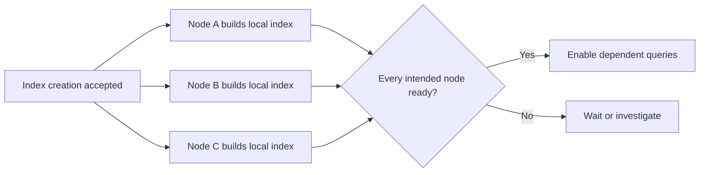

# Fix Aerospike Index Not Readable: Check Readiness on Every Node

Author: [nawazdhandala](https://www.github.com/nawazdhandala)

Tags: Aerospike, Database, Java, Troubleshooting

Description: Gate Aerospike queries on secondary-index readiness across every intended node, inspect build progress, and avoid premature rollout or repeated index rebuilds.

An index creation request succeeds, so the deployment starts issuing queries immediately. Some requests work; others fail with `AEROSPIKE_ERR_INDEX_NOT_READABLE`. The missing step is often waiting for every relevant node to finish building its local index.

Treat index creation and query readiness as separate milestones. A control-plane request can be accepted before the index is populated. Check the exact index definition and each node's state, then release query traffic only after the readiness condition is satisfied.

## Understand what RW means

A secondary index helps Aerospike find records by indexed values. While the index is building, it can absorb changes without being ready to serve queries. `RW` means read-write; a write-only state does not yet satisfy query readiness.

An explicit index-dependent query can fail when its required index is absent or unreadable. Error names vary by client: Java uses `INDEX_NOTREADABLE`, while other clients expose names such as `AEROSPIKE_ERR_INDEX_NOT_READABLE`. Do not confuse an unreadable index with a slow query or a missing record.

Query behavior also depends on the API and index-selection mode. Newer optimizer hints and scan-fallback options are not equivalent to an explicit index requirement. Aerospike's [secondary-index query guide](https://aerospike.com/docs/develop/learn/queries/secondary-index/) describes those distinctions. Keep the original query and error details when diagnosing the failure.

## Establish the expected node set first

Record the intended cluster membership, namespace, set, index name, bin or expression, and index type. A readiness check that silently omits an unreachable node can produce a false success. Compare the client's discovered nodes with the expected membership before relying on a client-side completion task.

If membership changes while the check runs, re-evaluate the expected nodes. Do not use “every node that answered” as a substitute for “every intended serving node.” A newly joining node and a stale address in a deployment inventory need different handling.



The nodes may finish at different times. A healthy node completing quickly is useful progress, but it is not permission to ignore the slower member.

## Inspect each node directly

These read-only examples target **Aerospike Database 8.2.0.1** with compatible Aerospike tools. Replace the example addresses with the complete intended node set, and replace `test` and `ageidx` with your namespace and index. Add the deployment's normal authentication and TLS options.

```bash
for node in 10.20.0.11 10.20.0.12 10.20.0.13; do
  echo "Node: $node"
  asinfo -h "$node" -p 3000 \
    -v 'sindex-list:namespace=test;v=v2;b64=true' -l
  asinfo -h "$node" -p 3000 \
    -v 'sindex-stat:namespace=test;indexname=ageidx' -l
done
```

This loop collects evidence; it is not an automated success gate. Read errors and missing responses explicitly. The listing should contain the expected index definition and `state=RW` on each node. Statistics should show completed population, including `load_pct=100`. Keep each response associated with its node.

The `v=v2` option is supported from Database 8.2 and reports integer key types as `integer`; older output uses `numeric`. `b64=true` makes context and expression fields easier to retain without their human-readable formatting. The [info-command reference](https://aerospike.com/docs/database/reference/info/) documents both commands and options.

For an interactive overview, `asadm -e "show sindex"` is useful, but keep the direct per-node evidence for the rollout decision. A grouped summary is not a substitute for proving that the full intended membership responded.

## Compare definitions, not just names

An index named `ageidx` in a different namespace or set does not satisfy the query you are deploying. Check the indexed bin's value type and any collection context or expression. A spelling match on the index name is insufficient.

Likewise, do not interpret a zero entry count as an unreadable index. An empty namespace, a set with no matching records, or records with values outside the indexed type can produce a ready index with few entries. Use state and build progress to assess readiness, then use a representative query to assess whether the definition matches the intended data.

The [secondary-index administration guide](https://aerospike.com/docs/database/manage/namespace/secondary-index/) covers listing, statistics, creation, and storage considerations. Keep the deployed definition alongside the application migration so the next release can compare it deliberately.

## Use the client completion task where appropriate

For Java client **10.5.0**, artifact `com.aerospike:aerospike-client-jdk8:10.5.0`, `createIndex` returns an `IndexTask`. Keep that task and wait before proceeding with dependent queries.

The following small helper accepts the task from your existing creation step. Save it as `IndexReadiness.java` in a project with the pinned dependency:

```java
import com.aerospike.client.task.IndexTask;
import java.util.Objects;

public final class IndexReadiness {
    private IndexReadiness() {}

    public static void awaitCreation(IndexTask task) {
        Objects.requireNonNull(task, "index creation task")
            .waitTillComplete(1000, 120000);
    }
}
```

The first argument is the polling interval in milliseconds; the second is the wait timeout. In this example, poll at one-second intervals with a two-minute budget. Choose a budget appropriate to your data and deployment process, and treat expiration as a failed readiness check rather than a reason to ignore the exception. The [tagged Task implementation](https://github.com/aerospike/aerospike-client-java/blob/10.5.0/client/src/com/aerospike/client/task/Task.java) defines the overload.

The [IndexTask implementation](https://github.com/aerospike/aerospike-client-java/blob/10.5.0/client/src/com/aerospike/client/task/IndexTask.java) checks population progress on the client's known nodes and requires `load_pct=100` for completion. That is why validating discovered membership matters. The helper does not independently know your deployment's intended node count.

If creation reports that the index already exists, do not skip readiness validation. Inspect the existing definition and each node's state. A previous deployment may have created the index but stopped before it became usable.

## Investigate stalled progress without restarting the build

Sample state and progress at a sensible interval. If progress advances, allow the build to continue within the deployment budget. If it stalls, correlate the affected node with logs, resource pressure, index storage limits, and concurrent migrations or other index builds.

Avoid dropping and recreating the index as the first response. That discards build progress and can extend the interruption. Aerospike recommends avoiding simultaneous index creation and index creation during migrations in its administration guidance. Schedule expensive builds with the workload and available capacity in mind.

An unreachable node is a connectivity or membership problem, not a percentage to average away. An index absent on one node is different from an index present but still populating. Record the distinction so the repair targets the actual failure.

## Gate the application rollout

Use a staged sequence: create or verify the definition, wait for all intended nodes, run a small representative query, then enable the application path that depends on it. Keep the previous working application path available until the check passes.

The representative query should use the real predicate type and a known test record. Verify the expected result rather than merely accepting an empty response as success. Repeat after any membership change that affects the rollout, and retain the node-by-node readiness evidence.

Do not make an unbounded retry loop around every user query while the build continues. That transfers deployment uncertainty into request latency and extra database load. A visible rollout gate gives the operator a specific problem to solve while protecting callers from a feature that is not ready yet.
