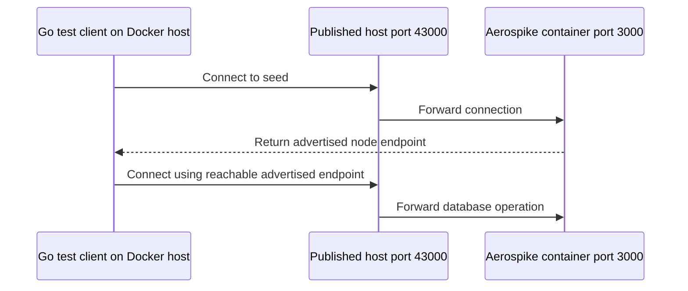

# Fix Aerospike INVALID_NODE_ERROR in Go Testcontainers

Author: [nawazdhandala](https://www.github.com/nawazdhandala)

Tags: Aerospike, Docker, Testcontainers, Go, Troubleshooting

Description: Debug Aerospike discovery in Go tests with a Server 8.2 lab, Go client policies, and Testcontainers Go host and mapped-port handling.

A Go integration test can reach Aerospike through a mapped Docker port and still fail with `INVALID_NODE_ERROR` when the client discovers an unreachable node endpoint. The test harness must agree with the server about both the reachable host and the published port.

This walkthrough targets Aerospike Go client v8.9.0 and Testcontainers for Go v0.45.0. It starts with a complete, disposable Aerospike Server 8.2.0.1 configuration that isolates address advertisement from the Go harness, then shows a Go helper for obtaining a started container's seed address. The helper is one part of a fixture, not a complete container lifecycle or discovery repair.

An Aerospike client starts with a seed endpoint, learns about the cluster, and connects to the nodes responsible for records. Every advertised endpoint must make sense from the client's network. A seed that works on the host does not make a container's private address reachable there.

In the [Go client v8.9.0 result codes](https://github.com/aerospike/aerospike-client-go/blob/v8.9.0/types/result_code.go), `INVALID_NODE_ERROR` means the chosen node is not currently active. Bad addressing is one possible cause, not the definition of the error. Check server startup, client logs, authentication, and TLS failures too.

## Identify the Go test client's two connections

Write down the seed your Go test actually uses, then compare it with the addresses the server publishes. Do this from the Go test process's environment, not from a convenient shell inside the database container.



If the returned endpoint is instead an unreachable container IP or the wrong host port, the last step fails. In a multi-node cluster, repeat this reasoning for every node. A load-balanced seed does not replace direct reachability to all discovered nodes.

Aerospike separates `address`, which controls listening, from `access-address` and `access-port`, which tell clients where to connect. Alternate access settings provide another advertised route for clients on a different network. See the [network configuration reference](https://aerospike.com/docs/database/manage/network/).

## Inspect before changing anything

For an existing container named `aerospike-lab`, Docker reports the actual published mapping with:

```bash
docker port aerospike-lab 3000/tcp
```

For the fixed-port example below, expect `127.0.0.1:43000`. This command inspects the mapping; it does not prove that Aerospike is ready. Docker documents the output in its [container port reference](https://docs.docker.com/reference/cli/docker/container/port/).

If Aerospike tools are installed on the client host, use these read-only info requests against the seed:

```bash
asinfo -h 127.0.0.1 -p 43000 -v 'service-clear-std'
asinfo -h 127.0.0.1 -p 43000 -v 'peers-clear-std'
asinfo -h 127.0.0.1 -p 43000 -v 'service-clear-alt'
```

The first shows this node's ordinary service endpoint; the second shows peer discovery information; the third shows its alternate endpoint. Use your deployment's approved authentication and TLS options where required. These clear-service queries describe non-TLS endpoints, not TLS configuration. The [Aerospike info reference](https://aerospike.com/docs/database/reference/info/) documents the commands and the separate TLS equivalents.

Record whether the advertised port matches Docker's host port and whether the advertised hostname resolves from the client. If the seed itself fails, investigate listening, mapping, firewall, and authentication first. Discovery debugging starts after the seed is reachable.

## Isolate the Go fixture with a fixed-port Server 8 lab

This example is for a disposable database used by a Go test process running on the **same machine as Docker Desktop or the local Docker daemon**. It uses the published `aerospike/aerospike-server:8.2.0.1` image, verified in the [official image repository](https://hub.docker.com/r/aerospike/aerospike-server/tags). Reserve host port 43000 and provide enough memory for a 1 GiB data allocation plus indexes and server overhead.

Save this complete lab configuration as `aerospike.conf`:

```text
service {
    cluster-name address-lab
}
logging {
    console {
        context any info
    }
}
network {
    service {
        address any
        port 3000
        access-address 127.0.0.1
        access-port 43000
    }
    heartbeat {
        mode mesh
        port 3002
        interval 150
        timeout 10
    }
    fabric {
        port 3001
    }
}
namespace test {
    replication-factor 1
    storage-engine memory {
        data-size 1G
    }
}
```

The data is intentionally disposable. The [namespace documentation](https://aerospike.com/docs/database/manage/namespace/) describes the memory storage engine. The host-facing loopback advertisement follows the pattern in Aerospike's [Docker installation guide](https://aerospike.com/docs/database/install/docker/).

Start a new lab container, using an unused name:

```bash
docker run -d --name aerospike-lab \
  -p 127.0.0.1:43000:3000 \
  --mount "type=bind,src=$(pwd)/aerospike.conf,dst=/opt/aerospike/etc/aerospike.conf,readonly" \
  aerospike/aerospike-server:8.2.0.1 \
  --config-file /opt/aerospike/etc/aerospike.conf
```

The server listens on container port 3000; Docker forwards host port 43000; the server advertises the host endpoint that this particular client can reach. Inspect startup logs and wait for readiness before running the info checks. The expected ordinary endpoint is `127.0.0.1:43000`.

Do not reuse this advertisement for a sibling application container or a remote Docker daemon. In those environments, `127.0.0.1` points at a different machine or container. This example deliberately exposes no database port to other hosts.

## Match advertisement to the Go test process

For a Go test process on the same user-defined Docker network, use a stable container DNS name and internal service port 3000, and ensure discovered endpoints are also reachable on that network. For a host application crossing a port mapping, advertise the reachable host address and mapped port.

When both kinds of clients must work, configure the ordinary and alternate address families deliberately. The host-side client can request alternate services while container-side clients use ordinary services. Every node needs its own reachable alternate endpoint. Merely setting `alternate-access-address` on the server does not make clients select it.

For the Go client v8.9.0, the relevant setting is `ClientPolicy.UseServicesAlternate`. Its [tagged policy source](https://github.com/aerospike/aerospike-client-go/blob/v8.9.0/client_policy.go) documents that choice. Use that Go policy when the fixture deliberately publishes alternate services. Keep the choice alongside the Go client initialization so it is recreated with every test client.

## Read dynamic ports through the Testcontainers Go API

Testcontainers commonly allocates host ports dynamically. Read the host and mapped port **after** the container starts. Do not assume that container port 3000 is also host port 3000, or that the Docker host is localhost.

This helper targets **Testcontainers for Go v0.45.0**, whose module requires Go 1.26. It accepts an already started container and returns its seed endpoint:

```go
package addresslab

import (
    "context"
    "net"

    "github.com/testcontainers/testcontainers-go"
)

func SeedAddress(ctx context.Context, c testcontainers.Container) (string, error) {
    host, err := c.Host(ctx)
    if err != nil {
        return "", err
    }
    port, err := c.MappedPort(ctx, "3000/tcp")
    if err != nil {
        return "", err
    }
    return net.JoinHostPort(host, port.Port()), nil
}
```

The [tagged container interface](https://github.com/testcontainers/testcontainers-go/blob/v0.45.0/container.go) provides these methods. Pin the dependency in your test module rather than silently updating the fixture between runs.

This helper fixes seed construction only. The [Aerospike module implementation](https://github.com/testcontainers/testcontainers-go/blob/v0.45.0/modules/aerospike/aerospike.go) exposes ports and configures readiness checks; it does not rewrite Aerospike's advertised addresses to match a newly allocated host port.

Choose an explicit fixture design: run the test client on the same container network, or arrange server advertisement to match the host-facing endpoints. Do not assume a hostname-only translation can repair an incorrect port. For multi-node tests, verify discovery for every node after initialization, rather than stopping at a successful seed connection.

## Verify the recreated Go fixture

From the Go test process, use a dedicated test namespace and write a uniquely named record, read it back, and verify the value. Confirm the client's discovered node count and endpoint list match the fixture. Repeat after recreating the container so a fresh dynamic port cannot be hidden by cached configuration.

If addresses are correct but the node still becomes inactive, examine server exits, startup readiness, TLS errors, and client connection logs. Increasing timeouts may be appropriate for a slow test machine, but it cannot make an unreachable advertised address routable. Keep the mapping, discovery output, and successful read-back evidence together so the next CI failure can be compared against a known working network path.
