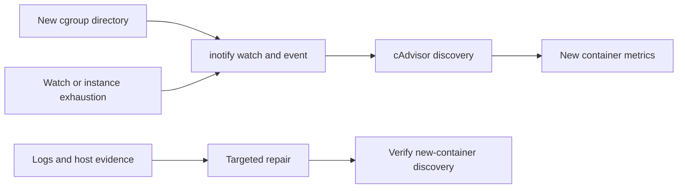

# Fix cAdvisor Container Discovery Failures Caused by inotify Limits

Author: [nawazdhandala](https://www.github.com/nawazdhandala)

Tags: Linux, Docker, Monitoring, Troubleshooting

Description: Distinguish exhausted inotify watches, instances, and file descriptors, inspect evidence safely, and verify cAdvisor discovers new containers after repair.

cAdvisor still serves metrics, but newly created containers do not appear. Its logs mention failure to watch a directory and “no space left on device.” Before deleting files, identify which operation failed. An inotify watch allocation can return that message even when the filesystem has plenty of free space.

Inotify is a Linux mechanism for receiving filesystem-change notifications. cAdvisor 0.55.1's raw watcher uses it to follow cgroup directories and discover container-related changes. If watch creation fails, a healthy HTTP endpoint does not prove complete container discovery.

This guide uses versioned cAdvisor source and Linux interface documentation. The diagnostic script was tested with filesystem fixtures; no kernel limits were changed during validation.

## Identify the failed resource

Preserve the complete error, including its surrounding operation and path. Similar-looking failures point to different limits:

| Failure context | Resource to investigate |
|---|---|
| Adding a watch returns `ENOSPC` | Per-user watch limit or kernel allocation failure |
| Creating an inotify instance returns `EMFILE` | Per-user instance limit or process file-descriptor limit |
| Creating an instance returns `ENFILE` | System-wide open-file limit |
| Queue overflow event | Event backlog; notifications have been lost |
| Permission denied or missing path | Access or visibility, not automatically a quota problem |

The error distinctions come from [inotify_add_watch](https://man7.org/linux/man-pages/man2/inotify_add_watch.2.html) and [inotify_init](https://man7.org/linux/man-pages/man2/inotify_init.2.html). Do not choose a repair from the English error string alone.

A watch is an entry tracking a filesystem object. An instance is an event queue with a file descriptor. One instance can hold many watches, so increasing the instance limit does not directly solve exhaustion of watches.

## Inspect the host limits without changing them

Run these read-only commands in the relevant Linux host environment:

```bash
sysctl fs.inotify.max_user_watches
sysctl fs.inotify.max_user_instances
sysctl fs.inotify.max_queued_events
```

The [inotify overview](https://man7.org/linux/man-pages/man7/inotify.7.html) describes these controls. Watches and instances are accounted per real user ID; other processes under that identity can consume the available budget. A collector running as root can therefore compete with unrelated root-owned services.

Record the effective values rather than assuming a distribution default. If cAdvisor is containerized, also establish which host process and user identity you are inspecting. A process ID from another host or PID namespace is not interchangeable.

For a suspected file-descriptor failure, inspect the actual collector process's limits through [`/proc/PID/limits`](https://man7.org/linux/man-pages/man5/proc_pid_limits.5.html) using established host access. The interactive shell's `ulimit` is not proof of the collector's limits.

## Estimate the collector's watch records

Linux exposes inotify watch entries in `/proc/PID/fdinfo`. Save this Python 3 script as `count-inotify-watches.py`:

```python
from pathlib import Path
import sys

root = Path(sys.argv[1])
records = 0
files_with_watches = 0
unreadable = 0

for entry in root.iterdir():
    try:
        lines = entry.read_text().splitlines()
    except OSError:
        unreadable += 1
        continue
    count = sum(line.startswith("inotify wd:") for line in lines)
    records += count
    files_with_watches += count > 0

print(f"watch_records={records}")
print(f"fdinfo_files_with_watches={files_with_watches}")
print(f"unreadable_files={unreadable}")
if unreadable:
    raise SystemExit(2)
```

On the host, replace `1234` with the collector's current process ID:

```bash
python3 count-inotify-watches.py /proc/1234/fdinfo
```

Each `inotify wd:` line describes a watched object, as documented in [proc_pid_fdinfo](https://man7.org/linux/man-pages/man5/proc_pid_fdinfo.5.html). The script counts visible records and reports unreadable entries instead of silently treating them as zero.

This is a diagnostic estimate, not an authoritative host-wide quota counter. Duplicated file descriptors can repeat the same instance's watches, empty instances have no watch records, and process state can change during inspection. Repeat the investigation for other significant consumers under the same user identity before concluding that cAdvisor alone exhausted the budget.

## Connect the failure to cAdvisor discovery



The [cAdvisor 0.55.1 raw watcher](https://github.com/google/cadvisor/blob/v0.55.1/container/raw/watcher.go) recursively watches supported cgroup directories and reports errors when a directory cannot be watched. Its code skips `.mount` cgroups to avoid unnecessary watch consumption. The [common watcher](https://github.com/google/cadvisor/blob/v0.55.1/container/common/inotify_watcher.go) registers create, delete, and move notifications.

Compare the failing path with the container population you expect. If failures began after increasing workload density, look for growing cgroup counts and competing watchers. If they began after an upgrade, compare collector versions and effective configuration. Do not delete active cgroup directories to reduce the count; those directories represent managed process groups.

## Repair the demonstrated bottleneck

First remove accidental duplicate collectors or fix a leaking consumer through its supported lifecycle. If legitimate watch demand exceeds the configured budget, choose a new host value with measured headroom and review its memory implications.

For example, after selecting and recording an approved numeric value, this host command changes only the watch limit at runtime:

```bash
sudo sysctl -w "fs.inotify.max_user_watches=${APPROVED_WATCH_LIMIT:?Set the reviewed numeric limit}"
```

The variable must contain the actual reviewed number. The [sysctl reference](https://man7.org/linux/man-pages/man8/sysctl.8.html) documents runtime writes. Record the old setting first and persist the change through your host's normal configuration management only after verification. Avoid changing every inotify and file limit simultaneously; that obscures which constraint mattered.

If the error concerns instances or file descriptors, investigate that resource instead. If the queue overflowed, increasing watch capacity does not restore lost events. Review event-consumer health and workload churn, then re-establish a trustworthy discovery baseline through the collector's supported restart or reconciliation procedure during a controlled window.

## Verify discovery, not just a green target

After the repair, inspect logs for recurring watch failures and observe existing containers. Then create and remove one approved staging workload through its normal runtime or orchestrator. Confirm its actual identity appears in cAdvisor and Prometheus within your expected collection delay, and that its disappearance is handled afterward.

An `up` value of one means scraping succeeded; it does not count undiscovered containers. Compare against runtime inventory and repeat the check under representative churn, not only on an idle host.

Keep the prior limits, measured consumers, failure context, and acceptance results in the change record. If the limit is exhausted again quickly, investigate growth or leakage rather than repeatedly raising it. The goal is reliable discovery with a justified resource budget, not merely making one startup error disappear.
