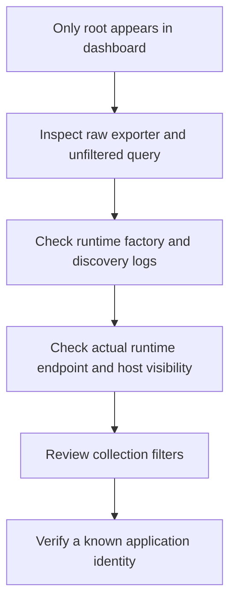

# Fix cAdvisor Reporting Only the Root Cgroup

Author: [nawazdhandala](https://www.github.com/nawazdhandala)

Tags: Docker, Linux, Prometheus, Monitoring

Description: Trace root-only cAdvisor output through query filters, runtime discovery, host visibility, and collection flags before applying a narrowly scoped fix.

Prometheus reports that cAdvisor is up, but every container graph is empty. Looking at the samples reveals only `id="/"`. The HTTP endpoint works; that does not establish that cAdvisor discovered and collected the application containers you expected.

Treat this as a discovery and visibility investigation before changing metric formulas. This guide follows cAdvisor 0.55.1 on a native Linux Docker host. Other runtimes and embedded kubelet deployments need their own source and configuration checks.

## Confirm that the exporter really reports only root

Start with one target and a metric that should be present for the workload:

```promql
count by (id) (
  container_memory_usage_bytes{job="cadvisor", instance="node-a:8080"}
)
```

Replace the job and target with the actual scrape labels. This inventories identities without filtering by `name`, `image`, namespace, or application metadata. If the raw identity list contains application cgroups, investigate the dashboard's filters rather than the collector.

Then ask whether any nonempty, non-root IDs exist:

```promql
count(
  container_memory_usage_bytes{
    job="cadvisor", instance="node-a:8080", id!="", id!="/"
  }
)
```

An absent result means this selector found no samples; it is not a health check. A positive count proves additional identities exist, not that every intended container has been discovered. Compare the selected target with the expected host so a mislabeled or duplicated scrape does not send you to the wrong machine.

Also inspect the authenticated raw scrape if metric relabeling could have removed application samples. A dashboard, Prometheus ingestion policy, and exporter discovery are three distinct places where data can disappear.

## Understand how root can remain when discovery fails

cAdvisor uses runtime-specific factories to recognize and inspect containers, alongside a raw cgroup handler. In the examined Docker factory, registration requires successful runtime communication and information validation. Later, recognition of a Docker container includes inspecting it through the Docker client. [Docker factory implementation](https://github.com/google/cadvisor/blob/v0.55.1/container/docker/factory.go).

The raw factory handles the root identity separately. With `docker_only` enabled, it can reject non-root raw cgroups unless allowed by the configured prefix list. Therefore, a working root sample can coexist with failed runtime-specific discovery. [Raw factory and filtering](https://github.com/google/cadvisor/blob/v0.55.1/container/raw/factory.go).

Do not disable root metrics as a repair. That can remove the only visible symptom while leaving application discovery broken. Likewise, adding more dashboard labels cannot create measurements the exporter never collected.



## Verify which Docker daemon you are inspecting

Run these read-only commands from the administration environment associated with the host:

```bash
docker context show
docker info --format 'name={{.Name}} root={{.DockerRootDir}} driver={{.Driver}}'
```

The first identifies the selected context; the second reports information from the daemon actually contacted. Environment settings and command-line overrides can also affect the endpoint. A successful `docker info` on your laptop does not prove that cAdvisor can reach the same daemon. [Docker contexts](https://docs.docker.com/engine/manage-resources/contexts/), [Docker info](https://docs.docker.com/reference/cli/docker/system/info/).

Record the daemon's storage root rather than assuming `/var/lib/docker`. Rootless Docker uses different defaults for its socket and data directory, and a rootful collector does not automatically discover every user's daemon. [Rootless Docker paths](https://docs.docker.com/engine/security/rootless/tips/).

Compare that endpoint and storage layout with cAdvisor's effective runtime arguments and mounted paths. The collector needs a coherent view of the runtime it is intended to observe, not a mixture of one daemon's socket and another daemon's filesystem.

## Inspect the running collector, not only its Compose file

Assuming the collector container is named `cadvisor`, inspect its effective configuration:

```bash
docker inspect --format '{{json .Config.Cmd}}' cadvisor
docker inspect --format '{{json .Mounts}}' cadvisor
docker inspect --format 'cgroupns={{.HostConfig.CgroupnsMode}} privileged={{.HostConfig.Privileged}}' cadvisor
docker logs --since 10m --tail 200 cadvisor
```

Replace the name if needed. The commands report arguments, mounts, selected host settings, and recent logs. Startup errors may be older than ten minutes, so use an appropriate bounded interval for the incident. [Docker inspect](https://docs.docker.com/reference/cli/docker/container/inspect/), [Docker logs](https://docs.docker.com/reference/cli/docker/container/logs/).

Look for failed runtime communication, failed Docker information validation, failed cgroup discovery, permission denials, and errors inspecting known containers. Preserve the specific error before making changes. The pinned source provides several of these failure paths; not every deployment will emit them at the same log verbosity.

Compare mount destinations and source paths with the installation instructions for the exact version and host. A path mounted into the container is not useful if it points at an empty directory or the wrong host location. [cAdvisor running instructions](https://github.com/google/cadvisor/blob/v0.55.1/docs/running.md).

## Check namespace visibility before broadening access

A cgroup namespace changes how cgroup paths appear to a process. Its root can differ from the host's full hierarchy. Consequently, a root-looking path should be interpreted in the collector's namespace and mount context rather than automatically labeled the entire host. [Linux cgroup namespaces](https://man7.org/linux/man-pages/man7/cgroup_namespaces.7.html).

Use the deployment's reviewed host-observation settings for the runtime and cgroup mode you actually operate. Do not add privileged mode or disable host security controls solely because a graph is empty. First determine which required mount, endpoint, namespace view, or permission is missing.

A read-only socket bind also does not turn the Docker API into a read-only API. Access to that socket remains sensitive. Prefer correcting the intended deployment boundary over granting an unrelated process access to every runtime on the host. [Docker daemon security](https://docs.docker.com/engine/security/#docker-daemon-attack-surface).

## Apply the smallest evidence-based repair

| Evidence | Repair to review |
| --- | --- |
| Raw exporter has application IDs, panel does not | Correct panel or ingestion filters |
| Collector points at a different daemon | Align endpoint, mounts, and intended host |
| Runtime factory initialization fails | Correct the logged compatibility or access problem |
| Needed host path is absent or wrong | Correct that mount and verify its contents |
| Non-root raw groups are intentionally filtered | Review the exact collection policy and scope |
| Known container cannot be inspected | Investigate runtime identity, lifecycle, and access |

Change one cause at a time on a staging host or small approved group. After restarting through the deployment owner, verify a known long-running application's ID, one memory value, and a changing CPU counter. Then create and remove a disposable workload to check that discovery continues beyond the initial startup.

The queries were tested with synthetic root-only and root-plus-container samples, and the inspection commands were syntax-checked and documentation-reviewed. No live Docker discovery repair is claimed. A completed repair requires evidence that the intended applications are observed, not merely that the endpoint still returns HTTP 200.
