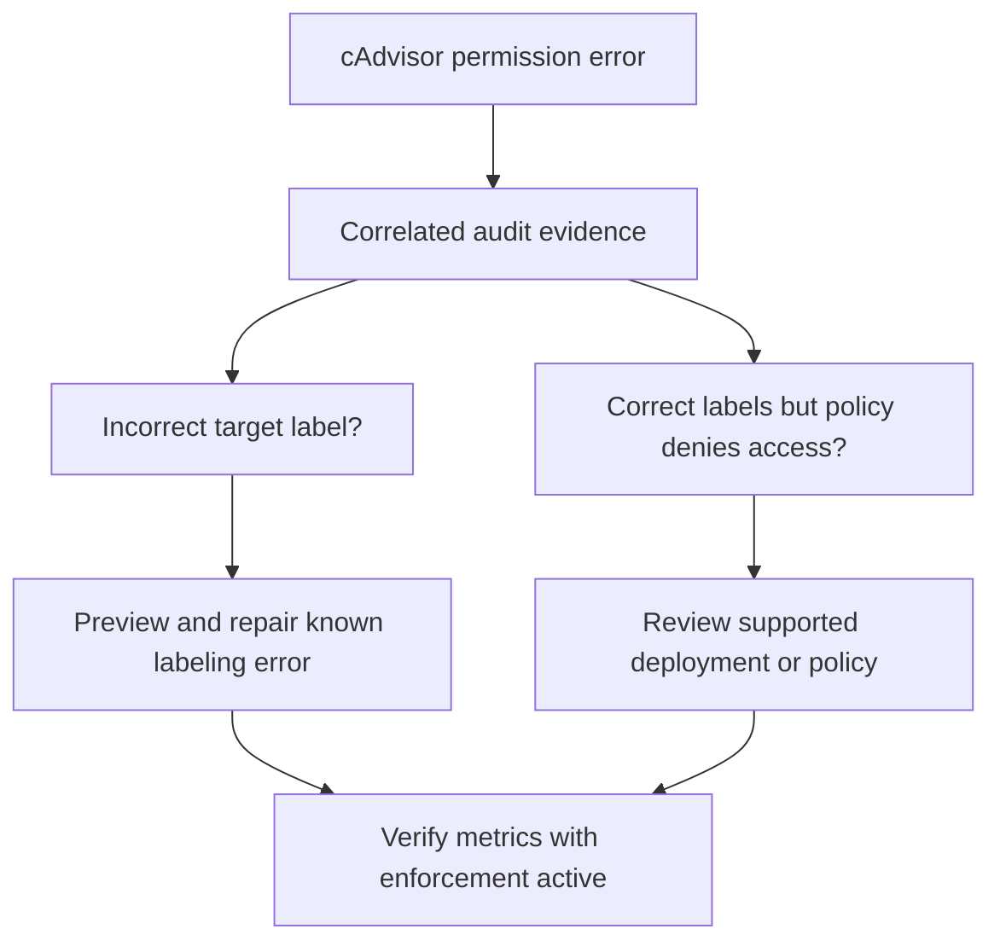

# Fix cAdvisor Permission Denials on SELinux-Enforcing Hosts

Author: [nawazdhandala](https://www.github.com/nawazdhandala)

Tags: Linux, Docker, Security, Monitoring, Troubleshooting

Description: Correlate cAdvisor failures with SELinux audit evidence, correct proven labeling mistakes, and choose a reviewed host-monitoring access model.

cAdvisor reports “permission denied” while reading a host path or connecting to the runtime socket. The host uses SELinux, so disabling enforcement seems like a quick diagnostic shortcut. It also changes the security behavior of every affected service and can obscure the actual cause.

Start with evidence instead. Ordinary file permissions, missing mounts, user namespaces, seccomp, and SELinux policy can produce related symptoms. A repair should identify the blocked operation and preserve the intended host security model.

This walkthrough uses cAdvisor 0.55.1 deployment guidance and Red Hat Enterprise Linux 9 SELinux documentation. Commands assume an authorized shell on the affected Linux host with the relevant SELinux and audit utilities installed. No live SELinux policy change was performed for this article.

## Confirm enforcement and capture a recent failure

Check the current mode, then reproduce one known failing collection attempt through normal operation:

```bash
getenforce
sudo ausearch -m AVC,USER_AVC,SELINUX_ERR,USER_SELINUX_ERR -ts recent
```

`Enforcing` means policy denials are enforced. An AVC is an Access Vector Cache message: it records a SELinux access decision. The [RHEL troubleshooting guide](https://docs.redhat.com/en/documentation/red_hat_enterprise_linux/9/html/using_selinux/troubleshooting-problems-related-to-selinux_using-selinux) documents this audit search.

Keep the complete matching event, including associated path and syscall records. Match its time, process, and target to the cAdvisor error. An unrelated denial from another service is not evidence that SELinux blocked the collector.

If the search finds nothing, do not conclude that SELinux is necessarily innocent or guilty. Check the time range, audit service, and logging coverage, then investigate ordinary permissions and mount visibility. Some policy decisions can be suppressed from audit output; use the distribution's supported diagnostic procedure if that becomes relevant.

## Read the denial as an access request

The useful question is: which process domain tried which operation on which target type?

| Audit field | What to establish |
|---|---|
| `scontext` | SELinux context of the requesting process |
| `tcontext` | Context of the target object |
| `tclass` | Object kind, such as file, directory, or socket |
| Denied permission | The attempted operation, such as read, search, or connect |
| PID, command, path, event ID | Correlation with the actual collector failure |

The [ausearch manual](https://man7.org/linux/man-pages/man8/ausearch.8.html) explains that related records share an event ID and are returned together. Do not reduce a multi-record event to one isolated line before reviewing its context.



This separates a mislabeled file from a policy that is correctly refusing an overly broad access request.

## Inspect the container and target context

For Docker, inspect the running collector's process label and requested security settings. Replace `cadvisor` with its actual container name:

```bash
docker container inspect cadvisor \
  --format '{{.ProcessLabel}} {{json .HostConfig.SecurityOpt}} {{.HostConfig.Privileged}}'
```

Compare the process label with the audit event rather than assuming every deployment uses the same domain. [Docker inspect](https://docs.docker.com/reference/cli/docker/container/inspect/) supports formatted output from the container configuration and state.

Inspect the specific host object named in the denial, replacing the path below:

```bash
ls -Zd /actual/denied/path
```

Check its owner, ordinary permissions, and the path as mounted inside cAdvisor too. A correct SELinux label cannot compensate for a bind mount pointing at the wrong directory, and adding a Linux capability does not automatically grant an SELinux policy permission.

Runtime-socket access deserves particular scrutiny. A read-only bind mount does not make a socket's API read-only; connecting to it can grant powerful runtime operations. The deployment should treat that access as a deliberate trust decision.

## Repair a proven labeling error narrowly

Suppose review establishes that one host file has an accidental label and the installed persistent policy already defines the correct label for its path. Preview restoration first:

```bash
sudo restorecon -n -v /actual/denied/path
```

The `-n` option performs a passive check, while `-v` shows proposed changes. Review the expected type with the host's policy owner. If it is the intended correction, apply it to that specific path:

```bash
sudo restorecon -v /actual/denied/path
```

The [restorecon manual](https://man7.org/linux/man-pages/man8/restorecon.8.html) documents both modes. These commands do not recursively relabel an entire tree. If the correct persistent mapping is missing, restoring the existing default is not a complete repair; establish the supported mapping first.

Do not add `:Z` or `:z` to cAdvisor's broad host mounts as a generic solution. Docker's [SELinux bind-mount documentation](https://docs.docker.com/engine/storage/bind-mounts/#configure-the-selinux-label) explains that these options change host labels, with private and shared container meanings. Relabeling `/`, system directories, or another service's runtime data can break host services or alter their access boundaries.

## Choose an explicit host-monitoring access model

If labels are correct and the requested access is outside the current policy, decide how the collector is supposed to run. cAdvisor needs access beyond that of a typical isolated application container.

The [cAdvisor 0.55.1 running guide](https://github.com/google/cadvisor/blob/v0.55.1/docs/running.md) includes privileged-container guidance for RHEL-family environments and older platform-specific examples. Treat that as documentation of broad host access, not a minimal-permission recipe for every current distribution. Preserve version and policy context when adapting it.

For a constrained deployment, use a maintained distribution or organizational policy that covers the required operations, or have a narrowly scoped local policy reviewed and packaged. An `audit2allow` result is not proof that every observed access should be granted; a bad mount or unexpected operation can generate a rule you do not want.

Avoid global permissive mode or disabling SELinux as the production fix. If the supported monitoring model requires broader container privileges, document and approve that scope explicitly instead of implying that ordinary application isolation remains unchanged.

## Verify both access and collection

After the targeted change, repeat the original operation and audit search while enforcement remains active. Check that the relevant denial no longer occurs and that the intended metric family appears for the same known container.

A healthy HTTP endpoint alone is insufficient. Verify runtime discovery, CPU and memory samples, and any filesystem or process metrics that originally failed. Also check that unrelated host services still function after any labeling repair.

Record the original denial, process and target contexts, chosen correction, and before/after evidence. Retest after a collector recreation or policy update. This makes the repair reproducible without converting every future permission error into another permanent privilege exception.
