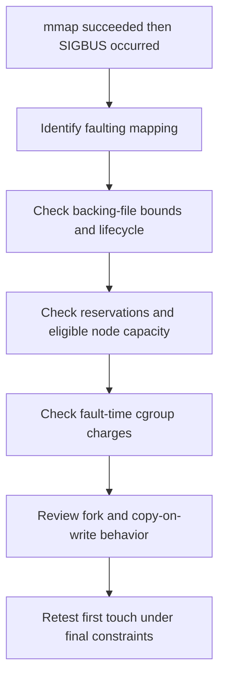

# Fix SIGBUS After a HugeTLB mmap Succeeds

Author: [nawazdhandala](https://www.github.com/nawazdhandala)

Tags: Linux, HugePages, Troubleshooting

Description: Diagnose HugeTLB faults after successful mmap by checking backing-file bounds, reservations, NUMA eligibility, cgroup charging, and fork-time behavior.

A successful `mmap()` call establishes a virtual mapping. It does not necessarily populate every page immediately. When the application later accesses an address, the kernel may need to supply backing memory through a page fault. If that cannot be done for a HugeTLB mapping, the process can receive `SIGBUS`.

That sequence changes the investigation. Looking only at the original return value or adding more ordinary RAM may miss a shortened backing file, a reservation bypass, a node restriction, or a cgroup limit enforced when the page is touched.

This walkthrough uses **Linux 6.12** documentation and fault-handling source. It provides evidence collection and a staged verification plan, not a command that deliberately exhausts a production pool.

## Confirm the failing stage and address

Record whether the original mapping returned `MAP_FAILED` or a valid address. A failed call with `ENOMEM` is a different starting point from a valid mapping followed by `SIGBUS`. Capture the mapping length, flags, page size, file offset where applicable, and the faulting address from your debugger or crash-reporting system.

On hosts using systemd-coredump, you can inspect recorded crash metadata without starting the application again:

```bash
coredumpctl list 12345
coredumpctl info 12345
```

Replace `12345` with the failed process's recorded PID and match the timestamp and executable, since PIDs can be reused. These commands require access to the relevant records. A journal entry does not guarantee the core file is still available. The command forms were checked against [systemd 257 coredumpctl documentation](https://www.freedesktop.org/software/systemd/man/257/coredumpctl.html).

If the process has exited, its `/proc/PID` files are gone. Use saved evidence or collect the following during a controlled staging reproduction before the failing access:

```bash
app_pid=12345
snapshot_dir=$(mktemp -d)
cat "/proc/$app_pid/maps" > "$snapshot_dir/maps.txt"
cat "/proc/$app_pid/smaps" > "$snapshot_dir/smaps.txt"
cat "/proc/$app_pid/status" > "$snapshot_dir/status.txt"
cat "/proc/$app_pid/cgroup" > "$snapshot_dir/cgroup.txt"
printf 'Saved process evidence in %s\n' "$snapshot_dir"
```

Correlate the fault address with the mapping range. Verify that it is actually HugeTLB-backed using the `ht` smaps flag and relevant accounting fields. A `SIGBUS` elsewhere in the process needs its own explanation. See [mapping ranges](https://man7.org/linux/man-pages/man5/proc_pid_maps.5.html) and [smaps flags](https://man7.org/linux/man-pages/man5/proc_pid_smaps.5.html).



## Check file bounds before changing capacity

For a file-backed mapping, calculate the file position associated with the fault:

```text
file position = mapping file offset + (fault address - mapping start)
```

Compare that position with the correct backing object's length at the relevant time. For example, a fault 48 MiB into a mapping at file offset zero is outside a file shortened to 32 MiB, even if the mapping was originally created for 64 MiB.

If the process still holds the corresponding descriptor, inspect it with GNU `stat`. Replace both PID and descriptor number after matching the object:

```bash
app_pid=12345
backing_fd=7
stat -L --format='size=%s bytes inode=%i device=%d' "/proc/$app_pid/fd/$backing_fd"
```

`-L` follows the procfs descriptor link; size, inode, and device help identify the object. These options are documented by [GNU stat](https://man7.org/linux/man-pages/man1/stat.1.html). The descriptor might already be closed while the mapping remains, and a pathname might now refer to a replacement file. Neither situation justifies inspecting an unrelated new object as if it were the original backing.

Access beyond a mapped file's end can generate `SIGBUS`, as described by [mmap](https://man7.org/linux/man-pages/man2/mmap.2.html). The [HugeTLB fault handler](https://raw.githubusercontent.com/torvalds/linux/v6.12/mm/hugetlb.c) also checks the backing object's size. Review initialization and concurrent truncation: [ftruncate](https://man7.org/linux/man-pages/man2/ftruncate.2.html) changes file length, and a failed sizing operation must not be ignored.

Fix the object lifecycle and synchronization if this is the cause. Increasing the page pool cannot make an out-of-range file access valid.

## Verify reservations and eligible capacity

Inspect the actual selected size; this example uses 2 MiB pages:

```bash
pool=/sys/kernel/mm/hugepages/hugepages-2048kB
for field in nr_hugepages free_hugepages resv_hugepages; do
    printf '%s=' "$field"
    cat "$pool/$field"
done
for file in /sys/devices/system/node/node*/hugepages/hugepages-2048kB/free_hugepages; do
    [ -r "$file" ] || continue
    printf '%s=' "$file"
    cat "$file"
done
```

Change the size path for the failing allocation. Compare these counts with the process's allowed memory nodes and configured policy. A host-wide free count does not guarantee that an eligible node has backing for the fault. The [HugeTLB administration guide](https://www.kernel.org/doc/html/v6.12/admin-guide/mm/hugetlbpage.html) documents size-specific and per-node pools.

Review whether the application used `MAP_NORESERVE` or the corresponding no-reservation shared-memory option. Bypassing reservation can postpone discovery of a shortage until first touch. Do not add `MAP_NORESERVE` to make startup appear successful.

Reservation is also not a blanket guarantee against all later constraints. The [reservation design documentation](https://www.kernel.org/doc/html/v6.12/mm/hugetlbfs_reserv.html) explains the distinction between promising pages and allocating them at fault time. Its internal implementation discussion references an older kernel; use current source and your running version for detailed failure analysis.

## Inspect cgroup limits at the faulting stage

A cgroup is a kernel resource-control group. Linux 6.12 documents HugeTLB usage enforcement during page faults. Resolve the application's actual cgroup path from its saved membership and the host's cgroup mounts, then inspect that group and its ancestors.

For a cgroup v2 host, substitute the real directory below. Do not copy the placeholder literally:

```bash
cgroup_dir=/sys/fs/cgroup/REPLACE_WITH_SERVICE_CGROUP
for name in hugetlb.2MB.current hugetlb.2MB.max hugetlb.2MB.events hugetlb.2MB.events.local; do
    if [ -r "$cgroup_dir/$name" ]; then
        printf '\n%s\n' "$name"
        cat "$cgroup_dir/$name"
    fi
done
findmnt --types cgroup2 --output TARGET,OPTIONS
```

Use the corresponding size names for another pool. Compare event counters before and after the failing attempt; an old event alone does not establish the cause of this crash. Parent limits can constrain the workload even when its immediate group's limit looks generous.

Also check whether the cgroup v2 mount enables `memory_hugetlb_accounting`. With this opt-in behavior, HugeTLB usage is charged to the memory controller too, and a failed charge can produce `SIGBUS` despite available pool pages. Review the applicable memory limits and events as well. Both behaviors are documented in the [cgroup v2 reference](https://www.kernel.org/doc/html/v6.12/admin-guide/cgroup-v2.html). Mount inspection uses the standard [findmnt interface](https://man7.org/linux/man-pages/man8/findmnt.8.html).

## Include fork and copy-on-write in the reproduction

Copy-on-write means a write may require a private copy of a previously shared page. A service that forks after allocating a large HugeTLB region can therefore have a different peak requirement from its original startup path.

Check whether the failure follows a fork, a child write, or a transition from read-only access to writes. Review shared versus private mapping semantics and which process owns the reservation. The kernel reservation documentation discusses special copy-on-write handling; do not assume a successful parent warm-up proves the child's write path is covered.

A useful reproduction follows the real lifecycle under the final node policy and resource limits. Starting with loose limits and tightening them only after warm-up can conceal the failing condition.

## Verify the fix without suppressing the fault

Keep the test in an isolated environment with approved capacity. Confirm correct file sizing, final cgroup placement, intended NUMA policy, and the exact mapping flags. Then exercise the full required working set, including writes and any fork behavior. A test touching only one byte proves very little about a large multi-page region.

Treat application health, completed first touch, unchanged failure-event counts, and expected pool usage as separate acceptance checks. Retrying the same instruction from a signal handler does not repair missing backing, and ignoring `SIGBUS` is not a capacity strategy.

The inspection snippets were checked for shell syntax and against official interfaces. The file-offset example was checked arithmetically. No Linux HugeTLB fault, cgroup charge failure, truncation crash, or fork-time allocation experiment was executed for this article.
