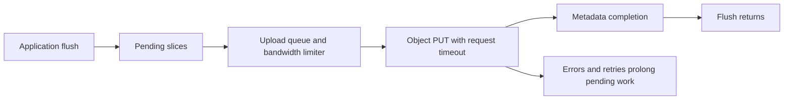

# Diagnose JuiceFS Flush Timeouts Before Increasing Upload Timeouts

Author: [nawazdhandala](https://www.github.com/nawazdhandala)

Tags: JuiceFS, Troubleshooting, Storage

Description: Trace JuiceFS flush failures through upload errors, bandwidth limits, buffering, and staging before changing concurrency or timeout settings.

A `flush timeout` means JuiceFS could not finish the pending work needed by a file flush within its waiting window. It does not, by itself, identify a slow object store. Authentication errors, unreachable endpoints, constrained bandwidth, saturated client resources, and accumulated pending work can all lead to a similar symptom.

This guide uses **JuiceFS Community Edition 1.4.2**. The goal is to find the first failing stage, preserve pending data, and test one relevant change. Increasing several limits at once usually makes the next incident harder to explain.

## Separate the two timeout boundaries

An object PUT uploads a block to the storage service. `--put-timeout` controls the client's timeout for that operation. The file writer has a separate wait for outstanding slices to finish flushing; its failure can produce the `flush ... timeout` message and pending-slice diagnostics.

The 1.4.2 writer calculates its flush wait separately from the individual object timeout. Therefore, raising `--put-timeout` is not equivalent to extending every application flush deadline. [Pinned file-writer implementation](https://github.com/juicedata/juicefs/blob/v1.4.2/pkg/vfs/writer.go).

A slice is a piece of file data tracked by the client during writing. Several slices, uploads, retries, and metadata operations may contribute to one application's wait. Preserve their identifiers in the incident record so you can correlate messages rather than treating each line as a separate outage.



## Preserve evidence before restarting

Record the affected client, volume, application error, first failure time, and whether writeback is enabled. Capture the preceding client log window, not just the final timeout. Include object request IDs when available.

For a systemd-managed client, replace the unit name and inspect recent logs:

```bash
journalctl -u juicefs-data.service -b -n 300 --no-pager
```

This reads the current boot's journal without an interactive pager. Use an account permitted to access the service logs. For a daemon using a configured log file, collect the equivalent window from that file. [journalctl documentation](https://www.freedesktop.org/software/systemd/man/257/journalctl.html).

Look for the earliest concrete error: certificate validation, DNS resolution, authentication, access denied, request throttling, or a slow PUT. A later timeout can simply be the consequence of repeated earlier failures.

Do not erase cache or staging directories. With writeback enabled, local staging may contain content already acknowledged to the application but not yet uploaded. Preserve it while investigating. [JuiceFS writeback caveats](https://github.com/juicedata/juicefs/blob/v1.4.2/docs/en/guide/cache.md#client-write-cache).

## Check reachability from the affected environment

Use the actual client host or container network, not an unrelated administrator laptop. Replace this placeholder with the configured HTTPS object-storage origin:

```bash
curl --head --connect-timeout 5 --max-time 15 \
  'https://OBJECT-STORAGE-HOST.example.internal/'
```

This sends an unauthenticated HEAD request. A valid HTTP response, including an access-denied response, can show that DNS, connection establishment, and TLS worked for this request. It does not prove that the JuiceFS identity can upload to the correct bucket, and it does not measure sustained upload capacity. Keep certificate verification enabled. [curl option reference](https://curl.se/docs/manpage.html).

Compare the client's endpoint, region, proxy settings, certificate trust, and credential lifetime with the expected configuration. A successful request using a different identity or hostname does not clear the failing path. Diagnose provider-specific authorization errors using the request ID and storage logs.

## Classify the limiting resource

| Evidence | First action to evaluate |
| --- | --- |
| Certificate or access-denied errors | Correct trust, identity, bucket policy, or expired credentials |
| Throttling responses | Reduce request pressure and inspect service limits |
| Slow PUTs while the network is saturated | Reduce competing traffic or upload concurrency |
| Growing buffers and long flush waits | Reduce ingestion and assess upload capacity |
| Staging grows while remote upload stalls | Preserve staging and recover the upload path |
| Disk or CPU saturation with low network use | Investigate local storage, compression, or host contention |

A temporary throughput shortfall and a permanent one need different responses. Buffers can absorb a burst, but they cannot make a sustained producer faster than its downstream destination indefinitely.

Inspect `--upload-limit` as well as network capacity. JuiceFS expresses this option in megabits per second, while buffers are configured in MiB. Mixing those units can make an intentionally capped client look inexplicably slow. [Mount option handling](https://github.com/juicedata/juicefs/blob/v1.4.2/cmd/mount.go).

## Use a rough bandwidth calculation to challenge assumptions

Suppose 20 simultaneous uploads share only 10 megabits per second. Ignoring overhead and assuming equal sharing, a 4 MiB block gets about 0.5 megabits per second and takes roughly 67 seconds:

```python
block_bytes = 4 * 1024 * 1024
shared_mbps = 10
concurrent_uploads = 20
ideal_seconds = block_bytes * 8 / (shared_mbps * 1_000_000 / concurrent_uploads)
print(f"Idealized transfer time per block: {ideal_seconds:.1f} seconds")
```

This is not a benchmark or a precise queue model. Compression, connection scheduling, retransmissions, provider behavior, and other traffic change the result. It does explain why more concurrency can be harmful on a narrow link: each request can remain active longer without increasing total throughput.

The official troubleshooting guidance suggests reducing upload concurrency and buffering in low-bandwidth conditions. Treat those as hypotheses to test against your measurements. [JuiceFS slow-upload guidance](https://github.com/juicedata/juicefs/blob/v1.4.2/docs/en/administration/troubleshooting.md#io-error-object-storage).

## Change one setting in a controlled reproduction

Use a staging client and representative workload after correcting clear reachability or authorization failures. Start with the existing options and reduce `--max-uploads` alone. Measure total completed bytes, per-request latency, flush success, and application duration. Then consider a smaller `--buffer-size` in a separate run if pending work is excessive.

The relevant pinned defaults and meanings can be checked without mounting:

```bash
juicefs --version
juicefs mount --help
```

In 1.4.2, the help reports a 60-second PUT timeout and 20 upload connections by default. Effective settings may differ in your service configuration. Do not copy new numbers into production simply because they worked on another link.

Consider increasing `--put-timeout` only when legitimate uploads are progressing but need longer, and the application can tolerate the resulting wait. More retries or a longer timeout can hide an unavailable service while increasing resource use. The chunk upload path includes retry waits, so individual request timing is only part of the total duration. [Pinned upload and retry implementation](https://github.com/juicedata/juicefs/blob/v1.4.2/pkg/chunk/cached_store.go).

## Define recovery beyond a quiet log

Stop or reduce incoming writes long enough to confirm that pending work drains. Then run a limited approved write, flush it, and read it from another client. Verify contents, not just directory visibility. Check that the application handled earlier failed operations correctly before retrying them blindly.

Resume normal traffic gradually while watching upload errors, flush latency, buffer pressure, staging, and free disk space. If the problem returns at a predictable ingestion rate, record that capacity boundary instead of increasing every timeout again.

Local validation checked the bandwidth arithmetic, shell syntax, and pinned executable help. The unauthenticated HEAD pattern was exercised against a local HTTP fixture for method and response handling only. No production endpoint, TLS incident, FUSE flush, constrained-link upload, or recovery was tested; those remain explicit staging checks.
