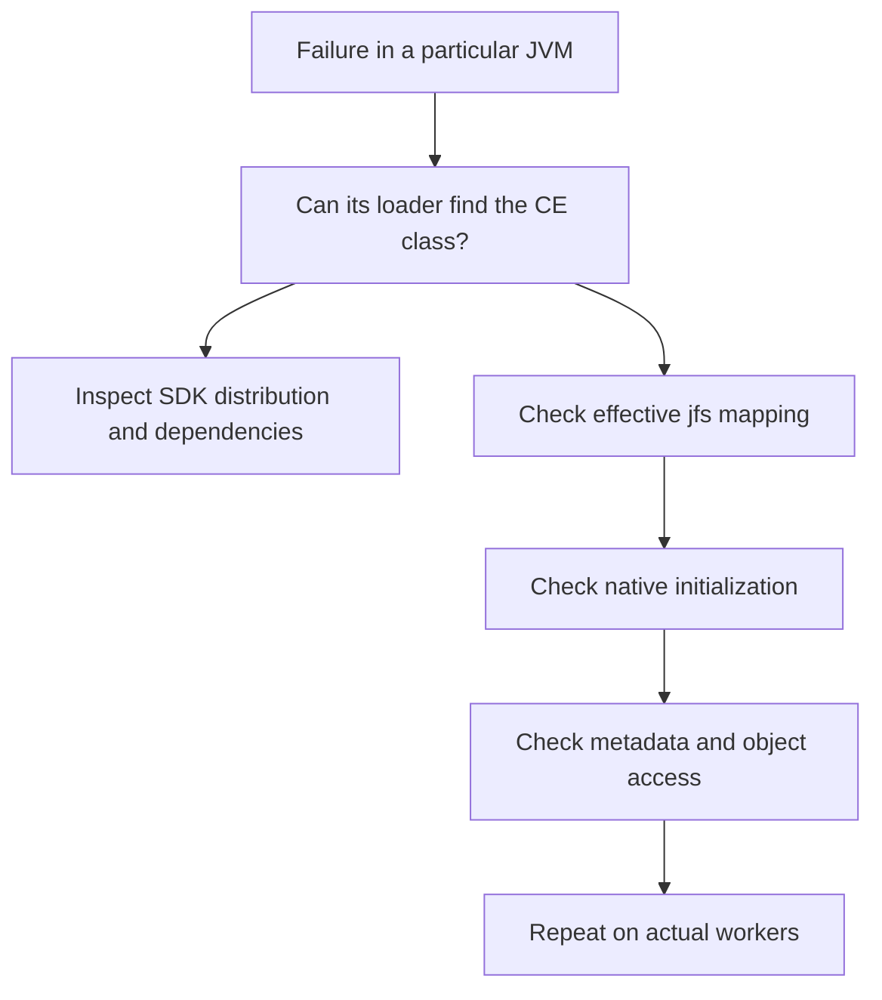

# Fix JuiceFS Java Class and jfs Scheme Resolution Errors

Author: [nawazdhandala](https://www.github.com/nawazdhandala)

Tags: JuiceFS, Java, Hadoop, Troubleshooting

Description: Trace JuiceFS class-loading and jfs scheme errors to the failing JVM, verify the effective classpath and configuration, and separate native-library failures.

`Class io.juicefs.JuiceFileSystem not found` and `No FileSystem for scheme: jfs` often appear during the same deployment, but they point to different parts of filesystem setup. Installing another JAR everywhere without identifying the failing process can leave the problem unchanged and introduce dependency conflicts.

Start with the JVM that emitted the error. Establish whether it can see the expected class, whether Hadoop maps `jfs` to that class, and whether initialization reaches the native library and backend configuration.

The examples use **JuiceFS Community Edition 1.4.2** class names, **Hadoop 3.3.6** command syntax, and a diagnostic helper compiled with **JDK 17**. They do not assume that a successful gateway-node command proves every remote executor is configured correctly.

## Classify the first useful cause

Read the nested exception chain, not only the final framework error.

| Error or cause | First investigation |
| --- | --- |
| `ClassNotFoundException: io.juicefs.JuiceFileSystem` | SDK availability to the relevant class loader |
| `No FileSystem for scheme: jfs` | Effective scheme registration and Hadoop configuration |
| `NoClassDefFoundError` naming another dependency | Missing or incompatible dependency, or an earlier initialization failure |
| `UnsatisfiedLinkError` | Native library platform, extraction, loading, or dependency problem |
| Metadata connection or authentication error | Configuration reached filesystem initialization; inspect backend access |

The [JuiceFS SDK FAQ](https://github.com/juicedata/juicefs/blob/v1.4.2/docs/en/deployment/hadoop_java_sdk.md#faq) identifies JAR loading and scheme configuration as separate checks. Avoid treating every nested failure as the same missing-file problem.

## Find the process whose environment matters

Record the service or task name, container image, host, Java version, SDK release, and effective launch configuration. For Spark, distinguish the driver from executors. For Hive, distinguish HiveServer2, the metastore, and query-engine workers. For Flink, inspect the JobManager and TaskManager paths that actually access storage.

A JAR installed on the submission host is not necessarily distributed to worker containers. Likewise, a shell's Hadoop configuration directory may differ from a long-running service's directory. Compare the failing process with a working process before changing either one.



The branches are diagnostic checkpoints, not a promise that every exception appears in exactly this order.

## Inspect the effective classpath

From the same Hadoop installation and configuration context used by the failing command:

```bash
hadoop classpath --glob
```

This expands the launcher's classpath. Check whether it includes the approved SDK artifact and whether the runtime user can traverse its parent directories and read the file. Hadoop documents `classpath --glob` in its [3.3.6 commands guide](https://hadoop.apache.org/docs/r3.3.6/hadoop-project-dist/hadoop-common/CommandsManual.html).

Do not add an entire directory of unrelated JAR versions as a quick fix. Keep one approved JuiceFS SDK version in the relevant loading path and understand the distribution's dependency policy. An old JAR earlier in the loading order may win over a newer file you just copied.

For Community Edition, the intended class is `io.juicefs.JuiceFileSystem`. Examples using a different edition's package are not interchangeable just because both products use a `jfs://` URI.

## Use a class-loader probe without opening the filesystem

Save this as `ClassProbe.java` in a dedicated diagnostic directory:

```java
import java.net.URL;
import java.security.CodeSource;
import java.util.Enumeration;

public class ClassProbe {
    public static void main(String[] args) throws Exception {
        if (args.length != 1) {
            throw new IllegalArgumentException("Pass one fully qualified class name");
        }
        String name = args[0];
        ClassLoader loader = Thread.currentThread().getContextClassLoader();
        String resource = name.replace('.', '/') + ".class";
        Enumeration<URL> candidates = loader.getResources(resource);
        while (candidates.hasMoreElements()) {
            System.out.println("candidate: " + candidates.nextElement());
        }
        Class<?> type = Class.forName(name, false, loader);
        CodeSource origin = type.getProtectionDomain().getCodeSource();
        System.out.println("loaded: " + type.getName());
        System.out.println("origin: " +
            (origin == null ? "platform or unavailable" : origin.getLocation()));
    }
}
```

Compile and run it against the local Hadoop launcher classpath:

```bash
javac --release 8 ClassProbe.java
java -cp "$(hadoop classpath --glob):." \
  ClassProbe io.juicefs.JuiceFileSystem
```

The helper lists visible class resources and reports the selected class's origin. Multiple candidates are a reason to inspect duplicate installations. Loading can still fail if required superclass dependencies are unavailable.

`Class.forName` uses `false` here to avoid requesting class initialization. Java documents that behavior in the [Class API](https://docs.oracle.com/en/java/javase/17/docs/api/java.base/java/lang/Class.html). Consequently, success does not prove that the native library can load or that the metadata service is reachable.

This standalone probe tests the classpath you supplied. A framework's plugin loader may differ. If the failure occurs only in remote workers, run an equivalent diagnostic through the approved worker execution path rather than assuming the shell result applies there.

## Correct the mapping in the effective configuration

Merge these properties into the configuration actually loaded by the failing component:

```xml
<configuration>
  <property>
    <name>fs.jfs.impl</name>
    <value>io.juicefs.JuiceFileSystem</value>
  </property>
  <property>
    <name>fs.AbstractFileSystem.jfs.impl</name>
    <value>io.juicefs.JuiceFS</value>
  </property>
</configuration>
```

The first mapping serves Hadoop's `FileSystem` interface; the second supports its abstract filesystem interface. Also supply the existing volume's metadata configuration, normally `juicefs.meta` or the volume-specific `juicefs.analytics.meta` form for `jfs://analytics/`. Protect credentials rather than printing the complete configuration into a shared log.

For a one-off Hadoop CLI diagnostic, an explicit property can test the mapping separately from configuration-file delivery:

```bash
hadoop fs \
  -Dfs.jfs.impl=io.juicefs.JuiceFileSystem \
  -ls jfs://analytics/
```

Replace the volume name and ensure its metadata settings are already present. If this changes the failure from an unknown scheme to a connection error, that is useful evidence that resolution progressed; it is not proof of a healthy storage deployment. Fix the persistent configuration rather than leaving every caller dependent on an ad hoc flag.

## Restart and verify the right boundary

After approved classpath or configuration changes, restart affected long-running services or roll worker containers so they use the new setup. Preserve enough failed-task evidence to compare before and after. Avoid toggling global class-loader precedence options without a specific dependency diagnosis.

If resolution now reaches native initialization, check OS and architecture compatibility, library dependencies, and temporary-file loading constraints. On newer Java runtimes, review the SDK's documented export option instead of confusing module-access errors with an absent JAR.

Finish with a read-only listing under the intended identity, followed by a small approved distributed read/write test. Confirm that every relevant worker type succeeds. Local validation compiled this helper and tested class discovery and missing-class reporting; it did not load the JuiceFS SDK or connect a Hadoop cluster. The final deployment test must exercise the process that originally failed.
