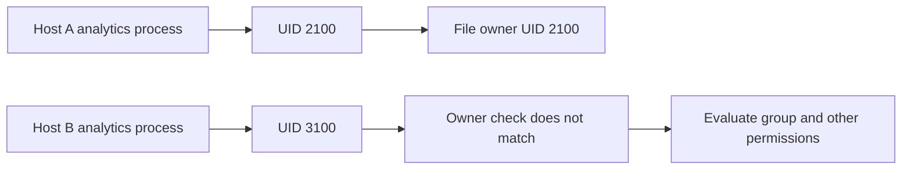

# Fix JuiceFS Permission Mismatches by Aligning Numeric User and Group IDs

Author: [nawazdhandala](https://www.github.com/nawazdhandala)

Tags: JuiceFS, Linux, Security

Description: Diagnose JuiceFS access differences across hosts, align numeric identities safely, and verify existing files and new processes without broad permission changes.

An application writes successfully on one host but gets `Permission denied` on another. Both machines show an account named `analytics`, and both mount the same JuiceFS filesystem. The missing detail may be the account's number: `analytics` can mean user 2100 on one machine and user 3100 on the other.

This guide uses the Unix permission model of **JuiceFS Community Edition 1.4.2**. It separates three things that are easy to confuse: account names, numeric identities attached to running processes, and numeric ownership stored with files. Changing one does not automatically reconcile the others.

## Compare numbers before changing permissions

A user identifier (UID) identifies a user numerically. A group identifier (GID) identifies a group. Processes also have supplementary groups, which can grant group access beyond their primary GID. Human-readable account names are local translations of these numbers.

Consider a file with owner UID 2100, group GID 4100, and mode `0640`. Its owner can read and write; its group can read; everyone else has no access under the basic mode bits. A process with UID 3100 does not become the owner because its account is also called `analytics`. Conversely, an unrelated account assigned UID 2100 can be treated as the owner.

JuiceFS explicitly recommends consistent numeric identities across clients in its [account synchronization guide](https://github.com/juicedata/juicefs/blob/v1.4.2/docs/en/administration/sync_accounts_between_multiple_hosts.md). Treat a collision as a security issue as well as an availability issue.



Matching ownership is only one part of access. Parent directories must permit traversal, the filesystem must be writable for writes, and any additional access controls still apply.

## Collect a read-only identity report

Run the following Python 3.11-compatible script from the application's execution context on each host. Save it as `identity-report.py`. Replace the path argument with a known affected file, not a credential file.

```python
import json
import os
import stat
import sys

if len(sys.argv) != 2:
    raise SystemExit("usage: identity-report.py PATH")

path = os.path.abspath(sys.argv[1])
report = {
    "host": os.uname().nodename,
    "process_uid": os.geteuid(),
    "process_gid": os.getegid(),
    "supplementary_groups": sorted(os.getgroups()),
    "paths": [],
}

for candidate in (os.path.dirname(path), path):
    try:
        info = os.stat(candidate, follow_symlinks=False)
        report["paths"].append({
            "path": candidate,
            "uid": info.st_uid,
            "gid": info.st_gid,
            "mode": oct(stat.S_IMODE(info.st_mode)),
            "is_symlink": stat.S_ISLNK(info.st_mode),
        })
    except OSError as error:
        report["paths"].append({
            "path": candidate,
            "error": type(error).__name__,
        })

print(json.dumps(report, indent=2))
```

Run it without elevated privileges:

```bash
python3 identity-report.py /mnt/jfs/projects/report.csv
```

The output compares the current process with the file and its immediate parent. It does not change ownership, read file contents, or perform a write test. A reported error is evidence to investigate, not a successful access check. The `is_symlink` field prevents confusing a final symlink's ownership with its target's ownership; intermediate path components can still be symlinks.

These fields and identity functions come from Python's [operating-system interface](https://docs.python.org/3.11/library/os.html#os.stat). This report is intentionally diagnostic: it does not calculate an authoritative allow/deny result or enumerate every ancestor directory.

Run through the same service account, container, or approved diagnostic environment as the application. A report from an administrator's shell describes that shell's identity. It cannot prove the credentials of an already-running service. Also confirm that both mount paths refer to the same JuiceFS volume and directory; matching path names alone are insufficient.

## Choose a canonical identity without stealing another account

Create a small mapping before making changes:

| Identity | Canonical number | Host A | Host B | Required action |
| --- | --- | --- | --- | --- |
| analytics user | UID 2100 | 2100 | 3100 | Reconcile host B |
| analytics-data group | GID 4100 | 4100 | 4100 | Check membership |
| Unrelated local user | Must remain distinct | Separate | Check UID 2100 | Resolve collision first |

The numbers are examples, not reservations. Check every participating host and container image for existing users or groups with the proposed IDs. Include deployment runners, scheduled jobs, and recovery hosts, which are often missed during an interactive test.

Use the organization's identity service or account-management configuration to maintain the agreed mapping. Do not delete another account just to free a number. Account changes can affect local files, home directories, service configurations, and other shared filesystems. Schedule a controlled migration if an existing account must move.

Changing account records does not rewrite numeric owners already stored on JuiceFS. It also does not replace credentials held by existing processes. Restart the affected service or establish a fresh login after the mapping change, then collect the report again from that new context.

## Reconcile old ownership as a separate migration

First inventory the affected application subtree, including directories, files, symlinks, and any access control lists. Preserve an ownership manifest and a recoverable metadata backup. Stop writers during a planned ownership migration so that old and new identities do not create a mixed population while the repair runs.

If existing files already use the chosen canonical UID and GID, changing their ownership is unnecessary. Correct the client identity instead. If data genuinely belongs to a retired numeric identity, review a narrowly scoped ownership migration for that specific subtree and mapping.

Avoid recursive ownership changes at the JuiceFS root. They can rewrite other teams' data and destroy distinctions between service accounts. Broad `chmod 777` is also a poor diagnostic fix: it grants access to everyone while leaving the identity mismatch unresolved.

Where POSIX access control lists (ACLs) are enabled, check their numeric entries and effective permissions as well as basic mode bits. An ACL can preserve a reference to the old identity. Do not enable ACLs merely to work around inconsistent accounts; in this release, enabling the feature is a persistent volume-level choice. See the [versioned ACL guidance](https://github.com/juicedata/juicefs/blob/v1.4.2/docs/en/security/posix_acl.md).

## Make container identities explicit

For a Kubernetes workload, these fields belong under the Pod's `spec.securityContext`, or under a Deployment's `spec.template.spec.securityContext`:

```yaml
securityContext:
  runAsNonRoot: true
  runAsUser: 2100
  runAsGroup: 4100
  supplementalGroups:
    - 4200
```

This is a fragment for an existing workload, not a complete manifest. Replace all numbers with approved identities and omit group 4200 unless it is needed. Container-specific settings can override applicable Pod settings, so inspect the running container too.

Setting `runAsUser` does not change file ownership. Likewise, `fsGroup` is not a general UID translation mechanism; its volume behavior depends on the storage implementation. Review [Kubernetes security-context semantics](https://kubernetes.io/docs/tasks/configure-pod-container/security-context/) and the [JuiceFS CSI permission examples](https://github.com/juicedata/juicefs-csi-driver/blob/v0.34.0/docs/en/security/permission.md) before adding volume ownership settings.

## Verify both old files and new work

From fresh application processes on both hosts, read a known old file and perform an approved create, read, rename, and delete test in a dedicated test directory. Confirm the new file's numeric owner and group from the other host. Include a group-only reader and an unrelated identity that should still be denied.

If the numbers now match but access still fails, inspect ancestor-directory permissions, ACLs, read-only mounts, and local security policy. Record the exact operation that fails. An application able to read a file may still lack permission to create or rename entries in its directory. Keep the fix tied to the required operations rather than expanding access until the error disappears.
