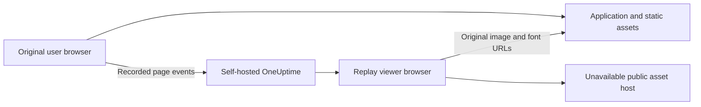

# How to Fix Missing Images and Fonts in Self-Hosted Session Replay

Author: [nawazdhandala](https://www.github.com/nawazdhandala)

Tags: Air-Gapped, Monitoring, Troubleshooting, Networking

Description: Diagnose missing replay assets from the viewer's browser, preserve old static files, and fix scoped TLS, CORS, and delivery issues without exposing private content.

A replay can have a complete timeline and still show blank logos or the wrong font. The recording arrived, but the browser watching it cannot reconstruct every visual resource. Restarting the recorder usually does not fix that situation.

For OneUptime web replay, images and fonts generally remain references to their original addresses. Readable stylesheets can be captured; other stylesheets still need to be fetched. Images embedded as data URLs are an exception because their data is already in the markup. The [session replay documentation](https://oneuptime.com/docs/en/telemetry/session-replay#images-styles-and-fonts-during-playback) explains this behavior.

The central troubleshooting question is: **Can the viewer's browser fetch the exact resource the recording references, under the replay's security rules?**

## Start at the viewer, not the monitoring server

The original user, the recording service, and the person watching a replay may have different network access. A server-side connection test does not describe the viewer's DNS, proxy, certificate trust, or browser policy.



First identify one broken asset and one working asset from the same session. Record the session, playback position, application release, viewer browser, asset URL, and observed error. Avoid collecting a whole session export when a single failed URL is enough; URLs can contain signed tokens or private identifiers.

In OneUptime, inspect **Session details → Fidelity → Missing assets** for failed images and stylesheets, then use browser developer tools for font failures and policy messages. Under **Mask all text**, external images and fonts are intentionally omitted. Check the recorded privacy mode before treating a wireframe as an incident. OneUptime's [replay troubleshooting guide](https://oneuptime.com/docs/en/rum/session-replay-troubleshooting#images-icons-or-styles-are-missing-in-the-replay) distinguishes these cases.

## Read the failure before changing configuration

Open developer tools before replaying, select Network, preserve the log, and disable cache for the inspection. Play to the affected point and filter by image, stylesheet, or font. Inspect the requested URL, redirects, response headers, and Console message. The [Chrome Network guide](https://developer.chrome.com/docs/devtools/network/) describes these inspection tools.

| Observation | Investigate first | Likely corrective action |
| --- | --- | --- |
| Hostname cannot resolve or connection times out | Viewer network, internal DNS, VPN, firewall | Restore the approved internal path |
| Certificate failure | Hostname match, CA chain, browser trust | Correct certificates or distribute CA trust |
| 404 | Old release files removed or URL changed | Restore the exact versioned asset |
| 401, 403, or redirect to login | Authentication, signed-link expiry, hotlink rules | Separate approved static resources from protected content |
| 200 with HTML instead of a font | Login page or application fallback route | Return the correct file or a real 404 |
| CORS or resource-policy error | Cross-origin response headers | Adjust only the approved static asset scope |
| Content Security Policy error | Replay privacy policy or dashboard policy | Preserve privacy restrictions; correct unintended policy blocks |

A successful status code is not enough. Check that a font URL returns a font and an image URL returns an image. A single-page application's fallback page can make every missing file return `200`, which disguises the real problem.

## Inspect the exact URL without disabling TLS

Run this read-only request from the viewer's network. Replace the hostname, path, and CA bundle with your approved values. The example uses GET, because some systems handle HEAD differently:

```bash
curl --silent --show-error \
  --cacert /path/to/internal-ca-chain.pem \
  --header 'Origin: https://monitoring.internal.example' \
  --dump-header - --output /dev/null \
  'https://operations.internal.example/replay-static/ui-2026-11-20/app.woff2'
```

You should see the expected HTTP status, content type, and cross-origin headers. Redirects remain visible because the command does not follow them. It also sends no application cookies, which helps expose resources that depend on the original user's login. Curl documents these options in its [manual](https://curl.se/docs/manpage.html).

This is a transport and header check. Curl does not enforce browser CORS or Content Security Policy, so a successful result must still be followed by replay testing. Do not add `--insecure` to make an internal certificate error disappear.

If the URL points to a public CDN, copying the file to an unrelated internal URL will not repair existing references. For future recordings, serve approved application assets internally before recording begins. For older recordings, preserve the original hostname and path through an authorized internal delivery arrangement where possible. Do not assume your replay product has an automatic asset-rewriting or archival feature.

## Fix static asset delivery narrowly

Separate reusable application assets from user-specific content. Logos, packaged icon files, stylesheets, and licensed web fonts can often live in a versioned static directory. Private attachments, avatars, and signed download links should keep their access controls; a blank area is preferable to exposing them to every replay viewer.

For a controlled example, suppose the application and assets share `https://operations.internal.example`, and reviewed static files live below `/srv/www/replay-static/`. Inside that host's existing HTTPS NGINX server, this location serves only that directory and permits the monitoring origin to use cross-origin resources:

```nginx
location ^~ /replay-static/ {
    root /srv/www;
    try_files $uri =404;

    add_header Access-Control-Allow-Origin "https://monitoring.internal.example" always;
    add_header Cross-Origin-Resource-Policy "cross-origin" always;
}
```

This is a location fragment, not a complete server configuration. Keep the existing TLS configuration and MIME-type mappings. The `root` and URI together map the sample URL to `/srv/www/replay-static/ui-2026-11-20/app.woff2`. `try_files` returns 404 when that file is absent instead of handing the request to the application. See NGINX's [core directive reference](https://nginx.org/en/docs/http/ngx_http_core_module.html#try_files).

Review inherited headers and access rules before using the fragment. Adding `add_header` directives at this level can change header inheritance, so preserve your required security headers explicitly using the behavior documented for your NGINX version. Validate the complete deployment configuration before reloading it. The [headers module reference](https://nginx.org/en/docs/http/ngx_http_headers_module.html) documents those rules.

Cross-Origin Resource Policy, or CORP, controls cross-origin loading in supported browsers. Its `cross-origin` value permits cross-origin use of this static resource; it is not authentication and should not be applied broadly to private application responses. See the [CORP reference](https://developer.mozilla.org/en-US/docs/Web/HTTP/Reference/Headers/Cross-Origin-Resource-Policy).

The fixed CORS origin in this example fits assets otherwise used by their own application origin. If other applications legitimately consume the same fonts cross-origin, design an explicit origin allowlist for them as well. Do not return arbitrary request origins or add credential support merely to make a replay look complete.

## Keep fonts and historical releases available

Fonts can fail even when their stylesheet loads. Inspect the font URL inside `@font-face`, not just the CSS request. Relative paths, missing font files, blocked cross-origin responses, or invalid font content can all cause fallback text. Mozilla's [`@font-face` documentation](https://developer.mozilla.org/en-US/docs/Web/CSS/@font-face) explains how a font source is selected.

Keep immutable assets for at least the replay retention period. If release A references `app.a1b2.woff2`, deployment B should not delete it while recordings of A remain in use. Retain associated stylesheets and their transitive dependencies, such as background images and nested font references. Confirm that your font license permits internal hosting and the intended distribution.

Do not overwrite an old URL with different visual content. That can make a historical replay appear healthy while showing a different interface. Preserve release directories or content-hashed files and make cleanup aware of the replay retention window.

## Verify the repair against an old recording

Replay the same session from the same network with a fresh cache. Confirm that the specific failed requests now return the right files and that the layout looks correct. Test the original application too: a header change that repairs playback must not break its normal asset loading.

Then repeat from a second approved viewer workstation. Confirm that protected content remains protected and intentional masking remains intact. Record which resources were restored, which policy changed, and which visual gaps remain by design. The durable fix is a reachable, authorized, version-preserving asset path that keeps yesterday's files available after the next deployment.
