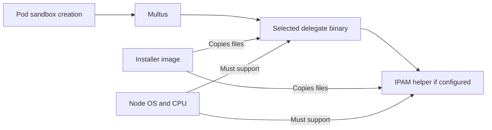

# Fix Architecture Mismatches in Multus Delegated CNI Binaries

Author: [nawazdhandala](https://www.github.com/nawazdhandala)

Tags: Multus, Kubernetes, Troubleshooting

Description: Trace Multus exec format errors to the exact delegated binary, compare its operating system and CPU architecture with the node, and repair installation artifacts safely.

A Pod starts on an AMD64 node but fails during network creation on an ARM64 node. The application image supports both architectures, and the Multus container is running. The error still says `exec format error` when Multus invokes a secondary network plugin.

The application image is only one executable in this path. Multus also runs delegated CNI binaries such as `macvlan`, `bridge`, or an IP address management plugin. A file copied onto the node can have the wrong architecture even when the installer container itself runs correctly.

This walkthrough uses **Multus v4.3.1** configuration and the official **CNI plugins v1.8.0** release artifacts. Artifact inspection can be done without running the plugins. Linux network creation still needs a separate staging test.

## Follow the failing executable

CNI means Container Network Interface. Multus invokes other CNI plugins according to the selected network configuration. Some plugins then invoke IPAM, or IP address management, helpers. Each executable needs to work in the environment where it runs.



Preserve the complete nested error and Pod node name before replacing anything. An error mentioning `host-local` inside a `macvlan` failure can point to the helper rather than the main plugin. If `multus-shim` itself cannot execute, investigate that executable first instead of assuming the delegate is responsible.

```bash
kubectl -n REPLACE_NAMESPACE describe pod REPLACE_POD
kubectl get nodes -L kubernetes.io/arch,kubernetes.io/os
```

These commands establish where the failure occurred and which node classes exist. Compare a failing node with a working node, including the deployed plugin version, installation method, and exact binary path.

## Inspect the file the process actually uses

Do not start by assuming every installation searches `/opt/cni/bin`. Multus's [v4.3.1 configuration reference](https://github.com/k8snetworkplumbingwg/multus-cni/blob/v4.3.1/docs/configuration.md) describes `binDir` as an additional plugin search directory. Runtime configuration, environment, host mounts, and thin versus thick deployment affect which files are visible.

Find the resolved path from logs and effective configuration. With thick Multus, inspect the path in the daemon's filesystem view and identify its backing host mount. A correct file elsewhere on the node does not repair a stale file at the selected path.

On the relevant Linux node or execution environment, use these read-only checks. Replace the path with the actual failing executable. Install `file` and GNU binutils through your approved diagnostic tooling if they are absent.

```bash
uname -m
plugin_path=/REPLACE_WITH_ACTUAL_CNI_DIRECTORY/macvlan
ls -l "$plugin_path"
file -L "$plugin_path"
readelf -h "$plugin_path"
readelf -l "$plugin_path"
```

`file -L` follows a symbolic link and classifies its target. `readelf -h` prints the ELF header, including its machine type; ELF is the executable format normally used by Linux binaries. `readelf -l` shows program headers, including an interpreter when one is required. These options are documented by [file](https://man7.org/linux/man-pages/man1/file.1.html) and [GNU readelf](https://sourceware.org/binutils/docs/binutils/readelf.html).

| Node CPU family | Common Linux machine name | Release archive architecture | Expected ELF machine |
| --- | --- | --- | --- |
| 64-bit x86 | `x86_64` | `amd64` | AMD x86-64 |
| 64-bit Arm | `aarch64` | `arm64` | AArch64 |

These names describe the same two CPU families using different conventions. Do not map every unfamiliar machine name to ARM64. The release also has other architecture variants, and a fleet can require more than these two.

## Separate architecture errors from nearby failures

Linux reports `ENOEXEC` for an unrecognized executable format, a wrong architecture, or another format problem. It can report `ENOENT` when the requested executable or its script/ELF interpreter is missing, and `EACCES` for execution permission problems. The [execve manual](https://man7.org/linux/man-pages/man2/execve.2.html) documents these distinctions.

Consequently, `exec format error` is evidence to inspect the file, not proof that it is AMD64 on ARM64. A truncated download, an HTML error page saved as a binary, or a macOS Mach-O executable copied onto Linux can produce a similar diagnosis. Changing execute permissions cannot convert one machine format into another.

If the architecture is correct but execution reports a missing file, inspect the interpreter path from the program headers. A dynamically linked binary can require a loader absent from the daemon container. Compare that environment with the one in which the binary was built; do not copy an arbitrary system loader into the container as a quick fix.

## Stage the correct release artifact

The official [v1.8.0 release](https://github.com/containernetworking/plugins/releases/tag/v1.8.0) provides separate Linux AMD64 and ARM64 archives and checksum files. The following Bash example checks an already downloaded AMD64 archive in a staging directory. It writes only extracted staging files and does not install anything onto a node.

```bash
set -euo pipefail
cd /REPLACE_WITH_DOWNLOAD_DIRECTORY
archive=cni-plugins-linux-amd64-v1.8.0.tgz
sha256sum -c "$archive.sha256"
staging_dir=$(mktemp -d)
tar -xzf "$archive" -C "$staging_dir"
file -L "$staging_dir/macvlan" "$staging_dir/host-local"
```

Obtain both files from the official release through your approved download process. The checksum should report `OK`; then inspect every plugin needed by your attachment, not just `macvlan`. For ARM64, select the correspondingly named ARM64 archive. A checksum checks agreement with that checksum file; it is not a substitute for trusting the source from which both were obtained.

Keep the previous known-good artifacts and record the selected archive, checksum, node architecture, and final installed paths. Repair the installation source, such as an init container's copy logic or a node provisioning package. Otherwise the next installer restart may put the incorrect binary back.

For your own Go-based plugin builds, set the target operating system and architecture deliberately. Go documents `GOOS` and `GOARCH` in its [build environment guidance](https://go.dev/doc/install/source#environment). A binary built on a developer laptop with default settings is not automatically a Linux node artifact. Also review CGO and library requirements when applicable.

## Verify execution before testing attachment

After an approved replacement on one staging node, re-run the file inspections at the actual installed path. For a trusted CNI plugin, a VERSION request checks whether it can start and report supported CNI versions without requesting network creation:

```bash
plugin_path=/REPLACE_WITH_ACTUAL_CNI_DIRECTORY/macvlan
CNI_COMMAND=VERSION "$plugin_path" </dev/null
```

The [CNI specification](https://github.com/containernetworking/cni/blob/v1.3.0/SPEC.md) defines this command. Expect JSON describing supported versions. This does not test ADD, interface creation, IPAM, permissions, or cleanup. Do not manually improvise an ADD invocation against a production sandbox.

Next create and delete a controlled test Pod using the real attachment. Check that the delegate and its helpers run, that the interface and address appear, and that cleanup succeeds. Repeat on each supported architecture. Existing Pods continuing to send traffic is insufficient: they may not execute the corrected binaries until recreation or cleanup.

Finally, review installer placement and artifact selection together. Separate architecture-specific installers need matching node selectors; a multi-architecture installer needs correct contents for every selected platform. Keep the verification result tied to the installed files, rather than treating a healthy installer Pod as proof of a healthy CNI toolchain.
