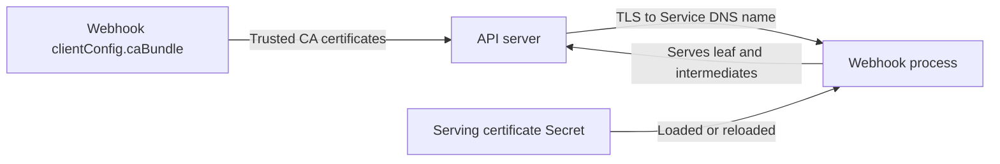

# Fix Mutating Webhook TLS Errors and Rotate Certificates Safely

Author: [nawazdhandala](https://www.github.com/nawazdhandala)

Tags: Kubernetes, Security, Troubleshooting

Description: Diagnose webhook certificate failures by checking Service DNS names, admission CA bundles, served certificate chains, and safe leaf or CA rotation order.

When Kubernetes reports `failed calling webhook` with an X.509 error, the request may never reach your mutation code. The API server must first establish a trusted TLS connection to the webhook endpoint.

Treat this as a relationship between three things: the Service identity in the webhook registration, the certificate actually served by the process, and the certificate authorities trusted by the API server for that webhook. A healthy Pod and an updated Secret do not prove those three agree.

The examples use the **Kubernetes v1.35.0 admission API** as their reference. OpenSSL commands use documented 3.0 options and were locally checked with OpenSSL 4.1.0; they are not claims of testing a live Kubernetes cluster.

## Identify which certificate relationship failed

A certificate authority, or CA, signs certificates. A Subject Alternative Name, or SAN, lists identities for which a certificate is valid. Trusting the signer and matching the endpoint's name are separate checks.



For a Service named `injector` in namespace `platform-system`, the webhook serving certificate needs the DNS SAN `injector.platform-system.svc`. A certificate covering only `injector`, a Pod name, or an external ingress hostname does not establish that identity. Kubernetes specifies the Service-name requirement in its [admission webhook configuration documentation](https://kubernetes.io/docs/reference/access-authn-authz/extensible-admission-controllers/#webhook-configuration).

Use the error to choose the first inspection:

| Symptom | First thing to compare |
|---|---|
| Certificate signed by unknown authority | Served chain against the selected webhook's CA bundle |
| Certificate valid for another name | SANs against the registered Service name and namespace |
| Expired or not yet valid certificate | Leaf and issuer validity dates, plus clock accuracy |
| Intermittent certificate errors | Certificates served by every backend replica |
| Timeout or connection refused | Routing, endpoints, ports, and process readiness before certificate work |

Do not rotate certificates blindly for a network timeout. Conversely, changing a network rule will not repair a SAN mismatch.

## Extract the trust bundle for the exact webhook

Use a kubectl context authorized to inspect the registration. Replace `platform-hooks` and `inject.platform.example.com` with the actual configuration and entry names. A single configuration can contain several webhooks with different client settings.

```bash
kubectl get mutatingwebhookconfiguration platform-hooks -o json \
  > registration.json

python3 - <<'PY'
import base64
import json
from pathlib import Path

config = json.loads(Path("registration.json").read_text())
matches = [w for w in config["webhooks"]
           if w["name"] == "inject.platform.example.com"]
if len(matches) != 1:
    raise SystemExit("Expected exactly one named webhook")
client = matches[0]["clientConfig"]
if "service" not in client:
    raise SystemExit("This example requires a Service-backed webhook")
bundle = client.get("caBundle", "")
if not bundle:
    raise SystemExit("No explicit CA bundle; inspect configured trust ownership")
Path("webhook-ca.pem").write_bytes(base64.b64decode(bundle, validate=True))
print(json.dumps(client["service"], indent=2))
PY
```

The expected output identifies the Service, namespace, and any explicit path or port. The file contains public CA certificates, not a private key. The [kubectl get reference](https://kubernetes.io/docs/reference/kubectl/generated/kubectl_get/) documents JSON output.

In the [v1 admissionregistration types](https://github.com/kubernetes/api/blob/v0.35.0/admissionregistration/v1/types.go), `caBundle` holds a PEM CA bundle, serialized as Base64 in JSON. If omitted, API-server system roots are used; an empty field does not mean verification is disabled. A private serving CA normally needs explicit trust here. Decode once, then check that the result is PEM certificate material rather than another layer of Base64 text.

## Inspect the intended serving certificate

Obtain only the public certificate from the actual Secret referenced by the webhook workload. Replace the namespace and Secret name below. Reading a Secret requires appropriate authorization even when selecting a public field; do not export its private key for this diagnosis.

```bash
set -o pipefail
kubectl -n platform-system get secret injector-serving \
  -o jsonpath='{.data.tls\.crt}' \
  | python3 -c 'import base64,sys; sys.stdout.buffer.write(base64.b64decode(sys.stdin.buffer.read(), validate=True))' \
  > intended-chain.pem

openssl x509 -in intended-chain.pem -noout \
  -subject -issuer -dates -serial -fingerprint -sha256 \
  -ext subjectAltName
openssl x509 -in intended-chain.pem -noout -checkend 604800
```

The inspection prints the first certificate, which should be the serving leaf. The second command returns nonzero if it expires within seven days. This is a renewal threshold, not a complete trust or hostname test. Inspect intermediate CA expiration too when the chain contains intermediates. See [OpenSSL x509 options](https://docs.openssl.org/3.0/man1/openssl-x509/).

Confirm the DNS SAN explicitly. A familiar Common Name in the subject is not an acceptable substitute for the required SAN. Also confirm that the Secret you inspected is the one mounted or loaded by the running process.

## Check what the process actually serves

For a Service using port 443, forward a local port in one terminal:

```bash
kubectl -n platform-system port-forward service/injector 8443:443
```

Then run this from another terminal, keeping the Service identity even though the TCP connection goes to localhost:

```bash
openssl s_client -connect 127.0.0.1:8443 \
  -servername injector.platform-system.svc \
  -verify_hostname injector.platform-system.svc \
  -CAfile webhook-ca.pem -verify_return_error -showcerts </dev/null
```

`-servername` sends the requested TLS server name; `-verify_hostname` checks certificate identity. `-verify_return_error` matters because this diagnostic tool otherwise can continue after verification errors. Expect successful certificate verification and a successful command exit for a normal server-authentication handshake. Additional client-certificate requirements need the approved client identity; do not disable them to make a probe pass. See [OpenSSL s_client](https://docs.openssl.org/3.0/man1/openssl-s_client/).

Compare the served leaf's serial number and fingerprint with the intended leaf. A difference can reveal a stale process, the wrong mounted Secret, or another backend using an older certificate. The process must serve required intermediate certificates as well as the leaf; the root trust anchor belongs in the client's trust configuration.

A [Service port-forward selects a Pod](https://kubernetes.io/docs/reference/kubectl/generated/kubectl_port-forward/). Success therefore proves neither every replica's certificate nor API-server network reachability. Inspect each backend through its own controlled connection and confirm a real canary admission request from the API server afterward.

## Rotate in an order that preserves trust

For a leaf renewal under the same trusted CA, issue the new certificate with the correct SANs and validity period, update the serving material through its owner, and ensure every process loads it. Verify the served certificate on every replica before closing the change.

Secret-volume updates are eventually propagated, but applications still need to reload files. A `subPath` Secret mount does not receive automatic updates. Follow the workload's documented reload or rollout procedure; see [Secret volume behavior](https://kubernetes.io/docs/concepts/configuration/secret/#using-secrets-as-files-from-a-pod).

For a CA change, use an overlap:

1. Publish trust for both the old and new CAs in every relevant webhook entry.
2. Confirm the effective configuration has propagated before switching serving certificates.
3. Roll out the new serving chain and verify all replicas and canary admission requests.
4. Remove the old CA only after no active endpoint or retained rollback plan needs it.

Perform these changes through the controller or deployment system that owns the fields. A manual `caBundle` patch may be overwritten by certificate automation. Avoid rotating a CA and deleting old trust in the same unverified step.

Finally, do not use `failurePolicy: Ignore` as a certificate repair. Skipping a failing webhook changes admission behavior while leaving the trust problem intact. Close the incident with evidence of the correct registered identity, effective CA bundle, served chain, and successful scoped admission, rather than merely a running Pod.
