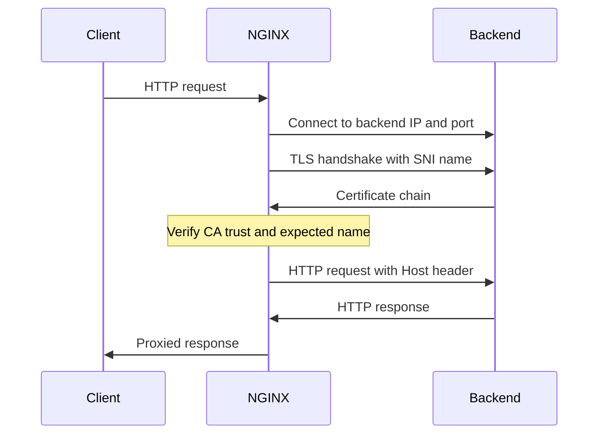

# Fix NGINX Upstream TLS Names with proxy_ssl_name and SNI

Author: [nawazdhandala](https://www.github.com/nawazdhandala)

Tags: Nginx, TLS, Troubleshooting

Description: Separate upstream connection addresses, TLS names, SNI, and HTTP Host headers to repair NGINX certificate-name failures while keeping upstream certificate verification enabled.

NGINX can connect to an HTTPS backend's IP address and still reject the connection because the certificate is valid for a different name. This often appears after moving from a direct hostname in `proxy_pass` to a named upstream group, or when the backend serves different certificates according to Server Name Indication.

The repair is to align the backend's intended TLS identity with the name NGINX verifies and sends. Changing the HTTP `Host` header alone does not change the earlier TLS handshake.

This guide was tested locally with **NGINX 1.30.7**, built with **OpenSSL 3.6.2**, against a loopback HTTPS test server and a temporary test certificate authority. The tests covered a successful request, a wrong certificate name, missing SNI against a server requiring it, and an unrelated trusted CA. They do not establish the state of your production backend.

## Keep four identities separate

Suppose the backend is reachable at `192.0.2.20:8443`, its certificate covers `api.internal.example`, and the NGINX upstream group is called `backend_pool`.

| Item | Example | Purpose |
| --- | --- | --- |
| Connection destination | `192.0.2.20:8443` | Where NGINX opens the connection |
| TLS verification name | `api.internal.example` | Identity expected in the certificate |
| SNI name | `api.internal.example` | Name sent during TLS negotiation |
| HTTP Host header | `api.internal.example` | Application virtual-host selection after TLS |

SNI means Server Name Indication. It lets a server choose a TLS configuration before it receives an HTTP request. An upstream group name is an NGINX configuration identifier; it is not automatically a name on the backend certificate. The [upstream module documentation](https://nginx.org/en/docs/http/ngx_http_upstream_module.html) describes server groups.



A failure at certificate verification happens before the backend can process your application headers. That timing explains why a correct `Host` header cannot repair an incorrect TLS name.

## Configure the backend identity explicitly

Place this example inside an existing `http` block. It exposes only a loopback staging listener; retain your separately managed client-facing TLS configuration for production. Replace the documentation address and CA bundle path with approved values.

```nginx
upstream backend_pool {
    server 192.0.2.20:8443;
}

server {
    listen 127.0.0.1:8080;

    location / {
        proxy_pass https://backend_pool;

        proxy_ssl_server_name on;
        proxy_ssl_name api.internal.example;
        proxy_ssl_verify on;
        proxy_ssl_trusted_certificate /etc/nginx/trust/upstream-ca.pem;
        proxy_ssl_verify_depth 2;

        proxy_set_header Host api.internal.example;
    }
}
```

`proxy_ssl_name` supplies the name used for verification and, when enabled, SNI. Its default is based on `$proxy_host`, which can be the upstream group identifier. `proxy_ssl_server_name` enables sending SNI; its default is off. Upstream certificate verification is also off by default, so keep `proxy_ssl_verify on` explicit. These defaults and roles are documented in the [proxy module reference](https://nginx.org/en/docs/http/ngx_http_proxy_module.html#proxy_ssl_name).

The trusted-certificate file contains the approved CA trust material in PEM format. The upstream should present its required intermediate certificates. Set verification depth to suit the reviewed chain; increasing it does not fix an untrusted issuer or a wrong hostname.

Here the application expects the same HTTP host as its certificate name. That is a design choice, not a universal requirement. Some applications need a different Host value. Keep it deliberate, and do not derive the trusted upstream TLS identity from an arbitrary client-supplied header.

## Inspect the backend with the same identity

From an authorized environment that can reach the backend, use OpenSSL to separate destination, SNI and verification name. Replace the address, port, hostname and CA path together:

```bash
openssl s_client \
  -connect 192.0.2.20:8443 \
  -servername api.internal.example \
  -verify_hostname api.internal.example \
  -verify_return_error \
  -CAfile /REPLACE_WITH_APPROVED_CA_BUNDLE \
  </dev/null
```

`-servername` sends SNI. `-verify_hostname` requests the identity check, while `-verify_return_error` makes verification errors fail the operation instead of merely printing diagnostics. The [OpenSSL s_client manual](https://docs.openssl.org/3.5/man1/openssl-s_client/) documents these options.

Expect a successful verification result for the intended name and trust bundle. Record the certificate's subject alternative names, issuer and expiry through your certificate-inspection process. Do not treat a completed TCP connection as certificate validation.

To test an HTTP request at a fixed IP while retaining the hostname for TLS and HTTP, use curl:

```bash
curl --noproxy '*' \
  --resolve api.internal.example:8443:192.0.2.20 \
  --cacert /REPLACE_WITH_APPROVED_CA_BUNDLE \
  --connect-timeout 5 --max-time 15 \
  https://api.internal.example:8443/health
```

Choose an approved read-only endpoint instead of assuming `/health` exists. `--resolve` changes address resolution for that host and port while preserving the URL hostname. The [curl manual](https://curl.se/docs/manpage.html#--resolve) explains the behavior. Do not use `-k`: it removes the check this investigation is supposed to verify.

## Match the error to the failed layer

Our local test used a certificate for `api.internal.example` and a server that rejected connections without SNI. It produced these results:

| Test | Local result | Meaning |
| --- | --- | --- |
| Correct name, SNI enabled, trusted CA | HTTP 200 | TLS succeeded and backend received the intended Host |
| Wrong verification name | HTTP 502 | NGINX logged a certificate-name mismatch |
| SNI disabled | HTTP 502 | The test server rejected the handshake |
| Unrelated CA trust file | HTTP 502 | NGINX logged a certificate verification error |

Missing SNI does not always produce the same error in a real deployment. A server may return a default certificate instead of rejecting the handshake, leading to a name mismatch later. Preserve the exact NGINX error and backend certificate evidence.

If the handshake succeeds but the application returns 404 or a wrong tenant, investigate Host-based routing separately. If only one member of a backend pool fails, inspect that member's certificate and chain. Every member reached under the shared TLS name must present an identity valid for it.

## Validate and roll out without masking the problem

Test the intended configuration file with the installed NGINX binary:

```bash
nginx -t -c /REPLACE_WITH_ABSOLUTE_NGINX_CONFIG
```

NGINX's [command-line reference](https://nginx.org/en/docs/switches.html) documents syntax testing and alternate configuration selection. This check reads configuration and referenced files; it does not perform an upstream HTTPS request. Follow it with a staging request through NGINX and inspect the error log.

Reload through the deployment's normal service or container lifecycle. Keep the previous configuration available, and verify fresh requests after reload. A direct curl success is useful evidence, but only the proxied request proves that NGINX is using the intended settings and trust file.

Finish by recording the connection address, expected certificate name, SNI setting, CA bundle owner and application Host value. Those explicit choices prevent the next upstream-group rename or backend certificate rotation from turning a working proxy into a confusing TLS failure.
