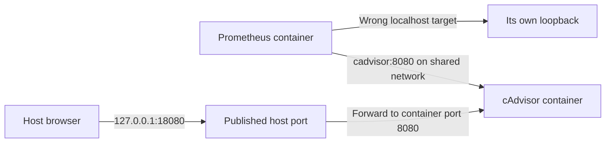

# Fix Prometheus-to-cAdvisor Connection Refused in Docker Compose

Author: [nawazdhandala](https://www.github.com/nawazdhandala)

Tags: Docker, Prometheus, Monitoring

Description: Diagnose Prometheus-to-cAdvisor connection failures by checking container-local addresses, service DNS, network membership, ports, and loaded configuration.

You can open cAdvisor in a browser, but Prometheus reports `connection refused`. A common cause is a scrape target such as `localhost:8080`. From inside the Prometheus container, that address points back to Prometheus's own network namespace, not to cAdvisor or the Docker host.

For two services on the same ordinary Compose network, use the cAdvisor service name and its container port: `cadvisor:8080`. The hostname identifies the destination service; the port identifies the listener inside that service. A published host port serves a different route.

This guide assumes an existing, reviewed cAdvisor deployment named `cadvisor`, listening on port 8080, and a separate Prometheus container using bridge networking. Host networking and containers deliberately sharing another container's network namespace need different address reasoning.

## Draw the route before changing settings

Suppose cAdvisor publishes `127.0.0.1:18080:8080`. The left-hand port, 18080, belongs to the host. The right-hand port, 8080, belongs to cAdvisor's container.

| Request location | Destination | Meaning |
| --- | --- | --- |
| Docker host | `127.0.0.1:18080` | Host publication forwards to cAdvisor |
| Prometheus container | `localhost:18080` | Prometheus container's own loopback |
| Prometheus container on shared network | `cadvisor:8080` | cAdvisor's service address and listener |
| Prometheus container on shared network | `cadvisor:18080` | Usually wrong: host publication does not change the internal listener |

Compose provides service-name discovery on shared networks. Recreated containers can get different addresses, so hard-coding an inspected container IP creates another failure waiting to happen. [Compose networking](https://docs.docker.com/compose/how-tos/networking/).



A working host route proves neither shared network membership nor the correctness of the scrape target.

## Configure a minimal scrape job

Create `prometheus.yml` alongside the Compose file:

```yaml
global:
  scrape_interval: 15s
  scrape_timeout: 10s

scrape_configs:
  - job_name: cadvisor
    metrics_path: /metrics
    scheme: http
    static_configs:
      - targets: ["cadvisor:8080"]
```

This tells Prometheus to fetch cAdvisor's metrics every 15 seconds, allowing up to 10 seconds per scrape. The target contains no URL scheme or path because those are separate configuration fields. Increasing the timeout cannot fix a refused TCP connection. [Prometheus scrape configuration](https://prometheus.io/docs/prometheus/latest/configuration/configuration/).

For a new staging Prometheus service, merge the following into your existing Compose model. Retain cAdvisor's reviewed image, host mounts, and privilege settings. Both services must join the same default network; if cAdvisor already uses explicit networks, attach Prometheus to one of those instead.

```yaml
services:
  prometheus:
    image: prom/prometheus:v3.7.3
    command:
      - --config.file=/etc/prometheus/prometheus.yml
      - --storage.tsdb.path=/prometheus
    ports:
      - "127.0.0.1:9090:9090"
    volumes:
      - type: bind
        source: ./prometheus.yml
        target: /etc/prometheus/prometheus.yml
        read_only: true
        bind:
          create_host_path: false
      - prometheus-data:/prometheus

volumes:
  prometheus-data:
```

This is an addition to an existing cAdvisor stack, not a complete cAdvisor installation. Prometheus 3.7.3 is the explicit example version, not a recommendation to downgrade an existing deployment. Keep your approved version and validate with its matching `promtool`. Preserve existing production flags, data volumes, security settings, and jobs when applying the networking fix. [Prometheus installation](https://prometheus.io/docs/prometheus/latest/installation/) and [3.7.3 release](https://github.com/prometheus/prometheus/releases/tag/v3.7.3).

## Check configuration before changing a running service

From the Compose directory, run:

```sh
docker compose config --quiet
docker compose run --rm --no-deps --entrypoint /bin/promtool \
  prometheus check config /etc/prometheus/prometheus.yml
```

The first command validates the Compose model. The second starts a temporary container from the configured Prometheus image to check the mounted configuration. It does not start a second Prometheus server or prove that `cadvisor` resolves. Use an approved local image if your environment restricts image downloads. [promtool configuration checks](https://prometheus.io/docs/prometheus/latest/command-line/promtool/).

If you edited only the mounted Prometheus configuration, reload the existing process:

```sh
docker compose kill --signal=SIGHUP prometheus
```

Despite the command name, the explicit signal requests a configuration reload rather than termination. Prometheus supports SIGHUP reloads. Its HTTP reload endpoint is disabled unless lifecycle controls are enabled; do not enable additional management access just to work around this networking issue. [Prometheus management API](https://prometheus.io/docs/prometheus/latest/management_api/).

If network attachments or other Compose settings changed, a configuration reload cannot apply them. Plan a service recreation using your normal deployment process. For the new staging stack above, `docker compose up -d prometheus` creates the service. Do not remove its data volume as a troubleshooting step.

## Read the target that Prometheus actually loaded

With the example loopback publication, inspect the active target from the Docker host:

```sh
curl --fail --silent --show-error \
  'http://127.0.0.1:9090/api/v1/targets?state=active'
```

In the `cadvisor` target entry, inspect `scrapeUrl`, `health`, `lastError`, and the scrape timestamps. Expect `http://cadvisor:8080/metrics` as the URL. If the old localhost address remains, investigate the mounted file, selected configuration path, and reload logs before changing Docker networking. The target API also distinguishes targets that are active from discovery entries removed by relabeling. [Prometheus target API](https://prometheus.io/docs/prometheus/latest/querying/api/#targets).

Then query `up{job="cadvisor"}` in Prometheus. A value of 1 means the latest scrape succeeded; it does not guarantee every desired container metric was present. An empty result also needs investigation: it is not equivalent to a target explicitly returning 0.

## Use the error to select the next check

| Observation | Likely layer | Next check |
| --- | --- | --- |
| `lookup cadvisor` fails | Name resolution or network membership | Shared networks and service name |
| `connect: connection refused` | Reached address, no accepting listener or active rejection | Port, cAdvisor process, bound address, firewall rejection |
| Connection times out | Routing, filtering, or overloaded destination | Network path and host policy |
| HTTP 404 | HTTP reached a server | Metrics path and destination service |
| TLS or certificate error | Protocol or trust | HTTP versus HTTPS and certificate configuration |

Inspect membership without assuming a network name:

```sh
docker inspect --format '{{json .NetworkSettings.Networks}}' \
  "$(docker compose ps -q prometheus)"
docker inspect --format '{{json .NetworkSettings.Networks}}' \
  "$(docker compose ps -q cadvisor)"
```

Run these only after both services have one running container. Compare the network keys; at least one shared network is needed for this service-name route. Separate Compose projects normally create separate default networks. For that arrangement, deliberately configure an existing shared external network in both projects rather than copying a transient container IP.

Do not assume the Prometheus image includes curl, a package manager, or DNS diagnostic utilities. The actual target error already comes from Prometheus's network context and often provides the most useful evidence.

## Distinguish startup timing from a persistent fault

An early failed scrape can occur while cAdvisor starts. Basic `depends_on` ordering does not establish application readiness; readiness requires an appropriate health check and condition. Even that cannot repair the wrong target hostname. [Compose startup ordering](https://docs.docker.com/compose/how-tos/startup-order/).

After the fix, watch several scrape intervals, then rehearse a controlled cAdvisor restart in staging. Confirm recovery through the stable service name, successful `up` samples, and expected per-container metrics. Preserve the target URL and error evidence with the change so a future failure starts from a known network route.
