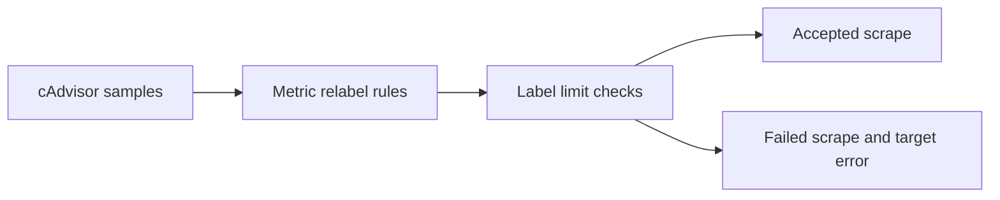

# Fix Prometheus Label-Length Errors from cAdvisor Device Paths

Author: [nawazdhandala](https://www.github.com/nawazdhandala)

Tags: Prometheus, Docker, Monitoring, Troubleshooting

Description: Diagnose oversized cAdvisor device labels, choose a bounded scrape limit or a narrow sample filter, and verify recovery without merging device identities.

A cAdvisor target responds over HTTP, yet Prometheus marks its scrape as failed. The error names `label_value_length_limit` and a `device` label containing a long filesystem path. Restarting the exporter will not solve a policy mismatch between the emitted label and the scraper's configured limit.

The useful question is whether you need that device's metrics. If you do, retain its identity and choose an appropriate bound. If you do not, deliberately exclude the affected samples. Removing or truncating the `device` label can create a different problem by making distinct devices look identical.

This walkthrough uses Prometheus 3.7.3 and cAdvisor 0.55.1 source. The numeric limits and filesystem paths below are examples for a controlled configuration, not recommended defaults for every installation.

## Confirm which limit failed

Prometheus distinguishes several limits:

| Setting | What it restricts |
|---|---|
| `label_limit` | Number of labels on a sample |
| `label_name_length_limit` | Length of an individual label name |
| `label_value_length_limit` | Length of an individual label value |
| `sample_limit` | Number of samples accepted from a scrape after metric relabeling |

A long path in `device` concerns the value, not the name. In Prometheus 3.7.3, the [label-limit implementation](https://github.com/prometheus/prometheus/blob/v3.7.3/scrape/scrape.go) uses Go string length, which measures bytes. A non-ASCII character can occupy multiple bytes, so a visual character count is not sufficient.

Read the target's last error and effective configuration. The [Prometheus targets API](https://prometheus.io/docs/prometheus/latest/querying/api/#targets) exposes target health and `lastError`. Use your existing authenticated Prometheus access rather than opening an administration endpoint publicly.

Record the metric family, label name, observed length, configured limit, and scrape target. The error text may shorten the offending value, so inspect the raw exposition through your established exporter access when you need the complete path. Do not assume every filesystem metric uses the same device representation.

## Understand why other metrics disappear too

A label-length limit is a scrape guardrail. Exceeding it can fail the entire scrape, not merely the one filesystem sample. The [scrape configuration reference](https://prometheus.io/docs/prometheus/latest/configuration/configuration/#scrape_config) describes these limits and their position after metric relabeling.



This explains why CPU and memory panels can develop gaps while the visible complaint mentions a filesystem path. An HTTP 200 from the exporter only establishes that the response was delivered; it does not establish that Prometheus accepted its samples.

Check `up` for the affected job and inspect the last scrape error together. A successful older sample in a dashboard is not evidence that the latest scrape succeeded.

## Option one: retain the samples with a bounded limit

If the devices matter, set a job-specific value large enough for the legitimate values you have inspected. Here is a small complete configuration illustrating a 512-byte bound:

```yaml
scrape_configs:
  - job_name: cadvisor
    scrape_interval: 30s
    scrape_timeout: 10s
    label_value_length_limit: 512
    static_configs:
      - targets: ['cadvisor.internal:8080']
```

Replace the target and preserve your existing TLS, authentication, discovery, and relabeling settings when applying this idea. The example's hostname does not imply that an unauthenticated HTTP endpoint is appropriate for your network.

The setting applies to all label values in that scrape job, not only `device`. Assess other labels before raising it. A value of zero removes this specific limit, so it should not be the automatic response to a single known path. Prefer a documented bound and watch for renewed failures after storage-driver or deployment changes.

## Option two: exclude a known unwanted sample family

Suppose inspection establishes that filesystem samples whose device begins with `/var/lib/docker/overlay2/` are unnecessary for this particular dashboard. You can drop those samples before the limit check. Add this fragment to the relevant existing scrape job:

```yaml
metric_relabel_configs:
  - source_labels: [__name__, device]
    regex: 'container_fs_.*;/var/lib/docker/overlay2/.+'
    action: drop
```

The default separator combines the metric name and device with a semicolon. Both conditions must match: the metric belongs to `container_fs_*`, and its device value has the specified prefix. Ordinary `/dev/...` samples remain, and unrelated metric families remain.

This is a deliberately scoped example, not a universal detector for long paths. Use it only if that prefix appears in your actual exposition and the excluded metrics are expendable. Another storage driver can expose entirely different values. Review the [cAdvisor filesystem metric definitions](https://github.com/google/cadvisor/blob/v0.55.1/metrics/prometheus.go) to understand which families your filter affects.

Dropping samples means losing their measurements. Record that decision in the dashboard or monitoring configuration. If the same long value appears in an unfiltered family, the scrape can still fail; verify the complete response rather than stopping after one matching line.

## Preserve identity when considering other repairs

A `labeldrop` rule for `device` removes a dimension, not the underlying duplicate samples. Two filesystem series can then have identical remaining labels. Truncating paths to a common prefix creates the same risk. A replacement should be designed and tested as a unique identity mapping, not improvised solely to fit a length budget.

Similarly, dropping the whole cAdvisor target removes useful CPU and memory observations along with the unwanted filesystem data. Choose the smallest change that matches the intended coverage. If the emitted value itself is unexpected, investigate the runtime and exporter version before treating that value as a permanent contract.

## Verify recovery and the intentional loss

Check the resulting complete configuration with the same Prometheus version:

```bash
promtool check config prometheus.yml
```

Then test it against representative exposition in staging. This article's local test used a real Prometheus 3.7.3 process and a synthetic exporter response containing a 300-byte device path, an ordinary filesystem device, and a memory metric. A 256-byte limit failed; a 512-byte limit accepted all three. Keeping 256 while applying the narrow filter accepted the ordinary filesystem and memory samples and excluded the unwanted path.

That test establishes the processing behavior, not the contents of your cAdvisor endpoint. After deployment, confirm successful current scrapes, the disappearance of the reported error, continued CPU and memory coverage, and either retention or deliberate exclusion of the device metric. Keep the original configuration available so an overly broad filter can be reverted without guessing what changed.
