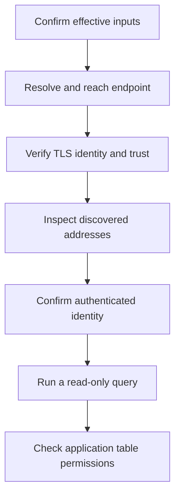

# Fix YDB Connection Failures: Endpoint, TLS, Database, and Identity

Author: [nawazdhandala](https://www.github.com/nawazdhandala)

Tags: Database, Troubleshooting, Security

Description: Diagnose YDB connection failures in stages, checking the endpoint, TLS trust, database path, discovered addresses, and authenticated identity.

“Unable to connect” is a starting point, not a diagnosis. A YDB client might fail before it opens a socket, while checking a certificate, after discovering another server, or when the database rejects its identity. Changing all connection settings together makes it difficult to learn which boundary failed.

Use the following sequence from the same machine, container, or network namespace as the application. A successful command on your laptop cannot prove that a Kubernetes workload has the same DNS, routing, certificate files, or credentials.

## Write down the connection contract

Before running probes, obtain five values from the database owner: endpoint, database path, authentication method, trusted certificate authority, and expected application identity. A certificate authority, or CA, signs certificates that clients trust.

YDB separates the endpoint from the database path. The endpoint has a protocol, host, and port. The path starts with `/` and identifies the database inside the cluster. Do not derive the path from the hostname or replace it with a filesystem directory. Copy it exactly from the deployment configuration or cloud console. See the official [connection concepts](https://ydb.tech/docs/en/concepts/connect).

| Input | Illustrative value | What to verify |
|---|---|---|
| Endpoint | `grpcs://ydb.example.internal:2135` | Actual listener and client-reachable name |
| Database | `/REPLACE_WITH_DATABASE_PATH` | Complete path supplied by the owner |
| Trust file | `/run/certs/ydb-root.pem` | Readable PEM trust material |
| Credential file | `/run/secrets/ydb-access-token` | Correct credential type and current value |
| Identity | Application service account | Expected principal, not an administrator fallback |

These are placeholders. The token example below applies only to deployments accepting that access-token mechanism. A username/password, service-account key, or token-exchange configuration is a different authentication path.

## Start with reproducible CLI inputs

The commands were reviewed with **YDB CLI 2.35.0** on macOS ARM64. Obtain the appropriate platform binary from the official [download page](https://ydb.tech/docs/en/downloads/ydb-cli). Confirm your executable before comparing results:

```bash
ydb version
ydb --help
ydb discovery list --help
ydb sql --help
```

These commands identify the client and show available options. They do not establish database connectivity. Older client versions may expose different command options.

Use Bash for the following array. Replace every example value, and run the subsequent commands in the same shell:

```bash
endpoint='grpcs://ydb.example.internal:2135'
database='/REPLACE_WITH_DATABASE_PATH'
ca_file='/run/certs/ydb-root.pem'
token_file='/run/secrets/ydb-access-token'

connection=(-e "$endpoint" -d "$database"
            --ca-file "$ca_file" --token-file "$token_file")

test -r "$ca_file" && test -r "$token_file"
```

The last line checks readability without printing certificate or credential contents. A nonzero exit means the files are not both readable; fix that before continuing. Readability does not establish that a token is valid or that a certificate chain is correct.

YDB's [CLI connection reference](https://ydb.tech/docs/en/reference/ydb-cli/connect) documents these flags and the different authentication modes. Select one appropriate mode; do not stack unrelated credentials in hopes that one succeeds.

## Follow the failing boundary



This is a diagnostic order, not a claim about the exact internal order of every SDK request. Some commands combine several boundaries.

### Check effective configuration before chasing DNS

```bash
ydb "${connection[@]}" config info
```

This reports the configuration the CLI resolved. Inspect it locally: endpoint, database path, credential mode, and CA file should match your intended contract. Profiles and environment variables can contribute values you did not expect. The documented [config info command](https://ydb.tech/docs/en/reference/ydb-cli/commands/config-info) also supports verbose source information when needed.

Treat the output as sensitive configuration. Redact identities, private endpoints, and credential-related material before sharing it; do not assume every client version masks every useful secret detail.

If a file is missing or a required database parameter is absent, that is a local configuration failure. It does not demonstrate that the server is down. For name-resolution or connection-refused errors, compare the application's network context with the successful diagnostic context, including service routing and the configured port.

### Keep encryption and identity separate

`grpcs://` requests an encrypted connection. A reachable port can still be the wrong listener. Match the protocol and port to the deployment rather than trying random combinations.

For an unknown-issuer error, verify that the client has the intended CA and that the server presents the necessary certificate chain. For a hostname mismatch, compare the endpoint name with the certificate's permitted names. A clock error can also make an otherwise correct certificate appear expired or not yet valid. Repair the name, trust material, chain, or time source; do not turn verification off.

A token cannot repair a failed TLS handshake. Equally, trusting the server's certificate does not grant your application database permissions. Keep the two investigations separate in the incident notes.

### Inspect the addresses returned by discovery

```bash
ydb "${connection[@]}" discovery list
```

The expected output is a list of endpoints with protocol and port, plus location and service information. Compare those addresses with what the application can resolve and reach. YDB documents this command as a way to localize SDK initialization problems in its [discovery reference](https://ydb.tech/docs/en/reference/ydb-cli/commands/discovery-list).

A healthy bootstrap address does not prove that all discovered addresses work. This distinction matters behind proxies, container port mappings, and private network boundaries. A returned internal hostname may be valid for cluster members and invalid for your external application.

Do not make skipping discovery your first permanent fix. Establish the intended routing design and which endpoints clients should receive. Bypassing that design can conceal a broken deployment assumption.

### Confirm who the server recognizes

```bash
ydb "${connection[@]}" discovery whoami
```

On an authentication-enabled deployment, check that the returned user security identifier matches the intended application principal. Do not settle for “some identity worked.” An administrator's success may conceal missing application permissions.

There is an important exception: the official [whoami documentation](https://ydb.tech/docs/en/reference/ydb-cli/commands/discovery-whoami) says this command fails when server authentication is disabled, as in some local setups. That failure alone does not establish a network outage.

For token-based authentication, check expiry and the configured issuer or credential mechanism without pasting tokens into logs. When credentials are refreshed through another service, that service's reachability and trust become additional dependencies.

## Finish with a small query and a narrow application check

```bash
ydb "${connection[@]}" sql -s 'SELECT 1 AS connection_probe;'
```

Expect one result containing the value `1`. This uses the documented [SQL execution command](https://ydb.tech/docs/en/reference/ydb-cli/sql) and does not modify tables. It verifies more than opening a socket, but it does not establish access to your application's tables.

Next, use an approved read-only query against a known application object under the same identity. If that fails while the constant query succeeds, inspect the object path and permissions before changing network settings. Do not test by granting broad administrator rights.

Record the client version, execution location, failing command, redacted error, and last successful boundary. That evidence gives the next person a reproducible starting point. During this article's review, CLI version and help commands ran locally and shell syntax was checked; no database connection, TLS handshake, identity exchange, or query was executed.
