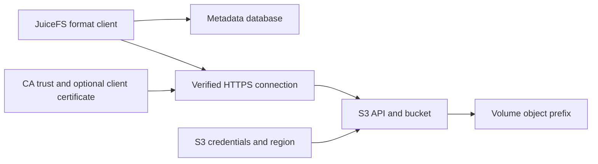

# Format JuiceFS for S3-Compatible Storage with Verified TLS

Author: [nawazdhandala](https://www.github.com/nawazdhandala)

Tags: JuiceFS, S3, TLS

Description: Verify S3 endpoint style, region, credentials, and TLS before creating a JuiceFS volume, with a version-pinned and explicitly scoped formatting example.

An S3-compatible service can be reachable in a browser while a JuiceFS format command fails. The browser may be showing an administration console, the request may use the wrong bucket-addressing style, or the server may reject the request's signing region.

Check these boundaries separately before creating a volume. Formatting initializes JuiceFS metadata and performs object-storage checks; it is not a read-only connection test.

This guide uses **JuiceFS Community Edition 1.4.2**. Its concrete example creates a disposable volume with local SQLite metadata and an HTTPS S3 endpoint requiring mutual TLS. SQLite keeps the lab self-contained; a shared production filesystem needs a deliberately selected metadata service and its own protection plan.

## Separate the three names

There are three identifiers to keep straight:

| Identifier | Example | Meaning |
|---|---|---|
| Metadata URL | `sqlite3://./format-lab.db` | Where filesystem metadata is stored |
| Bucket URL | `https://objects.example.internal/lab-bucket` | How the client reaches the S3 bucket |
| Volume name | `format-lab` | JuiceFS volume name and object prefix |

A bucket can exist before JuiceFS uses it. The volume name creates a namespace inside the selected object storage; it is not a second bucket endpoint. Reserve a dedicated bucket or a reviewed unused volume prefix so the experiment cannot collide with another filesystem.

The metadata service and S3 service are separate dependencies. Successful S3 authentication does not establish metadata connectivity, and a formatted metadata database does not make the object store reachable from every client.



## Choose the S3 API endpoint and addressing style

Use the storage provider's S3 API address, not its web console. JuiceFS's S3 adapter supports these URL forms:

```text
Path style:           https://objects.example.internal/lab-bucket
Virtual-hosted style: https://lab-bucket.objects.example.internal
```

For virtual-hosted style, DNS and the server certificate must cover the bucket-qualified hostname. Path style can simplify an internal endpoint whose certificate covers only the service hostname. The provider still has to support the chosen style. [Pinned object-storage setup guide](https://github.com/juicedata/juicefs/blob/v1.4.2/docs/en/reference/how_to_set_up_object_storage.md#amazon-s3).

Include `https://` explicitly. Do not rely on endpoint guessing to select a secure protocol. Set the provider's expected signing region through `AWS_REGION` or `AWS_DEFAULT_REGION`; the pinned adapter falls back to its default when no region is established. A non-AWS service may require a particular region string even though it does not use AWS geographic regions. [JuiceFS 1.4.2 S3 adapter](https://github.com/juicedata/juicefs/blob/v1.4.2/pkg/object/s3.go).

Keep any URL query parameters quoted. A shell interprets an unquoted `&` as a control operator rather than part of the bucket URL.

## Establish certificate trust first

Transport Layer Security, or TLS, verifies the server identity and encrypts the connection. Its trust decision is separate from the S3 access key's permission to read or write objects.

For ordinary HTTPS, install the issuing CA through the trust mechanism supported by the client operating system and runtime. Verify the server's hostname and chain. Do not disable certificate verification to move past an unknown-authority or hostname error.

For an endpoint that deliberately uses **mutual TLS**, the server also verifies a client certificate. JuiceFS 1.4.2's URL-based configuration loads custom CA roots only when all three parameters are present: `ca-certs`, `ssl-cert`, and `ssl-key`. A `ca-certs` parameter alone does not activate that code path in this release. [Pinned TLS setup implementation](https://github.com/juicedata/juicefs/blob/v1.4.2/cmd/format.go).

Use absolute paths to the trusted CA bundle, client certificate, and private key. Provision those paths on every future client that will use this stored bucket configuration. Protect the private key and ensure the files remain valid after the formatting host exits. URL-encode path characters such as spaces or `&` if they occur; the example below deliberately uses simple paths.

Mutual TLS does not replace S3 authorization. The request still needs the provider's accepted S3 credentials and signing behavior unless the provider explicitly documents another authentication model.

## Prepare credentials without putting them in the command

Provision the S3 access key and secret through your approved secret delivery mechanism as `ACCESS_KEY` and `SECRET_KEY`. The pinned format command reads those environment variables when the corresponding flags are absent. Keep shell tracing off and protect process environments, metadata access, and backups.

Temporary credentials also require their session token and a renewal plan. Do not substitute temporary values into this long-lived lab example without checking how the selected client version will refresh them. Avoid embedding secrets in terminal history or committing them alongside deployment configuration.

Grant the operations needed by the actual filesystem, including object reads and writes, listing, and cleanup according to your provider's policy. A successful upload test does not prove that deletion or later maintenance is allowed.

## Create only a new disposable volume

Prerequisites for this Bash example are the official JuiceFS 1.4.2 binary, an approved empty lab namespace, valid S3 credentials in the environment, and the mutual-TLS files described above. The endpoint must be configured to accept that client certificate. Replace all example addresses and paths.

Run from a new private working directory:

```bash
set -eu
umask 077
test ! -e format-lab.db
: "${ACCESS_KEY:?Provide the approved lab access key securely}"
: "${SECRET_KEY:?Provide the approved lab secret key securely}"
export AWS_REGION='us-east-1'  # Replace with the provider's signing region.

bucket='https://objects.example.internal/lab-bucket?ca-certs=/protected/s3-ca.pem&ssl-cert=/protected/s3-client.pem&ssl-key=/protected/s3-client.key'

juicefs format --no-update --storage s3 --bucket "$bucket" \
  'sqlite3://./format-lab.db' format-lab
```

The expected outcome is a newly initialized local metadata database and successful storage checks under the volume prefix. This command writes to the lab bucket. It is not suitable for probing an unknown production namespace.

`--no-update` avoids changing an already formatted metadata volume, but it is not evidence that a new volume was created: the pinned implementation can return successfully when existing metadata is found. The fresh working directory and absent database check establish the example's intended starting point. Do not add `--force` to bypass a conflict. [Format command behavior](https://github.com/juicedata/juicefs/blob/v1.4.2/cmd/format.go).

## Read the storage checks precisely

The pinned formatter writes random test data, reads it back, compares the bytes, and attempts deletion. A delete failure can be logged as a warning without making that test fail. Listing errors can also be warnings. Therefore, inspect the full result rather than treating exit status zero as proof of every required permission.

Do not bypass storage checks to make formatting succeed. Resolve the actual error first:

| Symptom | Check next |
|---|---|
| HTML response or unexpected redirect | Wrong console endpoint or proxy route |
| Unknown certificate authority | CA deployment and selected TLS configuration path |
| Certificate hostname mismatch | Endpoint hostname and certificate subject alternative names |
| Signature or region error | Signing region, endpoint style, clock, and credential pairing |
| Access denied on write or cleanup | Bucket/prefix policy and required operations |
| Metadata connection error | Metadata URL, authentication, and independent TLS trust |

After formatting, mount only through the approved staging procedure and test file creation, reads, rename, and deletion from another intended client. Include a restart so the test does not depend on the formatting process's environment. Plan metadata backup before storing valuable data.

For local validation, the official 1.4.2 binary formatted isolated SQLite metadata against a disposable HTTPS S3 fixture. The server required a client certificate; server verification remained enabled. The fixture observed PUT, GET, DELETE, and listing requests under the intended bucket and volume prefix. It did not validate S3 signatures or IAM permissions, and no real object-storage service or FUSE mount was used. The test verifies the invocation and TLS path, not full provider compatibility.
