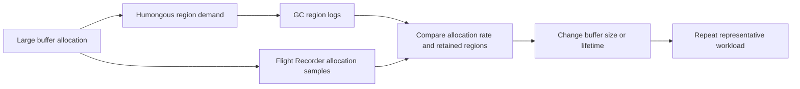

# Find and Reduce G1 Humongous Allocations

Author: [nawazdhandala](https://www.github.com/nawazdhandala)

Tags: Java, Garbage Collection, Performance

Description: Identify large G1 allocations with region logs and Flight Recorder, distinguish allocation pressure from retention, and test smaller buffers before changing region size.

A service can allocate temporary buffers that are large enough to bypass G1's ordinary young-object path. Those buffers may create old-generation pressure and leave unusable space at region boundaries, even when the application does not retain them for long.

Find the allocation site and object shape before changing heap-region settings. This guide uses Azul Zulu OpenJDK 17.0.16+8 with G1. A local buffer lab compared a single large array with smaller chunks and captured real Java Flight Recorder data. It did not reproduce a production fragmentation outage or measure application latency.

## Check the actual region size

G1 organizes the heap into equally sized regions. Humongous allocation is based on object size relative to a region, not a universal one-megabyte threshold. Oracle's [G1 overview](https://docs.oracle.com/en/java/javase/17/gctuning/garbage-first-g1-garbage-collector1.html) describes the special allocation path and the unused tail space that can remain in the final region.

For the exact OpenJDK 17 update examined here, the [allocation test in the source](https://raw.githubusercontent.com/openjdk/jdk17u/jdk-17.0.16%2B8/src/hotspot/share/gc/g1/g1CollectedHeap.hpp) uses an object size strictly greater than half a region. Include object headers and alignment when reasoning about a boundary: a byte array's payload length is not its full object size. Leave comfortable margin rather than designing buffers to sit exactly on the threshold.

With a one-MiB region, a 700-KiB byte array is clearly above the boundary. It occupies a humongous region despite leaving some unused space. An object spanning multiple regions requires a contiguous region run, so the placement of free regions can matter as well as their total capacity.

## Record region pressure before choosing a fix

On a staging instance already using G1, add this option to its existing startup command. Create a writable `logs` directory and replace the application filename:

```bash
java '-Xlog:gc*,gc+humongous=debug:file=logs/gc.log:time,uptime,level,tags' \
  -jar service.jar
```

This example is intended for a bounded diagnostic run. Add an appropriate rotation and retention policy before using it for a long-running service. Preserve the service's existing heap and collector settings. The [JDK 17 launcher manual](https://docs.oracle.com/en/java/javase/17/docs/specs/man/java.html) documents the logging selectors.

Check the startup `Heap Region Size` line, then inspect `Humongous regions: X->Y` around collections. These are region counts, not object counts or a direct measure of leaked bytes. Record both the peak and the remaining count after collections. A high allocation rate that quickly clears and a high retained count require different investigations.



Avoid declaring fragmentation from this counter alone. It establishes that the workload uses the special path; failures, region availability, and allocation requirements provide the additional evidence for fragmentation.

## Locate the code allocating the objects

Java Flight Recorder, or JFR, captures selected runtime events and stack traces. For a controlled startup recording, use the JDK's profile settings and write the result on process exit:

```bash
java -XX:StartFlightRecording=filename=allocation.jfr,settings=profile,dumponexit=true \
  -jar service.jar
```

Run this in staging with a writable destination and a bounded workload. It is a separate example of the recording option; combine it with the GC logging option when you need both in the same run. Treat recordings as diagnostic data with restricted access because they may contain application and environment details.

Inspect the resulting recording with the same JDK tools:

```bash
jfr summary allocation.jfr
jfr print --events jdk.ObjectAllocationSample --stack-depth 12 allocation.jfr
```

The [JFR command documentation](https://docs.oracle.com/en/java/javase/17/docs/specs/man/jfr.html) explains these filters. In the local lab, the recording contained 60 allocation samples, including `byte[]` allocations whose stack pointed to `BufferLab.main` at the large-array statement.

Do not interpret the sample's `weight` as the exact size of that one object. The [JDK event metadata](https://raw.githubusercontent.com/openjdk/jdk17u/jdk-17.0.16%2B8/src/hotspot/share/jfr/metadata/metadata.xml) defines it as a relative allocation weight. Use repeated stack samples to locate pressure, then inspect the allocation code and actual sizes. Sampling can miss short-lived or infrequent sites, so absence from a short recording is not proof of absence.

## Reproduce the object-shape change locally

The accompanying [BufferLab.java](./BufferLab.java) keeps eight recent payloads and performs 1,000 replacements. Its `large` mode allocates one 700-KiB array per payload. Its `chunks` mode allocates five 128-KiB arrays and one 60-KiB array, retaining the same total payload bytes.

With JDK 17 installed, compile it in a disposable working directory:

```bash
javac BufferLab.java
java -Xms64m -Xmx64m -XX:+UseG1GC \
  '-Xlog:gc*,gc+humongous=debug:file=large.log:time,uptime,level,tags' \
  BufferLab large
java -Xms64m -Xmx64m -XX:+UseG1GC \
  '-Xlog:gc*,gc+humongous=debug:file=chunks.log:time,uptime,level,tags' \
  BufferLab chunks
```

The 64-MiB heap is intentionally a lab setting. The observed runs used one-MiB regions. The large-array run showed humongous-region counts reaching 59; the chunked run's reported humongous-region counts remained zero. The large run also had JFR enabled during the review, so these runs are not a controlled throughput comparison.

The experiment demonstrates a change in allocation classification. It does not show that chunking reduces the total live payload, guarantees lower pauses, or solves every fragmentation problem. The outer arrays and extra object headers also have costs.

## Prefer changes that remove unnecessary large allocations

Inspect serialization buffers, compression buffers, database result materialization, and code that assembles an entire response before writing it. When the consuming API supports streaming, process bounded chunks and release each chunk promptly. This can reduce both maximum object size and retained bytes.

If the API ultimately demands one contiguous array, splitting the input and concatenating it again may simply move the large allocation later. Check the whole path, including copies made by libraries. A “chunked” wrapper around a large final buffer does not remove that final buffer.

Review pools carefully. Reusing a bounded buffer can lower allocation rate, but retaining an unbounded collection of oversized buffers can increase old-generation occupancy. Measure pool capacity, object lifetime, and peak request concurrency rather than assuming reuse always saves memory.

## Treat region-size changes as an experiment

Increasing region size raises the humongous threshold and may change how the same object is handled. It also changes G1's collection granularity. Oracle's [G1 tuning guidance](https://docs.oracle.com/en/java/javase/17/gctuning/garbage-first-garbage-collector-tuning.html) discusses region size as one possible response to large-object pressure, not a substitute for understanding allocations.

Before a trial, record the chosen region size, heap budget, large-object distribution, and workload. Change one setting, restart in staging, and compare retained regions, collection behavior, throughput, and request latency. Keep the same recording settings in both sides of a performance comparison.

The local review compiled and ran both buffer modes, parsed their region summaries, and successfully printed JFR allocation stacks. No live service, heap dump, region-size tuning, or sustained latency comparison was performed. Use the evidence to decide whether object size, lifetime, or collector layout is the next variable to investigate, then verify the change under the workload that actually matters.
