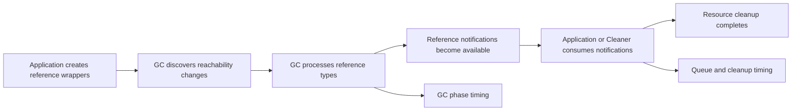

# Investigate G1 Pauses from Weak, Soft and Phantom References

Author: [nawazdhandala](https://www.github.com/nawazdhandala)

Tags: Java, Garbage Collection, Troubleshooting

Description: Identify G1 reference-processing costs, separate GC work from cleanup queues, and test reference-heavy workloads before changing parallel-processing flags.

A cache may retain relatively little useful data while creating hundreds of thousands of reference wrappers. A cleanup registry may register a phantom reference for every small resource. Both patterns can add work to garbage collection, but a slow cleanup thread is not automatically a long GC pause.

Investigate the phase that actually consumed time, then identify the reference population responsible. This guide uses G1 on Azul Zulu OpenJDK 21.0.13.1+2. The included lab verifies log fields and reference behavior; it does not reproduce a production latency incident or prove that a particular tuning change improves performance.

## Understand what the collector processes

A reference wrapper is a Java object pointing to another object, called its referent. The wrapper and the referent have separate lifetimes. Keeping a weak-reference wrapper in a registry does not keep its referent strongly reachable, but it does keep the wrapper itself alive.

| Reference type | Typical purpose | Diagnostic question |
|---|---|---|
| Soft | Memory-sensitive cached values | Does a large cache create unpredictable retention and clearing work? |
| Weak | Mappings that should not keep referents alive | Are stale wrappers removed from the owning structure? |
| Phantom | Notification used for resource cleanup | Are registrations bounded and cleanup consumers keeping up? |

The [Java reference package documentation](https://docs.oracle.com/en/java/javase/21/docs/api/java.base/java/lang/ref/package-summary.html) defines these reachability rules. A reference queue does not retain every reference merely because it was registered. Applications that need notifications must keep the reference objects reachable themselves until they are no longer needed.

Avoid treating reference count as equivalent to bytes retained. Many small wrappers can mean substantial processing work, while a few references may point to large objects. You need both object-population evidence and timing evidence.

## Separate three parts of the lifecycle



The `Reference Processing` phase belongs to collector work. Queue consumption and application cleanup can happen later. A database close operation blocked on a cleaner thread should not be labeled GC pause time merely because GC initiated the notification chain.

The [Cleaner contract](https://docs.oracle.com/en/java/javase/21/docs/api/java.base/java/lang/ref/Cleaner.html) describes a separate thread that performs cleaning actions. Blocking one action can delay other actions on the same cleaner. It also warns against cleaning state that strongly references the object being cleaned, which prevents the intended automatic cleanup.

## Capture enough detail to attribute a pause

In a controlled staging run, enable GC logs with reference detail. Replace the JDK path and application JAR below; use a writable directory with an appropriate retention policy:

```bash
JDK21=/path/to/jdk-21.0.13.1
mkdir -p gc-review
"$JDK21/bin/java" -XX:+UseG1GC \
  '-Xlog:gc*,gc+ref*=debug:file=gc-review/gc.log:time,uptime,level,tags:filecount=5,filesize=20M' \
  -jar /path/to/service.jar
```

Preserve the service's normal heap and application arguments when adapting this launch example. The added logging exposes reference subphases and counts, while rotation bounds the individual log files. Verify logging overhead under your workload before leaving detailed output enabled indefinitely. The [Java launcher reference](https://docs.oracle.com/en/java/javase/21/docs/specs/man/java.html) documents logging selectors and output options.

Group lines by GC identifier within one JVM lifetime. Compare the parent reference-processing duration with the complete pause duration for that collection. Do not add a parent duration to all its child phases; that double-counts time. Likewise, worker sums are not necessarily elapsed pause time.

A local weak-reference run produced this excerpt:

```text
GC(0) Reference Processing: 0.6ms
GC(0)   WeakReference Discovered: 100001, Dropped: 1, Processed: 100000
```

This confirms that the reference population reached the relevant phase. It is not a long-pause reproduction. If reference processing is a small fraction of the problematic pause, investigate other phases instead of tuning it because the count looks large.

## Reproduce the reference types independently

The companion `ReferenceLab.java` constructs 100,000 reference wrappers around small byte arrays. It keeps the wrappers in a list, requests one collection, waits briefly, and polls the notification queue. Select one type per process so the resulting logs are easy to interpret:

```bash
JDK21=/path/to/jdk-21.0.13.1
"$JDK21/bin/javac" ReferenceLab.java
mkdir -p reference-lab
for kind in weak soft phantom; do
  "$JDK21/bin/java" -XX:+UseG1GC -Xms256m -Xmx256m \
    "-Xlog:gc*,gc+ref*=debug:file=reference-lab/$kind.log:time,uptime,level,tags" \
    -cp . ReferenceLab "$kind"
done
```

All three modes completed locally. The weak and phantom runs each drained 100,000 notifications; the soft run drained none because this run did not force memory-sensitive clearing. That is an observation, not an API promise about the exact number available after 200 milliseconds.

The lab deliberately calls `System.gc()` to make inspection easier. Do not add that call to a request path as a reference-cleanup strategy. Its Full GC also means the lab's timing is not a substitute for studying your young or mixed collection pauses.

Polling removes notifications from the queue. The [ReferenceQueue API](https://docs.oracle.com/en/java/javase/21/docs/api/java.base/java/lang/ref/ReferenceQueue.html) does not expose a general queue-size counter. In a real registry, track registrations, completed cleanup and outstanding ownership using the application's own accounting. Do not drain a production queue with a diagnostic consumer that competes with its real cleanup logic.

## Inspect defaults before changing threads

Oracle's [G1 tuning guide](https://docs.oracle.com/en/java/javase/21/gctuning/garbage-first-garbage-collector-tuning.html) explains that reference processing can be parallelized, with worker selection influenced by reference count and bounded by GC worker availability. On the tested runtime, `ParallelRefProcEnabled` was already true.

```bash
"$JDK21/bin/java" -XX:+UseG1GC -XX:+PrintFlagsFinal -version
```

This starts a diagnostic JVM. It does not inspect the flags of an existing service. Check the corresponding entry, then verify that your real deployment does not explicitly disable it.

A separate lab run with `-XX:-ParallelRefProcEnabled` still drained all weak notifications. That verifies functionality under the alternative mode, not a timing recommendation. Repeated representative tests are needed to compare wall-clock pause distributions.

`ReferencesPerThread` was an experimental option with value 1000 in this build, visible after unlocking experimental options. Do not blindly copy threshold settings between releases. Increasing worker use can be unhelpful when the process is CPU-throttled, and small populations may not justify coordination overhead.

## Reduce the work at its source

Trace the dominant wrapper population to its owner. For a weak registry, check whether cleared entries remain in long-lived collections. For a soft cache, consider explicit size and eviction limits so retention is predictable. For phantom cleanup, reduce unnecessary registration churn and use the library's explicit close or release lifecycle where available.

Compare one change at a time against the same traffic and dataset. Record reference counts, phase durations, full request latency, allocation rate and CPU availability. If cleanup remains slow while GC reference phases are short, investigate the consumer and resource-release path separately.

Accept a change only when the relevant pause distribution improves without introducing unbounded registry growth, lost notifications or delayed resource release. A lower reference count is useful evidence; correct cleanup and better application behavior are the actual result you need.
