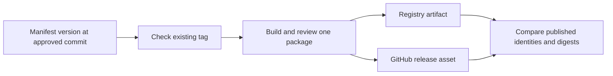

# Keep Git Tags, GitHub Releases, and Package Versions Consistent

Author: [nawazdhandala](https://www.github.com/nawazdhandala)

Tags: Open Source, Git, CI/CD

Description: Tie a release version to one source commit and reviewed package artifact, then verify tags, release assets, and registry metadata agree.

The repository says version 1.4.0. GitHub advertises a release named 1.4.0. The installed package reports 1.3.9. Each publishing step may have succeeded, yet users received something different from what maintainers intended.

Avoid maintaining three independent version decisions. Choose one version authority, derive the other labels, and bind the release to exact source and artifact identities. This article uses an npm package to make that relationship concrete; the same release record can include other registries with their own rules.

## Choose an authority and document the mapping

For this example, `package.json` is the version authority. The Git tag must be `v` followed by that version, and the GitHub Release must use that existing tag. npm identifies a package through its name and version. [Package metadata](https://docs.npmjs.com/cli/v11/configuring-npm/package-json/).

| Surface | Required relationship |
| --- | --- |
| Source manifest | Version `1.4.0` at the approved commit |
| Git tag | `v1.4.0` resolves to that same commit |
| GitHub Release | Uses `v1.4.0`; assets match the reviewed artifact list |
| npm package | Expected name, version `1.4.0`, and accepted tarball integrity |
| Release record | Source commit, tag, version, artifact digests, and validation results |

A GitHub Release includes release information and downloadable assets and is based on a Git tag. Its display title and publication time are not substitutes for checking the tag's source commit. [About GitHub Releases](https://docs.github.com/en/repositories/releasing-projects-on-github/about-releases).

Other projects derive versions from tags instead. That can work, but avoid a loop where one job changes the manifest, another guesses the tag, and a third infers a version from the newest release page. Document one direction of derivation.

## Reject a mismatched checkout before packaging

The following guard was exercised with **Node.js 24.1.0**, **npm 11.10.0**, and **Git 2.54.0**. It assumes a single package at the repository root. The selected tag must already exist locally, so fetch the intended tag in your controlled CI checkout before running it.

Save the guard as a reviewed CI helper named `check-release.mjs`. If you keep it in the project, commit it before tagging. An untracked helper inside the checkout will correctly make the clean-state check fail:

```javascript
import assert from 'node:assert/strict';
import {readFileSync} from 'node:fs';
import {execFileSync} from 'node:child_process';

const git = (...args) => execFileSync('git', args, {encoding: 'utf8'}).trim();
const pkg = JSON.parse(readFileSync('package.json', 'utf8'));
const tag = process.env.RELEASE_TAG;
assert.equal(typeof pkg.version, 'string', 'Missing package version');
assert.equal(tag, `v${pkg.version}`, 'Tag and package version differ');
assert.equal(git('status', '--porcelain', '--untracked-files=all'), '',
  'Start from a clean checkout');
const commit = git('rev-parse', '--verify', 'HEAD^{commit}');
const tagged = git('rev-parse', '--verify', '--end-of-options',
  `refs/tags/${tag}^{commit}`);
assert.equal(tagged, commit, 'Tag does not point to this checkout');
console.log(JSON.stringify({name: pkg.name, version: pkg.version, tag, commit}));
```

The `^{commit}` suffix resolves an annotated tag to its commit rather than comparing the tag object's identifier with `HEAD`. `--end-of-options` prevents the following argument from becoming another command option. The script executes Git with argument arrays rather than constructing a shell command. [Git revision verification](https://git-scm.com/docs/git-rev-parse), [Node child processes](https://nodejs.org/download/release/v24.1.0/docs/api/child_process.html).

From the package root, select the release explicitly:

```bash
RELEASE_TAG=v1.4.0 node /review-tools/check-release.mjs
```

Replace the helper path and tag with reviewed values. Success prints the name, version, tag, and commit as JSON. Missing tags, different commits, version mismatches, modified tracked files, and ordinary untracked files stop the guard.

This is a consistency check, not tag-signature verification or full semantic-version validation. It also does not inspect ignored files. Start with a fresh controlled checkout and review the final package contents; clean Git status alone is not proof that every packable file is approved. [Git status behavior](https://git-scm.com/docs/git-status).

## Package once and inspect the actual archive

For an isolated exercise, use this manifest and an ordinary `index.js` file in a disposable repository:

```json
{
  "name": "release-version-demo",
  "version": "1.4.0",
  "private": true,
  "files": ["index.js"]
}
```

The `private` flag intentionally blocks accidental npm publication of the fixture. A real publishable package needs an explicitly reviewed publication configuration. The `files` list limits intended package content, but npm also has documented inclusion rules for files such as its manifest. [Package file selection and private flag](https://docs.npmjs.com/cli/v11/configuring-npm/package-json/).

Create an output directory outside the checkout, then run:

```bash
npm pack --ignore-scripts --json --pack-destination /review/output
```

The output directory must exist. This example has no build lifecycle hooks, so suppressing scripts is intentional. If your real package relies on `prepare` or `prepack`, use its reviewed build procedure and inspect the resulting artifact; blindly suppressing required steps can package stale or missing code. [Pinned npm pack command](https://raw.githubusercontent.com/npm/cli/v11.10.0/docs/lib/content/commands/npm-pack.md).

Retain the JSON report. For npm 11.10.0 it includes the package identity, filename, file list, and integrity value. Inspect the archive's embedded `package.json`, not just the source file beside it. The version and name must agree with the guard record, and every included file should belong to the release. [Pinned pack implementation](https://raw.githubusercontent.com/npm/cli/v11.10.0/lib/commands/pack.js).

Use that reviewed tarball as the publication input and as the matching GitHub asset when distributing the same package there. Rebuilding separately in each publishing job introduces another opportunity for the artifacts to diverge.



## Treat channels as movable pointers

An npm distribution tag such as `latest` or `next` is a label pointing to a package version. It is not the version itself and is separate from a Git tag. A prerelease should be assigned to the intended registry channel rather than accidentally promoted through an assumed default. [npm distribution tags](https://docs.npmjs.com/cli/v11/commands/npm-dist-tag/).

After an authorized publication, inspect the exact package version using the intended registry configuration:

```bash
npm view '@YOUR-SCOPE/YOUR-PACKAGE@1.4.0' version dist.integrity dist.tarball --json
```

Replace the package identity and version. This reads registry metadata; it does not publish or modify the package. Compare the reported integrity with the retained packaging record and verify the downloaded archive before accepting it. A successful metadata lookup alone is not a runtime test of the installed package. [npm view](https://docs.npmjs.com/cli/v11/commands/npm-view/).

Keep channel movement separate from artifact creation. If a registry rejects publication because the version already exists, check whether the existing artifact is the one previously accepted. Do not respond by replacing the Git tag or silently creating different bytes under an old release story.

## Plan for partial publication

Git hosting and a package registry do not form one atomic transaction. A registry upload can succeed while a GitHub asset upload fails. Record the successful step and retry only the missing distribution step with the same accepted bytes.

For the public npm registry, the documented name-and-version pair cannot be reused once published, even after unpublishing. A bad released artifact generally needs a new version and a clear correction rather than a changed source tag. [Pinned npm publication rules](https://raw.githubusercontent.com/npm/cli/v11.10.0/docs/lib/content/commands/npm-publish.md).

Where enabled, GitHub immutable releases lock the associated tag and attached assets after publication. Prepare a draft with all intended assets before publishing it. Verify the repository's actual setting; do not assume every historical release has this protection. [Immutable releases](https://docs.github.com/en/code-security/concepts/supply-chain-security/immutable-releases), [enabling immutability](https://docs.github.com/en/code-security/how-tos/secure-your-supply-chain/establish-provenance-and-integrity/prevent-release-changes).

Before announcing the release, reconcile the source commit, version, tag, registry integrity, GitHub assets, and installation result from a clean consumer environment. Record any platform-specific packages individually rather than pretending one digest describes every binary.

The local fixture validated an annotated tag and rejected a mismatched version, untracked file, modified source, and checkout at the wrong commit. It also checked the packed manifest, file inventory, and SHA-512 integrity. No package was published and no GitHub Release was created. Those external checks remain part of the real release handoff, after the local consistency guard has passed.
