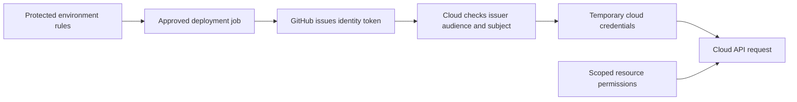

# Authenticate GitHub Actions to AWS, Azure, and GCP with OIDC

Author: [nawazdhandala](https://www.github.com/nawazdhandala)

Tags: GitHub Action, OIDC, Cloud Automation

Description: Replace stored cloud keys with scoped GitHub Actions federation, using explicit trust rules and separate AWS, Azure, and Google Cloud identities.

A deployment job needs permission to do its work. It does not necessarily need a cloud password stored in GitHub. OpenID Connect (OIDC) lets GitHub issue a signed identity token for a particular job. A cloud identity service checks that token and exchanges it for temporary credentials.

The important design decision is which jobs the cloud should trust. Replacing an administrator key with a federated administrator identity preserves most of the original risk. Start with one repository, one protected deployment environment, and one narrowly authorized identity in each cloud.

This walkthrough targets GitHub.com and the public commercial clouds. It provides a source-checked workflow, not a claim of successful deployment in your accounts. Establish cloud trust with your existing administrative process before running it.

## Understand the two permission boundaries

Authentication answers who the job is. Authorization answers what that identity may do. Configure both:



The **issuer** identifies the token signer. The **audience** identifies the intended recipient. The **subject** identifies the workload being trusted. A successful token exchange does not prove that a deployment has permission to update its target.

Keep cloud identities separate. An AWS role, an Azure application identity, and a Google service account have independent permissions and audit records. A compromise in one job should not automatically supply credentials for every cloud.

## Write down the trust contract first

Create a GitHub environment called `production`, restrict its deployment branches to the intended release branch, and configure required review where your plan supports it. Review workflow changes as deployment authority: code executed after login can use the job's credentials. Pin third-party actions to reviewed commit hashes. [GitHub's secure-use guidance](https://docs.github.com/en/actions/reference/security/secure-use) explains these workflow risks.

Record the expected issuer as `https://token.actions.githubusercontent.com`. Obtain the exact subject for the intended job from your repository's OIDC configuration and a controlled diagnostic run; never publish the complete token.

Do not assume every repository still uses `repo:ORG/REPO:environment:production`. GitHub documents an immutable format containing owner and repository IDs for repositories created after July 15, 2026, and for subsequent renames or transfers. Older repositories can retain the previous format. Custom subject templates also change the result. An environment subject does not itself impose a branch restriction; configure that restriction on the environment. [Check GitHub's current subject rules](https://docs.github.com/en/actions/reference/security/oidc).

Use this worksheet before changing any cloud policy:

| Setting | AWS | Azure public cloud | Google Cloud |
|---|---|---|---|
| Intended identity | Dedicated IAM role | Entra app and its service principal | Dedicated service account for this example |
| Token audience | `sts.amazonaws.com` | `api://AzureADTokenExchange` | Full workload identity provider identifier used by the action |
| Workload restriction | Exact subject in role trust | Exact subject in federated credential | Provider condition plus narrowly scoped service-account binding |
| Resource authority | Role permissions | Azure role assignment at intended scope | Service-account resource roles |

These values belong to different exchanges. Do not copy Azure's audience into the AWS action just because both use OIDC.

## Configure AWS trust and permissions

Register GitHub's OIDC provider in the target AWS account. Give the deployment role a trust policy shaped like this, replacing the account and subject placeholders before use:

```json
{
  "Version": "2012-10-17",
  "Statement": [{
    "Effect": "Allow",
    "Principal": {
      "Federated": "arn:aws:iam::ACCOUNT_ID:oidc-provider/token.actions.githubusercontent.com"
    },
    "Action": "sts:AssumeRoleWithWebIdentity",
    "Condition": {
      "StringEquals": {
        "token.actions.githubusercontent.com:aud": "sts.amazonaws.com",
        "token.actions.githubusercontent.com:sub": "EXACT_PRODUCTION_SUBJECT"
      }
    }
  }]
}
```

This allows the token exchange, not deployment operations. Attach a separate permissions policy limited to the actual deployment resources and actions. Avoid a repository wildcard as a workaround for a mismatched subject. The [GitHub AWS guide](https://docs.github.com/en/actions/how-tos/secure-your-work/security-harden-deployments/oidc-in-aws) documents the provider, audience, and subject condition.

## Configure Azure federation

For this example, use an Entra application registration with its service principal. Add a standard federated identity credential to that application with these fields:

```json
{
  "name": "github-production",
  "issuer": "https://token.actions.githubusercontent.com",
  "subject": "EXACT_PRODUCTION_SUBJECT",
  "audiences": ["api://AzureADTokenExchange"]
}
```

This is the credential document, not a shell command. The subject must match the job exactly. Assign the service principal only the required Azure resource role at the appropriate resource or resource-group scope. Federation does not create that role assignment. Save the application's client ID, tenant ID, and subscription ID for the workflow. These identifiers do not replace a password because there is no password in this exchange. Follow Microsoft's [application federation procedure](https://learn.microsoft.com/en-us/entra/workload-id/workload-identity-federation-create-trust).

## Configure Google Cloud federation

Create a workload identity pool and OIDC provider with the GitHub issuer. Map `google.subject=assertion.sub`; also map the repository and owner ID claims when using them in conditions or bindings. Restrict the provider to the intended numeric owner ID, repository ID, and exact production subject. Numeric IDs avoid trusting a later repository that reuses an old name.

This example uses service-account impersonation. Grant the intended federated principal `roles/iam.workloadIdentityUser` on the chosen service account, then grant that service account narrowly scoped permissions on the deployment resources. Do not grant the whole pool access to every deployment account. Google's [deployment federation guide](https://docs.cloud.google.com/iam/docs/workload-identity-federation-with-deployment-pipelines) covers mappings, conditions, API prerequisites, and bindings.

Direct federation is another supported path; it authorizes the external identity on resources without this service-account hop. Choose the model deliberately instead of mixing the two sets of IAM instructions.

## Run separate login jobs

Save this as `.github/workflows/cloud-login.yml`. Define the referenced environment variables under the `production` environment's GitHub **configuration variables**. Use your actual role ARN, account ID, region, Azure identifiers, Google project ID, service-account email, and full provider identifier. None is a long-lived credential.

The hashes below resolve to AWS credentials action **5.1.0**, Azure login **2.3.0**, Google auth **3.0.0**, and checkout **4.2.2**. They are explicit example versions, not a claim that they are the latest. Google auth's tagged `action.yml` uses Node 24; provision compatible runners when self-hosting.

```yaml
name: Cloud login checks
on:
  workflow_dispatch:
permissions: {}
jobs:
  aws:
    runs-on: ubuntu-24.04
    environment: production
    permissions:
      id-token: write
    steps:
      - uses: aws-actions/configure-aws-credentials@00943011d9042930efac3dcd3a170e4273319bc8
        with:
          role-to-assume: ${{ vars.AWS_ROLE_ARN }}
          aws-region: ${{ vars.AWS_REGION }}
          allowed-account-ids: ${{ vars.AWS_ACCOUNT_ID }}
          unset-current-credentials: true
          audience: sts.amazonaws.com
      - run: aws sts get-caller-identity
  azure:
    runs-on: ubuntu-24.04
    environment: production
    permissions:
      id-token: write
    steps:
      - uses: azure/login@a457da9ea143d694b1b9c7c869ebb04ebe844ef5
        with:
          client-id: ${{ vars.AZURE_CLIENT_ID }}
          tenant-id: ${{ vars.AZURE_TENANT_ID }}
          subscription-id: ${{ vars.AZURE_SUBSCRIPTION_ID }}
          audience: api://AzureADTokenExchange
      - run: az account show --query '{subscription:id,tenant:tenantId}' --output json
  google:
    runs-on: ubuntu-24.04
    environment: production
    permissions:
      contents: read
      id-token: write
    steps:
      - uses: actions/checkout@11bd71901bbe5b1630ceea73d27597364c9af683
        with:
          persist-credentials: false
      - uses: google-github-actions/auth@7c6bc770dae815cd3e89ee6cdf493a5fab2cc093
        with:
          project_id: ${{ vars.GCP_PROJECT_ID }}
          workload_identity_provider: ${{ vars.GCP_WIF_PROVIDER }}
          service_account: ${{ vars.GCP_SERVICE_ACCOUNT }}
          token_format: access_token
          create_credentials_file: false
```

The AWS [identity check](https://docs.aws.amazon.com/cli/latest/reference/sts/get-caller-identity.html) reports the assumed identity; Azure [account show](https://learn.microsoft.com/en-us/cli/azure/account#az-account-show) reports the selected subscription and tenant. Google's action requests an impersonated access token without writing a credentials file. Do not print that token. A deployment tool may instead need the action's credentials file; enable it deliberately and exclude `gha-creds-*.json` from artifacts and images.

Inputs and credential behavior are documented in the pinned [AWS action](https://github.com/aws-actions/configure-aws-credentials/tree/v5.1.0), [Azure action](https://github.com/Azure/login/tree/v2.3.0), and [Google action](https://github.com/google-github-actions/auth/tree/v3.0.0); the latter's [runtime declaration](https://github.com/google-github-actions/auth/blob/v3.0.0/action.yml) is authoritative for Node compatibility. Checkout precedes Google authentication as its documentation requires.

## Prove the boundary before removing keys

First run the authorized job and verify the resulting identity against the worksheet. Then perform a narrowly scoped read of a known deployment resource. Login success alone is not a resource-permission test.

In a disposable test configuration, prove that a different repository, an unapproved environment, and a disallowed branch cannot acquire the production identity. Distinguish an environment gate blocking the job from the cloud rejecting its token; record which boundary rejected each case.

Finally remove static-key inputs and fallback credential paths, disable the old keys through your normal change process, and rerun the required workflows. Keep an independently controlled recovery identity. Review cloud audit events alongside the workflow run ID. Temporary credentials reduce secret storage, while explicit trust and resource permissions determine the actual security boundary.

The published YAML and JSON were parsed locally, and action inputs and hashes were checked against official tagged metadata. No GitHub workflow or cloud login was executed for this article.
