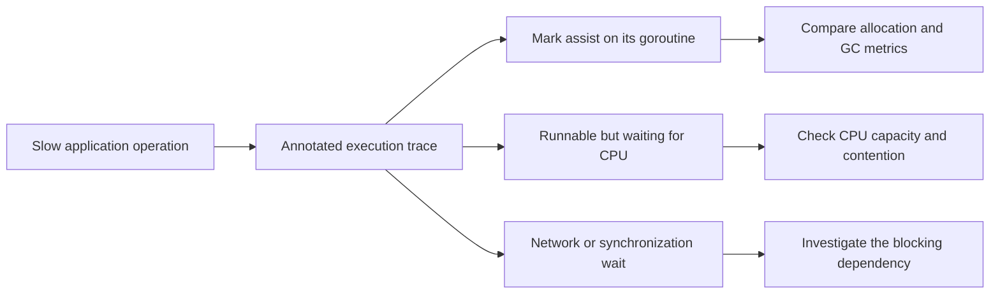

# Diagnose Go GC Assist Latency with Runtime Traces

Author: [nawazdhandala](https://www.github.com/nawazdhandala)

Tags: Go, Garbage Collection, Performance

Description: Connect slow allocation paths to GC mark assists using annotated execution traces, then interpret assist CPU and limiter metrics without confusing them with pause time.

A request can spend time helping the garbage collector even when stop-the-world pauses are short. Go's allocator may make an allocating goroutine perform GC work so collection keeps up. That work is called a mark assist, and it can sit directly on the request's critical path.

A rising assist metric is a clue, not proof that assists caused a particular slow request. To make that connection, combine a short execution trace with application timing and runtime metrics. This guide uses Go 1.25.0 and a locally tested allocation lab. It does not claim to measure a real HTTP service or establish a universal latency threshold.

## Distinguish three kinds of delay

A stop-the-world pause stops application execution for a coordinated runtime operation. A mark assist charges some collection work to an allocating goroutine. Scheduler delay is time a runnable goroutine waits before it can execute. These can appear near one another without being the same event.

The [Go GC guide](https://go.dev/doc/gc-guide) describes allocation-related latency and the memory/CPU tradeoff. More allocation or less memory headroom can increase the pressure that makes assists relevant. But an application blocked on a database will not become fast merely because you reduce allocation elsewhere.



Follow the operation through its actual states. The presence of GC activity somewhere in the process is not enough to attribute the operation's full duration to GC.

## Establish whether assist pressure is increasing

Track `/cpu/classes/gc/mark/assist:cpu-seconds` over time, along with total GC CPU, allocation rate, live heap and heap goal. The assist value is cumulative, so compare changes over equal intervals and handle process restarts.

The [Go 1.25 metrics documentation](https://pkg.go.dev/runtime/metrics@go1.25.0) calls these CPU-class measurements estimates and says to compare them with other CPU-class metrics. Do not divide an assist estimate by an unrelated operating-system CPU sample and present the result as an exact percentage.

Record `/gc/limiter/last-enabled:gc-cycle` separately. It identifies the GC cycle when the CPU limiter last activated; zero means it has never activated. It is neither an activation count nor evidence that assists cannot occur when zero. Compare it with current collection progress before treating an old nonzero value as a current incident.

For a service investigation, preserve the configured `GOGC`, current `GOMEMLIMIT`, CPU restrictions, application build and traffic mix. Otherwise, a trace from one resource configuration may be compared accidentally with metrics from another.

## Add useful operation boundaries

The execution tracer can record a task spanning a logical operation and regions within a goroutine. For example, this integration pattern marks an allocation-heavy phase:

```go
ctx, task := trace.NewTask(request.Context(), "build-response")
defer task.End()

trace.WithRegion(ctx, "encode-response", func() {
    encodeResponse()
})
```

Here `request` and `encodeResponse` are placeholders for your existing handler and encoding function. Import `runtime/trace`. A region begins and ends in the same goroutine; use the task context when work crosses goroutine boundaries. The [runtime/trace API](https://pkg.go.dev/runtime/trace@go1.25.0) documents these relationships.

Use stable operation names instead of embedding user data or unique request identifiers in every region name. Capture only a bounded interval containing the problem, and assess tracing overhead. Do not change the workload so substantially that recording it creates the incident you are investigating.

## Generate a bounded trace locally

The companion `main.go` starts tracing, creates an `allocation-batch` task, and marks its short replacement loop as `allocate`. It retains 48 MiB of data and runs the loop for approximately 200 milliseconds under an intentionally restrictive memory budget. It then prints GC metrics and closes the trace through deferred cleanup.

Use a fresh development directory because the program creates `trace.out`:

```bash
GO125=/path/to/go1.25.0/bin/go
"$GO125" build -o assist-lab main.go
GOMAXPROCS=2 GOGC=100 GOMEMLIMIT=32MiB ./assist-lab
"$GO125" tool trace -d=parsed trace.out > trace-events.txt
```

The limit belongs to this diagnostic example, not to a recommended service deployment. Build before running so compilation is outside the trace. The source-verified Go 1.25 debug mode is `parsed`; older examples using numeric debug modes are not interchangeable. See the [tagged trace command source](https://raw.githubusercontent.com/golang/go/go1.25.0/src/cmd/trace/main.go).

The local run produced task and region boundaries, `GC mark assist` ranges, and an assist-related waiting state. Its assist CPU estimate was about 0.053 CPU-seconds, while the limiter metric remained zero. That establishes that traceable assists occurred without limiter activation in this run. It does not turn the estimate into measured request latency.

The text output is useful for confirming events exist. A raw count of matching lines is not a count of assists: begin, end and state-transition records can all mention them. Prefer the structured trace view for duration and goroutine attribution.

## Inspect the timeline and use profiles carefully

Open the same trace with a loopback-only viewer:

```bash
"$GO125" tool trace -http=127.0.0.1:8088 trace.out
```

Choose a slow annotated task, find its allocation region, and inspect the responsible goroutine. Identify intervals spent in assist work, waiting, running ordinary code and runnable-but-unscheduled states. Check whether other work on the critical path explains the rest of the duration. The browser timeline command is source-reviewed here; the local validation used parsed events rather than interactive browser inspection.

A scheduler profile provides a different view:

```bash
"$GO125" tool trace -pprof=sched trace.out > sched.pprof
"$GO125" tool pprof -top sched.pprof
```

Both commands ran successfully against the lab trace. This profile attributes scheduler latency, not total assist execution time. Seeing `runtime.gcAssistAlloc` in its stacks does not make every reported delay pure GC CPU. The trace command also supports network, synchronization and syscall profiles, which can help rule out alternative causes.

## Test a focused intervention

Use the evidence to choose one change. If a response builder repeatedly allocates large temporary objects, test streaming or bounded reuse. If queues retain too much live data, bound concurrency and backlog. If the heap goal is pinned near live data by an unrealistic memory limit, revisit the budget within the container's actual capacity.

Repeat the same workload with and without the intervention. Compare allocation volume, assist deltas, annotated operation duration, throughput and total memory. Keep a no-tracing performance run as well so diagnostic overhead does not become the reported improvement.

Accept the fix only when useful operation latency improves without excessive memory growth or another bottleneck taking over. Shorter pauses alone do not validate an assist-latency fix; the evidence should connect less work on the affected goroutine to better application behavior.
