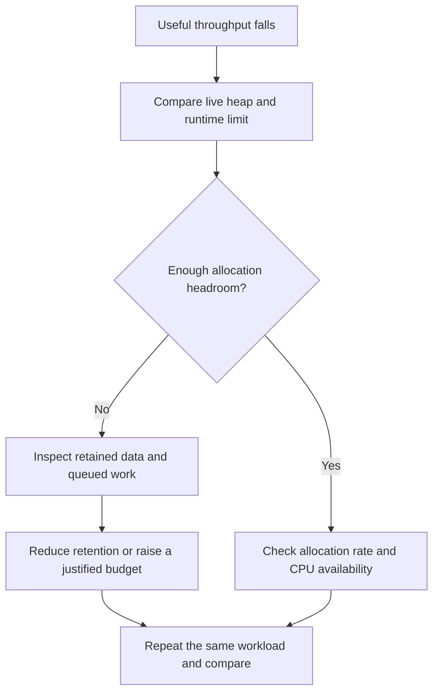

# Diagnose Go GC Thrashing When GOMEMLIMIT Is Too Low

Author: [nawazdhandala](https://www.github.com/nawazdhandala)

Tags: Go, Garbage Collection, Troubleshooting

Description: Recognize an impossible Go memory budget using live-heap, heap-goal and GC metrics, then recover useful work without blindly raising container risk.

The service still answers health checks, but useful throughput collapses. Collection runs repeatedly, memory barely falls, and lowering the memory setting makes matters worse. One possible cause is a `GOMEMLIMIT` smaller than the data the application must keep alive.

This is different from choosing an initial memory budget. During an incident, you need evidence that collection is being asked to reclaim memory it cannot reclaim, and a recovery action that fits the actual container. The bounded experiment below uses Go 1.25.0 on macOS ARM64. It demonstrates the symptom without claiming a production reproduction.

## Start with the live-data floor

Live heap means objects still reachable by the program at the previous collection. A collector cannot discard an active request queue, a retained cache entry or a slice still referenced by a global variable merely because a limit is too low.

The runtime also needs memory outside those objects. `GOMEMLIMIT` applies to runtime memory accounting, not just the live heap. Its documented approximation is total runtime memory minus heap memory released to the operating system. See [Go 1.25 SetMemoryLimit](https://pkg.go.dev/runtime/debug@go1.25.0#SetMemoryLimit).

If live objects alone occupy 48 MiB and the configured runtime budget is 32 MiB, no amount of ordinary collection can make the budget achievable while those objects remain live. The budget may also be impossible when the live heap is below the limit but stacks and other runtime allocations consume the remaining space.

## Assemble a small evidence set

Collect time series from the affected process, not isolated values from different replicas. Preserve the process start time so a restart does not look like a sudden counter improvement.

| Signal | Interpretation |
|---|---|
| `/gc/gomemlimit:bytes` | The runtime's current configured limit |
| `/gc/heap/live:bytes` | Objects marked live by the previous GC |
| `/gc/heap/goal:bytes` | Current heap target |
| `/gc/cycles/total:gc-cycles` | Counter used to calculate collection frequency |
| Runtime total minus released heap | Memory counted toward the limit |
| Completed requests and latency | Whether the application is making useful progress |

These runtime names are defined in [Go 1.25 runtime/metrics](https://pkg.go.dev/runtime/metrics@go1.25.0). A goal close to the live heap, frequent collections and little reclamation form a stronger diagnosis than high GC frequency alone. A service can legitimately collect frequently while maintaining good throughput.

Check CPU throttling and host contention separately. If the application receives less CPU than expected, both service work and GC can slow down. Do not assume a memory-setting change explains every rise in latency that happened around the same deployment.



## Reproduce the failure mode safely

The companion `main.go` retains 48 one-mebibyte byte slices, then replaces entries in a small allocation ring for approximately three seconds. It prints useful-work count and runtime metrics. It has no network listener and does not alter another process.

Build it once with the pinned Go toolchain. Run it outside production, on a development machine with enough memory for the experiment:

```bash
GO125=/path/to/go1.25.0/bin/go
"$GO125" build -o thrashing-lab main.go
GOMAXPROCS=2 GOGC=100 GOMEMLIMIT=32MiB ./thrashing-lab
GOMAXPROCS=2 GOGC=100 GOMEMLIMIT=96MiB ./thrashing-lab
```

`GOMAXPROCS=2` limits simultaneous Go execution in this experiment; it does not create a container CPU quota. The 32 MiB run intentionally has an impossible memory budget. The 96 MiB run changes only that budget. The [runtime environment documentation](https://pkg.go.dev/runtime@go1.25.0) describes these controls.

One local pair produced:

| Observation | 32 MiB limit | 96 MiB limit |
|---|---:|---:|
| Allocation iterations completed | 327,136 | 2,250,355 |
| GC cycles at final sample | 20,549 | 4,246 |
| Live heap at final sample | 50,609,152 bytes | 59,582,552 bytes |
| Heap goal at final sample | 50,609,152 bytes | 94,196,493 bytes |
| Last limiter-enabled cycle | 0 | 0 |

The constrained run made much less progress and ended with its goal equal to its live heap. It also exceeded its configured soft limit. This is expected behavior for an infeasible target, not proof that the environment variable was ignored.

These are single short runs. The loop mostly allocates pointer-free byte arrays, so it is not representative of every service's scanning cost. Counts and ratios vary with scheduling and runtime behavior. Use it to recognize the pattern, then repeat the analysis with the real allocation and retention profile.

## Interpret the GC CPU limiter correctly

Go has a safeguard that can let memory grow rather than spend excessive CPU trying to meet an impossible target. The [GC guide](https://go.dev/doc/gc-guide) describes a roughly 50-percent GC CPU limit over a runtime-defined window. This is not a guarantee that container memory stays below its hard limit, nor a universal bound on end-to-end request slowdown.

`/gc/limiter/last-enabled:gc-cycle` records the collection cycle when the safeguard last activated. It is not an activation counter or a boolean current-state indicator. Compare it with recent cycle progress; a nonzero old value can describe an earlier event. In this lab it remained zero, despite the constrained run's heavy collection activity. Do not require limiter activation before investigating a poor budget.

The lab also prints GC CPU estimates and mark-assist CPU. Assists are collection work performed by allocating goroutines. These runtime CPU-class estimates should be compared with compatible runtime CPU-class metrics, not treated as exact operating-system CPU measurements. A request may be delayed by assist work without a correspondingly large stop-the-world pause.

## Recover without moving the failure elsewhere

First check whether the deployment recently lowered `GOMEMLIMIT`, changed dataset size or increased concurrency. If a known-good budget still fits the container with measured headroom, restoring it is a reasonable controlled test. Do not raise it beyond the real memory boundary simply because throughput improves locally.

When memory cannot increase, reduce the live workload: cap queue length, bound caches, limit concurrent large operations or release retained request data sooner. Reject or defer excess work using the service's normal overload controls. A growing in-memory backlog can make GC pressure and latency reinforce each other.

Changing `GOGC` alone cannot remove data that must remain live. Similarly, repeatedly forcing collection is unlikely to repair a target below the live-data floor. Inspect ownership and retention before adding more collection work.

After the intervention, compare the same offered load and request mix. Look for recovered throughput, fewer unproductive collections, adequate space between live heap and goal, and stable container memory. Keep the test running through a peak and recovery period. A quieter GC graph is useful only if the service is completing work reliably within its real resource budget.
