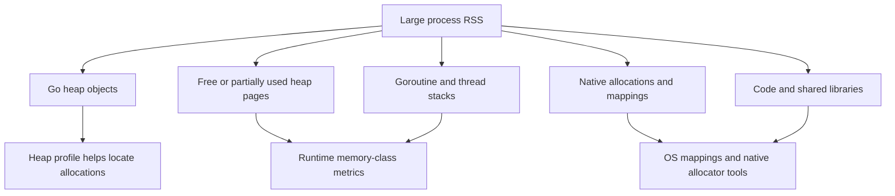

# Explain High Go RSS When pprof Shows a Small Heap

Author: [nawazdhandala](https://www.github.com/nawazdhandala)

Tags: Go, Garbage Collection, Troubleshooting

Description: Reconcile Go heap profiles with resident memory by checking free heap pages, stacks, mappings and native allocations before diagnosing a leak.

Your dashboard reports a large process, but the Go heap profile contains surprisingly little live data. Neither observation has to be wrong. A heap profile answers where sampled Go allocations came from; resident set size, or RSS, measures pages currently resident for the process. They describe different parts of memory at different times.

Start by aligning the measurements, then account for the difference. This guide includes a Go 1.25.0 allocation-and-release lab tested on macOS ARM64. Linux inspection commands are documentation-reviewed examples; no Linux RSS or cgo leak experiment was performed.

## Check which profile you are reading

A heap profile supports several sample types. `inuse_space` focuses on live allocated bytes, while `alloc_space` represents cumulative allocation, including memory already reclaimed. Comparing cumulative allocation to current RSS is not a useful leak test.

The [Go 1.25 pprof documentation](https://pkg.go.dev/runtime/pprof@go1.25.0) also explains that heap profiles normally reflect the most recently completed garbage collection. Very recent allocations can be absent, and sampling introduces estimation. Record the profile time, process identity and GC history before comparing it with a dashboard.

For a profile already collected through your approved diagnostic path, inspect it explicitly:

```bash
GO125=/path/to/go1.25.0/bin/go
"$GO125" tool pprof -top -sample_index=inuse_space \
  /path/to/matching-service-binary /path/to/heap.pprof
```

Use the binary matching the running build so symbolization is meaningful. This reads existing artifacts and does not force collection in the service. The [Go diagnostics guide](https://go.dev/doc/diagnostics) describes the profiling workflow. Avoid adding a publicly reachable profiling endpoint just to investigate memory.

## Build an accounting map



This is an investigation map, not an equation whose boxes can simply be added. Runtime accounting, sampled profiles and OS resident-page accounting are not interchangeable.

Read Go's memory classes alongside the profile. `heap/free` identifies completely free pages not yet released; `heap/released` identifies pages returned to the underlying system. `heap/unused` covers reserved space within heap-object allocation areas that is not occupied by objects. `heap/stacks` accounts for goroutine stack reservations. The [versioned runtime metrics reference](https://pkg.go.dev/runtime/metrics@go1.25.0) defines their boundaries.

A useful first split is whether Go's own total-minus-released accounting is also large. If it is, inspect the runtime categories. If it is relatively small while RSS grows, investigate mappings and allocations outside those categories.

## Distinguish collection from returning pages

Collection discovers unused objects and makes their storage reusable. Scavenging returns suitable unused memory to the operating system. These steps do not have to occur simultaneously, and partially occupied pages may remain necessary even after many objects disappear.

The companion `main.go` allocates and touches a 128 MiB slice, releases its reference, requests a GC, writes a heap profile, and finally calls `debug.FreeOSMemory()`. Run it in a development directory with enough available memory:

```bash
GO125=/path/to/go1.25.0/bin/go
"$GO125" build -o rss-accounting-lab main.go
./rss-accounting-lab
"$GO125" tool pprof -top -sample_index=inuse_space \
  ./rss-accounting-lab ./heap.pprof
```

It writes `heap.pprof` in the current directory. Use a fresh directory if that filename already contains evidence you need to preserve.

In the local run, heap-object accounting fell from about 128 MiB to roughly 173 KiB after GC, while approximately 128 MiB appeared as free heap memory. After `FreeOSMemory`, most of that free memory moved into the released category. The profile could be read successfully and no longer attributed the large retained slice as live data.

This verifies the accounting transition, not a Linux RSS reduction. Sampling also meant the profile's estimated total did not equal the runtime's exact object-accounting value. Do not force those two numbers to match.

The [FreeOSMemory API](https://pkg.go.dev/runtime/debug@go1.25.0#FreeOSMemory) forces GC and then attempts to return memory; the runtime also returns memory in the background. Treat the explicit call as a controlled diagnostic experiment, not a timer to add indiscriminately to production. Repeatedly discarding reusable pages can change allocation cost and latency.

## Check stacks and concurrency

If stack memory grows with goroutine count, inspect what those goroutines are waiting for. A queue of blocked requests may retain both stacks and request objects. Reducing the number of objects in a cache will not address thousands of goroutines waiting on an unavailable dependency.

Compare a goroutine profile before and during the increase. Look for repeated stacks associated with unbounded fan-out, missing cancellation or blocked channel operations. Measure after the work drains as well as during the peak; one burst does not establish a leak.

OS thread stacks require separate care in cgo programs. Go's documented OS-stack metric does not comprehensively account for all native thread stacks. A small stack metric therefore does not rule out native thread growth. Check the process's thread population and the native library's threading behavior.

## Inspect Linux mappings without changing the process

On Linux, use the PID as seen in the same PID namespace as the inspection shell. The account must have permission to read the target's proc files:

```bash
service_pid=12345  # Replace with the verified service PID.
cat "/proc/$service_pid/status"
cat "/proc/$service_pid/smaps_rollup"
```

Review RSS, anonymous versus file-backed memory, shared mappings and thread count. `smaps_rollup` summarizes mapping statistics; use `smaps` for mapping-level detail when necessary. Reading mapping information has overhead, so avoid tight polling loops. The [Linux proc documentation](https://www.kernel.org/doc/html/latest/filesystems/proc.html) describes these fields and their consistency limitations.

RSS includes shared resident pages; proportional set size distributes shared pages among mappings/processes according to its accounting rules. Container memory usage is another measurement with a different boundary. Do not subtract a whole pod's memory from one process's heap profile and call the remainder a native leak.

## Investigate cgo and native ownership

C libraries can allocate memory that never appears as a Go heap allocation. Go's [memory-limit contract](https://pkg.go.dev/runtime/debug@go1.25.0#SetMemoryLimit) explicitly excludes allocations managed outside the runtime. Reducing `GOGC` cannot reclaim a native buffer still owned by a library.

Correlate growth with specific native operations: image conversion, compression, database calls or foreign-function batches. Inspect the library's documented release API and allocator statistics. Check both missing releases and allocator retention after releases; these require different remedies. Use native profiling tools appropriate to the library and platform rather than expecting Go pprof to identify every allocation.

Finish the investigation with a timeline: workload, heap profile, runtime classes, RSS or mapping summaries, goroutines and native activity. Stable live Go data with falling free pages suggests a different explanation from steadily growing native mappings. Name the category supported by the evidence before changing GC policy, and validate the fix with the same workload that produced the discrepancy.
