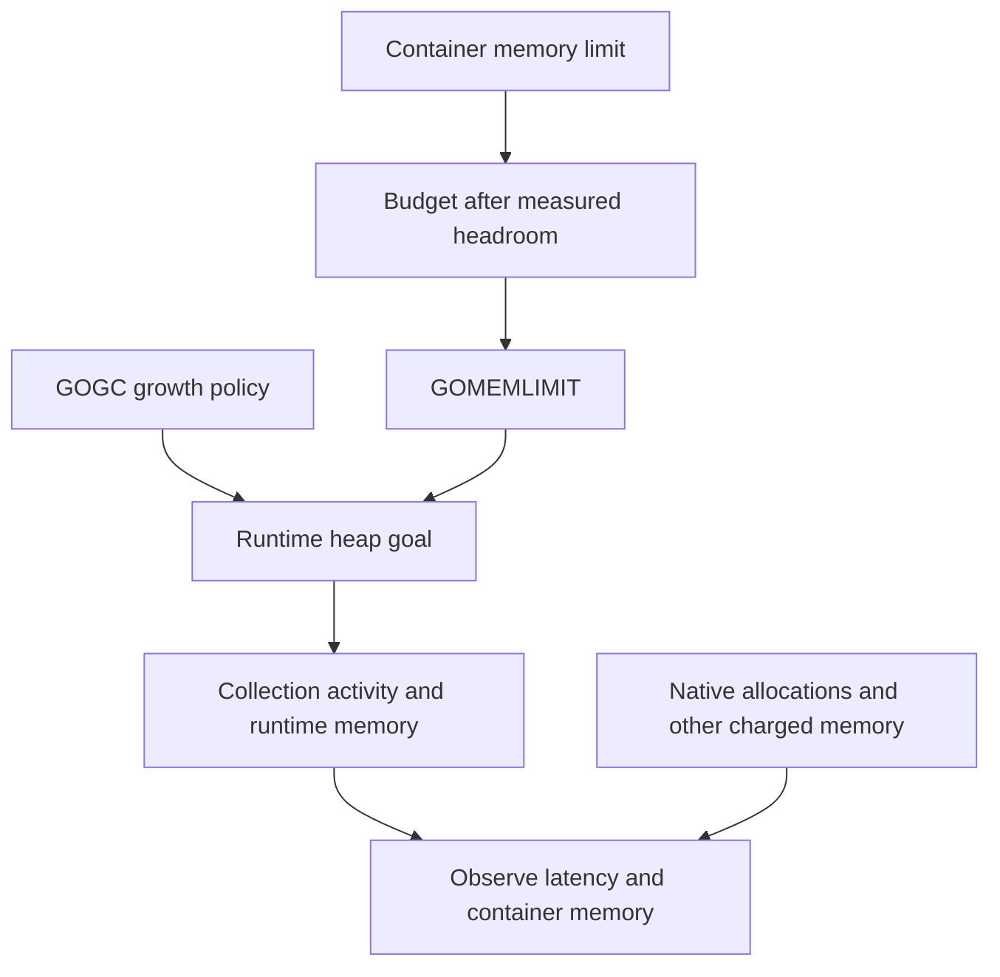

# Set GOGC and GOMEMLIMIT for Kubernetes Memory Budgets

Author: [nawazdhandala](https://www.github.com/nawazdhandala)

Tags: Go, Kubernetes, Garbage Collection

Description: Give Go a realistic memory budget below the container limit, then tune GOGC with runtime metrics and representative load instead of relying on one percentage.

A Go service can run comfortably most of the day and still be killed during a traffic burst. Setting `GOGC` lower may reduce heap growth, but it does not tell the runtime how much memory the container is allowed to use. Setting `GOMEMLIMIT` equal to the container limit leaves no deliberate space for memory outside Go's accounting.

Use the controls together: a measured runtime budget, a normal collection policy, and enough container headroom for the rest of the process. The examples below use Go 1.25.0. Local tests ran on macOS ARM64; the Kubernetes configuration is an explained example, not a live cluster deployment.

## Give each limit one job

`GOGC` controls the heap-growth target relative to live data and GC roots, such as stacks containing pointers. The default is 100. Increasing it generally trades more heap space for less frequent collection; decreasing it trades more collection work for less heap growth. The [Go GC guide](https://go.dev/doc/gc-guide) explains that the memory limit can constrain this target even when `GOGC` is high.

`GOMEMLIMIT` is a soft runtime memory limit. It includes more than live heap objects, but not every allocation in the process. Its accounting is:

```text
Go runtime memory = total runtime memory - heap memory released to the OS
```

The exact metric names are `/memory/classes/total:bytes` and `/memory/classes/heap/released:bytes`. The [Go 1.25 SetMemoryLimit documentation](https://pkg.go.dev/runtime/debug@go1.25.0#SetMemoryLimit) defines this calculation and excludes memory such as allocations managed by C code. A soft limit is not a promise that the process will remain below it at every instant.

The Kubernetes container memory limit is a separate enforcement boundary. Exceeding it can lead to an out-of-memory kill. A memory request helps scheduling; it is not the runtime's GC target. See [Kubernetes resource management](https://kubernetes.io/docs/concepts/configuration/manage-resources-containers/).



The diagram separates policy from enforcement. Neither environment variable changes the container's configured limit.

## Calculate an initial budget

Inventory what shares the relevant memory boundary. Does the container run only the Go process? Does it load C libraries, use large mappings, launch subprocesses or write into memory-backed volumes? Those details determine how much reserve is needed.

For an illustrative container limit of 512 MiB, an initial Go budget of 400 MiB leaves 112 MiB for excluded memory, measurement uncertainty and transient peaks. That reserve is an example to validate, not a recommended universal ratio. If a native library alone can allocate 150 MiB, the example budget is inappropriate.

Measure ordinary traffic and a realistic peak before selecting the final value. Record container usage alongside Go runtime accounting over the same window. Their difference is useful evidence, but it is not a perfectly precise measurement of C allocations because the accounting systems cover different things.

Also check whether the live working set can fit. A service retaining nearly 400 MiB of Go objects needs additional runtime space and room to allocate. Setting a 400 MiB limit does not make that working set smaller.

## Put explicit values in the application container

The following is a container fragment for an existing Deployment's `spec.template.spec.containers` list. Replace the image placeholder with your tested application image, built with the selected Go release. Preserve your normal ports, probes and security settings.

```yaml
- name: api
  image: registry.example.internal/team/api:replace-with-tested-release
  resources:
    requests:
      memory: "256Mi"
      cpu: "250m"
    limits:
      memory: "512Mi"
      cpu: "1"
  env:
    - name: GOGC
      value: "100"
    - name: GOMEMLIMIT
      value: "400MiB"
```

Kubernetes uses `Mi` in resource quantities; Go accepts `MiB` in `GOMEMLIMIT`. Keep environment values as strings. The CPU settings are illustrative too: collection needs CPU, so a memory experiment under an unrealistically generous CPU budget can conceal problems that appear in the actual deployment.

Start with `GOGC=100` while validating the memory budget. Later, compare another value such as 200 without changing request rate, application build or container resources. If the memory limit already constrains the heap goal, raising `GOGC` may have little effect on that goal.

Do not silently derive the Go limit from a pod-wide total when the relevant process has a different container boundary. A sidecar normally has its own container resources, although higher-level pod or node constraints still matter. Review the actual deployment and cluster resource configuration before automating budget calculation.

## Verify the running policy with runtime metrics

Reading an environment variable proves what was passed at startup, not necessarily the current policy. Application code can change GC settings through `runtime/debug`. Export the runtime values to confirm what is active:

| Go runtime metric | What to check |
|---|---|
| `/gc/gogc:percent` | Active growth percentage |
| `/gc/gomemlimit:bytes` | Active soft limit in bytes |
| `/gc/heap/live:bytes` | Live heap from the most recent collection |
| `/gc/heap/goal:bytes` | Current heap target |
| `/memory/classes/total:bytes` minus `/memory/classes/heap/released:bytes` | Memory counted toward the runtime limit |
| `/gc/cycles/total:gc-cycles` | Collection frequency over time |

These names and meanings are documented in [Go 1.25 runtime/metrics](https://pkg.go.dev/runtime/metrics@go1.25.0). Your monitoring exporter may translate them into different metric names. Check its mapping instead of assuming the slash-separated names are directly queryable in Prometheus.

The included `main.go` is a bounded allocation probe that prints these metrics. Build it once, then run the binary with different settings so compiler activity does not enter the experiment:

```bash
GO125=/path/to/go1.25.0/bin/go
"$GO125" build -o memory-budget-lab main.go
GOGC=100 GOMEMLIMIT=off ./memory-budget-lab
GOGC=200 GOMEMLIMIT=off ./memory-budget-lab
GOGC=200 GOMEMLIMIT=64MiB ./memory-budget-lab
```

Run this only as a separate development process. The small 64 MiB setting belongs to this probe, not to the earlier Deployment example. All three runs completed locally. Their collection counts were 13, 7 and 23 respectively, and the final run reported a 67,108,864-byte limit. These are single-run observations illustrating policy interaction, not a reproducible performance ranking or proof of container safety.

## Validate under the workload that matters

Test startup, normal load, peak concurrency, a bounded burst and recovery after traffic drops. Include the largest accepted request bodies and batch sizes. Keep overload controls active so the test represents the intended service rather than an unlimited queue.

Compare request throughput, errors, tail latency, CPU throttling, Go memory and container memory. Investigate a rising collection rate with little reclaimed memory; lowering the limit further can make useful work harder. Conversely, a large container-memory increase without a matching runtime increase suggests looking beyond the Go heap.

Promote the change through a limited canary. Keep the previous environment and resource values available for rollback, and review restart reasons if instances disappear. The acceptance condition is sustained service performance with measured headroom, not simply seeing the configured limit printed in a dashboard.
