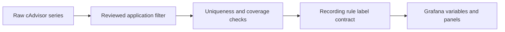

# Build cAdvisor Dashboards with Explicit Filters and Stable Labels

Author: [nawazdhandala](https://www.github.com/nawazdhandala)

Tags: Grafana, Prometheus, Kubernetes, Monitoring

Description: Filter parent and infrastructure series deliberately, give Grafana a documented container-label contract, and test dashboard behavior before exporter labels change.

A container dashboard can double its totals without a single application using more memory. A broad selector may include parent cgroups, infrastructure containers, and application containers together. Later, an exporter upgrade changes a label and the same dashboard becomes empty.

The solution is not a universal filter copied into every panel. Define the population the dashboard should show, establish its identity labels, and test that contract against representative samples. This guide uses a Kubernetes-oriented cAdvisor dataset and Prometheus 3.7.3 query fixtures. Standalone Docker data needs its own label mapping.

## Inspect the raw population before filtering

Start in Prometheus or Grafana Explore with the metric name alone, constrained to one known scrape source:

```promql
container_memory_working_set_bytes{job="kubelet-cadvisor"}
```

Inspect actual labels and compare a few samples with running workloads. The term pseudo-container is often used informally for non-application entries such as root or parent cgroups and infrastructure records. Their labels are not guaranteed to be identical across versions and runtimes.

For the example dataset, application samples have nonempty `namespace`, `pod`, and `container` labels. An infrastructure entry uses `container="POD"`; parent entries lack those application labels. Establish that pattern in your data before applying this selector:

```promql
container_memory_working_set_bytes{
  job="kubelet-cadvisor",
  namespace!="", pod!="", container!="", container!="POD"
}
```

The explicit nonempty checks matter. A matcher such as `container!="POD"` also admits series with no container label, because absent labels are treated as empty for matching. [Prometheus label-matching semantics](https://prometheus.io/docs/prometheus/latest/querying/basics/).

Do not add `image!=""` merely because a downloaded dashboard uses it. First determine whether your intended application samples reliably carry image metadata. A missing descriptive label should not silently erase a valid workload from an operational dashboard.

## Write down the identity contract

For this tutorial, each selected memory sample must have these labels:

| Label | Intended meaning |
| --- | --- |
| `cluster` | Explicit cluster identity supplied by the scrape pipeline |
| `instance` | Canonical kubelet target within that cluster |
| `id` | Container cgroup identity for that runtime instance |
| `namespace`, `pod`, `container` | Human-readable Kubernetes workload context |

The `cluster` label is a prerequisite, not something cAdvisor invents for this example. Use your existing target-label policy to supply it consistently. Keep one canonical cAdvisor source; do not scrape both embedded and standalone collectors into the same logical population without a deliberate distinction.

The immutable runtime identity helps distinguish replacements and replicas. Pod and container names alone can be reused. If your environment lacks `id`, choose and validate another identity, such as an available runtime container identifier, rather than removing the dimension and hoping names stay unique.

## Normalize a presentation metric carefully

A recording rule stores the result of an expression under a chosen metric name. It can give dashboards a stable set of labels while the raw metrics remain available for investigation. [Prometheus recording rules](https://prometheus.io/docs/prometheus/latest/configuration/recording_rules/).

Save the following as a rules file and include it in the existing Prometheus `rule_files` list:

```yaml
groups:
  - name: container-dashboard
    rules:
      - record: dashboard:container_memory_working_set_bytes
        expr: |
          sum by (cluster, instance, id, namespace, pod, container) (
            container_memory_working_set_bytes{
              job="kubelet-cadvisor",
              cluster!="", id!="",
              namespace!="", pod!="", container!="", container!="POD"
            }
          )
```

This drops incidental metadata from the presentation metric. It assumes exactly one input sample for each listed identity. Under that assumption, summing the single sample preserves its value. If duplicate sources exist, the rule will add them; it does not deduplicate them.

Check that prerequisite explicitly before rollout:

```promql
count by (cluster, instance, id, namespace, pod, container) (
  container_memory_working_set_bytes{
    job="kubelet-cadvisor", cluster!="", id!="",
    namespace!="", pod!="", container!="", container!="POD"
  }
) != 1
```

The expected result is empty. Investigate any returned identity before trusting the recorded total. Keep a separate inventory comparison for missing workloads: a uniqueness query cannot report a container that has no sample at all.

The rule does not backfill history. A dashboard migrated to it will initially have data only from the rule's first evaluations. Preserve a raw-data view for older investigations or plan a clearly identified transition period.

## Build variables from the same population

In Grafana, create query variables using the Prometheus data source's Label values query type. For `cluster`, use the recorded metric and the label `cluster`. For `namespace`, constrain that metric to the selected cluster and request the `namespace` label. For `pod`, constrain both cluster and namespace and request `pod`.

Use the same metric population for variables and panels. A variable listing every historical namespace from unrelated metrics can offer selections that the panel never intends to show. Configure refresh behavior to match your time-range and workload changes. [Grafana Prometheus variables](https://grafana.com/docs/grafana/latest/datasources/prometheus/template-variables/).

For multi-select variables, use regex matchers and explicit regex interpolation:

```promql
dashboard:container_memory_working_set_bytes{
  cluster=~"${cluster:regex}",
  namespace=~"${namespace:regex}",
  pod=~"${pod:regex}"
}
```

This is a Grafana query template, not a literal expression to paste into Prometheus. Grafana substitutes and escapes the selected values before sending it. Inspect the resulting query for single selection, multiple selection, and any All option; do not use raw interpolation to bypass escaping. [Grafana variable syntax](https://grafana.com/docs/grafana/latest/visualizations/dashboards/variables/variable-syntax/).

Choose a legend that shows at least namespace, Pod, and container, with instance or runtime identity available for investigation. Keep the unit in bytes and avoid stacking gauges that represent overlapping measurements.

## Make upgrades pass a small fixture suite

Before changing exporter versions or relabeling, test samples representing an application replica, another replica, a parent group, an infrastructure entry, a missing metadata label, and a duplicate scrape. Include a replacement container with a new runtime ID and a reused human-readable name.

The rule should retain valid applications, exclude the defined non-application population, preserve distinct runtime identities, and flag duplicate inputs. A source label rename should trigger an intentional mapping review, not an emergency change to every panel.



The examples were checked with synthetic Prometheus series and recording-rule evaluation. Grafana's UI and interpolation were documentation-reviewed, not executed in a live instance. Validate the actual dashboard after import or editing, including its rendered query and empty-state behavior.

Keep the dashboard description explicit about included workloads, excluded infrastructure records, and the canonical source. That makes a label change a controlled compatibility update rather than a silent change in what the graph measures.
