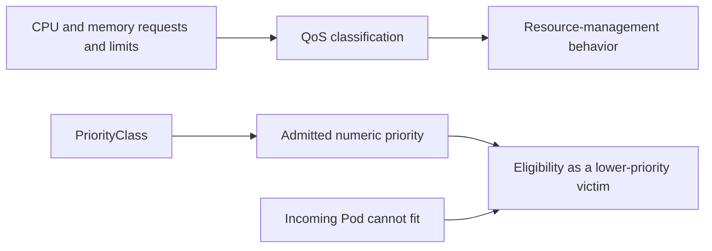

# Why Guaranteed QoS Pods Can Still Be Preempted

Author: [nawazdhandala](https://www.github.com/nawazdhandala)

Tags: Kubernetes, Troubleshooting, Resource Management

Description: Separate Kubernetes Guaranteed QoS from scheduling priority, inspect the admitted Pod, and diagnose preemption without changing resource limits blindly.

The word `Guaranteed` can suggest stronger protection than Kubernetes provides. A Pod with that quality-of-service class can still be removed to make room for a higher-priority Pod. Matching its CPU and memory requests to its limits does not exempt it from scheduler preemption.

This matters during incident response. Increasing limits or adding equal requests may change resource accounting, but it does not change the victim's scheduling priority. If preemption caused the interruption, that edit can consume more requested capacity without addressing the decision that removed the Pod.

This article reviews the **Kubernetes 1.34.0 default scheduler** and uses ordinary container-level resource settings. Pod-level resource features and custom scheduler plugins require their own version-specific review.

## Read QoS and priority as separate properties

Quality of service (QoS) describes a Pod's resource configuration. For the simple container-level case used here, a `Guaranteed` Pod has positive CPU and memory requests and matching limits for every ordinary and init container. Adding a sidecar without corresponding resources can change the result.

The numeric scheduling priority comes from a different mechanism, normally the Pod's selected PriorityClass. The scheduler can consider lower-priority Pods as preemption victims even if those Pods have `Guaranteed` QoS. Kubernetes explicitly distinguishes these properties in its [priority documentation](https://kubernetes.io/docs/concepts/scheduling-eviction/pod-priority-preemption/#interactions-of-pod-priority-and-quality-of-service).



There is deliberately no arrow from `Guaranteed` to “cannot be preempted.” QoS and priority answer different questions.

## Inspect a small example

An administrator could define this illustrative class:

```yaml
apiVersion: scheduling.k8s.io/v1
kind: PriorityClass
metadata:
  name: service-standard-example
value: 1000
globalDefault: false
preemptionPolicy: PreemptLowerPriority
description: "Example service priority for a controlled staging exercise."
```

A staging Pod using it might look like this:

```yaml
apiVersion: v1
kind: Pod
metadata:
  name: guaranteed-example
  namespace: scheduling-test
spec:
  priorityClassName: service-standard-example
  restartPolicy: Never
  automountServiceAccountToken: false
  securityContext:
    runAsNonRoot: true
    runAsUser: 1000
    seccompProfile:
      type: RuntimeDefault
  containers:
    - name: workload
      image: busybox:1.37.0
      command: ["sh", "-c", "sleep 3600"]
      resources:
        requests:
          cpu: "500m"
          memory: "128Mi"
        limits:
          cpu: "500m"
          memory: "128Mi"
      securityContext:
        allowPrivilegeEscalation: false
        capabilities:
          drop: ["ALL"]
```

Here, `500m` means half a CPU core, and `128Mi` means 128 mebibytes. The Pod has only one container and no init containers, so its explicit settings satisfy the usual `Guaranteed` criteria. The [QoS documentation](https://kubernetes.io/docs/concepts/workloads/pods/pod-qos/) describes these classes; the [pinned classification code](https://github.com/kubernetes/kubernetes/blob/v1.34.0/pkg/apis/core/v1/helper/qos/qos.go) also shows the separate handling of pod-level resources.

These manifests are examples for an approved staging namespace, not a request to create contention on shared nodes. The class value is arbitrary and must be reviewed against the cluster's existing hierarchy.

If a competing Pod has priority `2000`, this priority-`1000` Pod remains an eligible victim. Eligibility is not certainty: placement constraints, available capacity, alternative victims, and budget preferences still affect the final choice.

## Observe the admitted object, not just the template

Admission can inject containers or supply defaults. A deployment template that appears to qualify for `Guaranteed` is not the final evidence. Read the actual Pod's reported QoS and numeric priority.

With `kubectl` access and `jq` installed, replace the context, namespace, and name as appropriate:

```bash
kubectl --context staging -n scheduling-test get pod guaranteed-example \
  -o json | jq '{
    name: .metadata.name,
    uid: .metadata.uid,
    qos: .status.qosClass,
    priority: .spec.priority,
    class: .spec.priorityClassName,
    preemptionPolicy: .spec.preemptionPolicy,
    node: .spec.nodeName
  }'
```

The useful evidence is a pair such as `qos: "Guaranteed"` and `priority: 1000`. Neither field contradicts the other. If a field is null, preserve the object and inspect its lifecycle and admission outcome rather than filling in the expected value yourself.

Read the competing Pod the same way. Also record the victim's UID and timestamps; a replacement with similar labels is a different Pod. Retained events and scheduler logs help establish whether preemption actually occurred.

In the [default preemption source](https://github.com/kubernetes/kubernetes/blob/v1.34.0/pkg/scheduler/framework/plugins/defaultpreemption/default_preemption.go), victim eligibility compares the victim's priority with the incoming Pod's priority. `Guaranteed` classification is not an exemption in that check.

## Avoid confusing three different failures

| Observation | Investigate first | Why matching requests and limits is insufficient |
|---|---|---|
| Lower-priority Pod removed for an incoming Pod | Scheduler preemption and competing priority | QoS does not supply preemption immunity |
| Pod evicted while a node runs short of resources | Kubelet node-pressure eviction | Resource pressure has a different decision path |
| Container terminated with an out-of-memory reason | Memory usage, limits, and termination details | Guaranteed QoS does not mean unlimited memory |

For node-pressure eviction, the kubelet's ranking considers factors including usage relative to requests and Pod priority; it does not simply apply the scheduler's victim selection. Resource-specific behavior matters, especially for disk pressure. Consult the [node-pressure eviction documentation](https://kubernetes.io/docs/concepts/scheduling-eviction/node-pressure-eviction/) before treating a QoS label as a full explanation.

Do not lower requests just to fit more Pods without checking actual usage. That can move the problem from scheduling contention to resource pressure. Conversely, raising requests can reduce the number of feasible placements. Resource sizing should follow workload measurements, not a belief that the QoS name provides an availability guarantee.

## Change the priority relationship deliberately

When the evidence points to scheduler preemption, review whether the incoming workload should outrank the victim. Options include a controlled priority hierarchy, limiting access to elevated classes, keeping suitable spare capacity, and making expendable workloads wait instead of initiating preemption.

`preemptionPolicy: Never` belongs to the potential **preemptor's** policy. It prevents that Pod from evicting lower-priority Pods to obtain a placement. It does not protect the same Pod from being selected by something with higher priority.

Use a staging exercise to verify the intended relationship while holding resource settings constant. Record the actual priority and QoS of both workloads, the eligible nodes, and whether the expected Pod waits or is removed. If a workload must survive interruption, also test its restart and data-recovery behavior rather than relying solely on scheduling policy.

The manifests here were validated against Kubernetes 1.34.0's OpenAPI definitions, and the inspection filter was checked with representative JSON. No live cluster, QoS assignment, or scheduler preemption was executed. Treat the examples as reviewed configuration and diagnosis tools, then confirm behavior on the scheduler configuration you actually operate.
