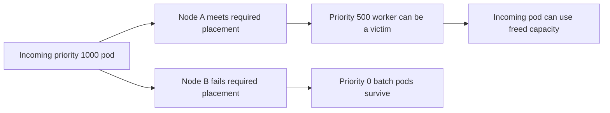

# Why Lower-Priority Pods Can Survive Kubernetes Preemption

Author: [nawazdhandala](https://www.github.com/nawazdhandala)

Tags: Kubernetes, Scheduling, Troubleshooting

Description: Explain seemingly inverted Kubernetes preemption decisions by checking node feasibility, resource shape, disruption budgets, and the actual preemptor.

An incident report says that a priority-500 worker was preempted while priority-0 batch pods kept running. That sounds backward until you ask where those pods were running and which incoming pod needed space. Priority influences preemption, but Kubernetes does not maintain a cluster-wide eviction list sorted from least important to most important.

A higher-priority victim in this discussion means higher than another surviving workload. Under the default policy, it must still be lower priority than its preemptor. A priority-1000 incoming pod can preempt a priority-500 worker; the continued existence of priority-0 pods elsewhere does not by itself make that decision incorrect.

This guide uses the default scheduler behavior in Kubernetes 1.34.0. It focuses on investigating that apparent inversion, with a read-only evidence workflow and illustrative examples rather than a claim of live reproduction.

## Start with the incoming pod's usable nodes

Imagine two worker pools. Node A has the local storage and labels required by an incoming analytics pod. Node B hosts ordinary batch jobs but lacks the required label. Removing every batch job from B would still leave B unsuitable.



A `nodeSelector` is a required match, not a preference that preemption can ignore. Required node affinity behaves similarly. An untolerated `NoSchedule` taint can also exclude a node even when removing its workloads would free plenty of resources. See the official [node assignment](https://kubernetes.io/docs/concepts/scheduling-eviction/assign-pod-node/#nodeselector) and [taint and toleration](https://kubernetes.io/docs/concepts/scheduling-eviction/taint-and-toleration/) documentation.

The practical question is therefore: “Could the preemptor actually run where the surviving low-priority pods live?” If the answer is no, comparing their priorities with the victim's priority skips the constraint that determined the decision.

Do not remove placement restrictions just to make an incident diagram look more balanced. A zone restriction may protect data locality, and a taint may enforce workload isolation. First establish whether the restriction is intentional and whether that eligible pool has enough spare capacity.

## Resource shape can preserve small, low-priority pods

Even on one node, lower-priority pods are not necessarily all removed. Consider an incoming pod that needs two additional CPUs. The node contains a priority-500 worker requesting two CPUs and a priority-0 helper requesting a small fraction of one CPU.

If removing only the helper cannot create enough room, the worker may be necessary as a victim. Once the worker is removed, the helper may fit alongside the incoming pod and survive. These are assumed requests for an explanatory scenario; actual feasibility includes memory, other resources, and scheduling filters.

The [Kubernetes 1.34 default preemption implementation](https://github.com/kubernetes/kubernetes/blob/v1.34.0/pkg/scheduler/framework/plugins/defaultpreemption/default_preemption.go#L216) first simulates removing eligible pods, then restores potential victims when doing so still allows the incoming pod to fit. It does not delete every pod below the highest victim priority as a matter of consistency.

This also explains why a CPU utilization graph can mislead. Scheduling uses resource requests, not the current CPU usage sampled by your monitoring system. A worker that is idle now can still have a large request that blocks placement. Diagnose the declared resource requirements before changing them; lowering a request without understanding demand can trade a scheduling problem for contention.

## Disruption budgets can change the preference

A PodDisruptionBudget, or PDB, describes allowed disruption for a selected group of pods. Preemption attempts to minimize budget violations, although a PDB does not absolutely prevent it.

Suppose two candidate nodes are feasible. Removing a priority-0 pod from A would violate a budget. Removing a priority-500 pod from B would not. For a priority-1000 preemptor, the default node comparison can prefer B because the count of PDB-violating victims is considered before the highest victim priority. That order is explicit in the [versioned framework source](https://github.com/kubernetes/kubernetes/blob/v1.34.0/pkg/scheduler/framework/preemption/preemption.go#L611).

Budget-aware restoration can also affect which pods survive on a single node. Avoid concluding that a surviving pod has a “stronger priority” merely because it was restored. Its budget membership and the remaining feasible resource combination may explain the result.

Inspect budget selectors and status at the incident time. A budget with an accidental broad selector can protect a different group than its author intended. Conversely, a current healthy budget does not prove that disruption was allowed when the decision occurred.

## Capture priorities and placement together

With read permission across the relevant namespaces, save a pod snapshot using kubectl. The following commands use jq 1.6-compatible syntax:

```bash
kubectl get pods -A -o json > pods.json
jq '[.items[] | {
  namespace: .metadata.namespace,
  name: .metadata.name,
  uid: .metadata.uid,
  node: (.spec.nodeName // "unassigned"),
  priority: (.spec.priority // 0),
  class: (.spec.priorityClassName // ""),
  policy: (.spec.preemptionPolicy // "PreemptLowerPriority")
}] | sort_by(.node, .priority)' pods.json
```

The result groups observations by node and then priority. It retains UIDs so that recreated pods are not mistaken for their predecessors. A pod absent from the snapshot may already have been deleted; use your event or audit retention to recover its earlier identity.

Use the resolved numeric priority on the Pod, not just a class name from a Deployment template. Admission assigns priority when the Pod is created. Also check that the supposed preemptor uses the scheduler profile you are investigating and permits preemption. `preemptionPolicy: Never` prevents a pod from preempting others; it does not grant immunity from a higher-priority pod.

For the incoming pod, substitute its actual namespace and name:

```bash
kubectl -n staging get pod incoming-worker -o yaml
kubectl -n staging describe pod incoming-worker
kubectl get pdb -A -o yaml
kubectl get nodes -L topology.kubernetes.io/zone
```

Read the required placement fields, requests, tolerations, scheduling events, and any nominated node. A nomination is a scheduling intention, not proof that the pod has bound to that node. Kubernetes documents this distinction and other [preemption limitations](https://kubernetes.io/docs/concepts/scheduling-eviction/pod-priority-preemption/#limitations-of-preemption).

## Separate the cause before changing policy

Confirm that the victim was actually removed by scheduler preemption. Node-pressure eviction, node shutdown, rollout replacement, and explicit deletion have different causes. When available, a `DisruptionTarget` condition with reason `PreemptionByScheduler`, scheduler events, and correlated UIDs provide better evidence than a generic “terminated” dashboard label.

Then classify the finding:

| Finding | Targeted response |
|---|---|
| Lower-priority survivors occupy ineligible nodes | Review capacity in the eligible pool and the reason for its restrictions |
| A larger victim was necessary to make room | Review request sizing and capacity fragmentation |
| Budget preferences explain the choice | Verify budget selectors, availability requirements, and replica placement |
| Evidence comes from different times or pod identities | Improve event retention and UID-based incident correlation |
| A custom scheduler made the decision | Inspect that profile's actual plugins and version |

Raising every application's priority does not create capacity and can shift disruption onto another service. A better outcome is a specific explanation of which constraint or preference made the victim necessary, followed by a capacity or policy change that addresses it. When the original candidate set or budget state is unavailable, record that uncertainty and rehearse the suspected mechanism in staging before declaring the scheduler wrong.
