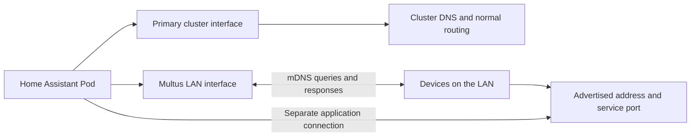

# Make Home Assistant mDNS Discovery Work on a Multus LAN

Author: [nawazdhandala](https://www.github.com/nawazdhandala)

Tags: Home Assistant, Multus, Kubernetes, mDNS

Description: Diagnose Home Assistant discovery across a Multus LAN attachment by checking interface selection, multicast delivery, advertised service addresses, and device connectivity.

Home Assistant can reach a device by IP address while automatic discovery finds nothing. In a Kubernetes Pod with both a primary cluster interface and a Multus LAN interface, discovery may be using the wrong interface even though the LAN attachment works.

Treat discovery as a sequence: the Pod needs LAN connectivity, Home Assistant must select the LAN interface, multicast messages must arrive, and the advertised service endpoint must be reachable. Fixing only one step can leave the integration unusable.

This guide reviews **Home Assistant Core 2026.11.2**, **Multus v4.3.1**, and official multicast DNS documentation. It assumes an existing Home Assistant Container deployment with persistent configuration. No Home Assistant instance, Kubernetes cluster, or physical-device discovery was tested during authoring.

## Understand the two network paths

Multicast DNS, or mDNS, performs DNS-like discovery on a local link. IPv4 uses `224.0.0.251`, IPv6 uses `ff02::fb`, and the protocol uses UDP port 5353. These are local-link discovery destinations, not an ordinary central DNS server. See [RFC 6762](https://www.rfc-editor.org/rfc/rfc6762.html).



Kubernetes DNS working does not prove mDNS works. Likewise, seeing an advertisement does not prove Home Assistant can connect to the advertised service address and port.

## Confirm that the LAN attachment exists

The secondary network should put the Pod on the intended device LAN or on a deliberately designed discovery path. A macvlan attachment can provide a distinct LAN identity when the physical network permits additional MAC addresses. IPvlan L2 is another design to evaluate; IPvlan L3 does not deliver broadcast or multicast to children, according to the [kernel ipvlan guide](https://www.kernel.org/doc/html/latest/networking/ipvlan.html).

For an existing, reviewed NetworkAttachmentDefinition named `home-lan` in the Pod's namespace, add this metadata fragment to the Home Assistant workload template:

```yaml
annotations:
  k8s.v1.cni.cncf.io/networks: '[{"name":"home-lan","interface":"net1"}]'
```

This is not a network definition. The definition must already specify an available parent, supported plugin, unique address allocation, and any needed routes. Multus documents the annotation format in its [v4.3.1 usage guide](https://github.com/k8snetworkplumbingwg/multus-cni/blob/v4.3.1/docs/how-to-use.md). Recreate a controlled staging Pod to exercise attachment creation; editing the template does not add a device to the current Pod automatically.

With iproute2 available in the Pod's diagnostic environment, inspect:

```bash
kubectl -n REPLACE_NAMESPACE exec REPLACE_POD -- ip -brief address
kubectl -n REPLACE_NAMESPACE exec REPLACE_POD -- ip route show
kubectl -n REPLACE_NAMESPACE exec REPLACE_POD -- ip route get 224.0.0.251
```

Expect `net1` to exist with the intended LAN address. The final command reveals the kernel's route choice for the IPv4 discovery destination. It does not show every socket binding or prove that the application selected that interface. The [ip-route manual](https://man7.org/linux/man-pages/man8/ip-route.8.html) describes route lookup behavior.

Do not change the Pod's default route just to influence discovery. That can alter cluster DNS, API access and unrelated application traffic. Configure Home Assistant's interface selection deliberately instead.

## Select the interface in Home Assistant

Home Assistant's [Network integration](https://www.home-assistant.io/integrations/network/) uses routing toward the mDNS destination for automatic interface detection. With multiple interfaces, that can favor the primary cluster network. The integration is managed under **Settings > System > Network**.

Inspect the selected interfaces there and select the LAN adapter that has the expected address. Preserve other interfaces your integrations require. Follow the running version's prompts for applying or restarting after changes; then revisit the settings and verify the selection persisted.

The [Core 2026.11.2 Zeroconf implementation](https://github.com/home-assistant/core/blob/2026.11.2/homeassistant/components/zeroconf/__init__.py) builds its interface choices from enabled Network adapters. This is why merely attaching `net1` is not the end of the setup.

Zeroconf is enabled by `default_config:` in the usual configuration. If you intentionally removed that default configuration and these integrations are absent, the official documentation permits enabling them explicitly:

```yaml
network:
zeroconf:
```

Merge these keys into `configuration.yaml` without duplicating existing keys, validate through your normal Home Assistant configuration process, and restart as required. Do not replace the rest of the configuration with this fragment. The [Zeroconf integration guide](https://www.home-assistant.io/integrations/zeroconf/) documents both activation and interface selection.

## Observe discovery at the right boundary

Home Assistant provides a **Zeroconf Browser** under **Settings > System > Network**. Use it to look for a known supported device while triggering that device's normal discovery or restart process. Record the service type, instance, target hostname, addresses and service port.

If nothing appears, capture a small amount of traffic in the Pod's network namespace using an approved diagnostic environment with packet-capture permissions. This command requires tcpdump and the correct interface name:

```bash
tcpdump -p -n -i net1 -s 512 -c 40 'udp port 5353'
```

`-p` avoids requesting promiscuous mode, `-n` avoids name resolution, and `-c 40` limits the number of captured packets. If no traffic arrives, stop the capture manually; the packet count is not a time limit. The filter includes unicast mDNS replies as well as multicast messages. These options are documented in the [tcpdump manual source](https://github.com/the-tcpdump-group/tcpdump/blob/tcpdump-4.99.5/tcpdump.1.in).

Do not add broad privileges permanently to the Home Assistant application just for this investigation. Use your existing troubleshooting process, and avoid publishing packet contents that reveal device names or service metadata.

## Use the evidence to locate the fault

| Observation | Next investigation |
| --- | --- |
| No LAN address on `net1` | CNI attachment, IP allocation and node parent configuration |
| Packets exist on the node LAN but not in the Pod | VLAN membership, virtual-switch multicast filtering, and multicast snooping |
| Packets arrive in the Pod but browser is empty | Enabled adapter selection, service type support and integration logs |
| Device is discovered but connection fails | Advertised address, application port, routing and authentication |
| Discovery changes after rescheduling | Node-specific parent, VLAN or interface configuration |

If devices live on another VLAN, ordinary IP routing does not automatically extend mDNS discovery. Use a reviewed reflector or discovery gateway only when cross-network discovery is intentional. Reflecting discovery also does not open the device's application port; both paths need a design.

Keep IPv4 and IPv6 evidence separate. A device can advertise an address family that the Pod cannot use, and an IPv6 link-local address requires the correct interface scope. Avoid forcing a single-stack workaround before identifying which records and transport the integration actually uses.

## Verify normal use after discovery

Complete one real integration setup and exercise its normal functions. Confirm that reconnecting after a device restart works, then recreate the staging Pod and check interface selection and discovery again. Retain the primary network checks too, so fixing LAN discovery has not broken ordinary cluster connectivity.

The acceptance result is a discovered service whose advertised endpoint remains usable after normal lifecycle events. That evidence is stronger than a successful ping, an interface named `net1`, or an isolated UDP packet in a capture.
