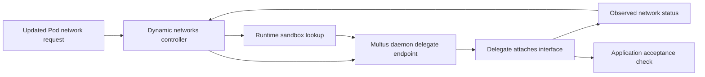

# Hot-Plug Pod Networks with the Multus Dynamic Networks Controller

Author: [nawazdhandala](https://www.github.com/nawazdhandala)

Tags: Multus, Kubernetes, Networking

Description: Add a secondary interface to a running Pod with a version-scoped dynamic-controller workflow, preserve existing attachments, and verify reconciliation before moving application traffic.

Editing a running Pod's Multus annotation does not, by itself, guarantee that a new interface will appear. Ordinary attachment creation happens during sandbox setup. Dynamic attachment requires a component that notices the changed request and performs the corresponding network operation against the running sandbox.

The **Multus Dynamic Networks Controller v0.3.9** provides that reconciliation loop with Multus in thick-plugin mode. Its desired state comes from the `k8s.v1.cni.cncf.io/networks` annotation, and its observed attachment state comes from network status. This guide reviews that version alongside **Multus v4.3.1** source; it does not claim a universally certified version combination. [Controller overview](https://github.com/k8snetworkplumbingwg/multus-dynamic-networks-controller/blob/v0.3.9/README.md).

Use a disposable staging workload first. The configuration and patch examples were checked locally; no running Pod was hot-plugged for this article.

## Check the node-side prerequisites

The controller needs access to the node's container runtime and the Multus daemon. Confirm that thick Multus is installed, the desired delegate binaries and IPAM are present, and the selected network supports the intended attachment lifecycle.



In the v0.3.9 reference deployment, the runtime socket is mounted from host `/run/containerd/containerd.sock` to `/host/run/containerd/containerd.sock`. The Multus socket is mounted from `/run/multus/multus.sock` to `/host/run/multus/multus.sock`. The ConfigMap points at those container-side paths. Verify your actual runtime layout rather than copying those paths into a different distribution. [Controller deployment](https://github.com/k8snetworkplumbingwg/multus-dynamic-networks-controller/blob/v0.3.9/manifests/dynamic-networks-controller.yaml).

That same manifest uses `latest-amd64`. A tagged source checkout does not pin the deployed image, and that reference does not cover every node architecture. Review privileges, mounts, RBAC, architecture and an immutable image digest before installation through your deployment owner. The controller's health probes are not proof that a particular delegate or application can hot-plug successfully.

## Make every intended interface explicit

The controller documentation requires interface names for all desired attachments. Before making a change, align the request with the interfaces that actually exist. Do not invent a new name for an existing attachment and assume it is merely a display label.

For this example, assume `hotplug-demo` in namespace `network-lab` is a running, non-host-network Pod with exactly this current annotation:

```json
[
  {"name": "existing-net", "interface": "net1"}
]
```

The `existing-net` and `extra-net` NetworkAttachmentDefinitions must already exist in that namespace. The second network must have working allocation and connectivity, and it must not unintentionally replace the Pod's primary default route. This example adds an ordinary secondary network, not a new hardware resource allocation.

The pinned controller rejects additions to host-networked Pods. Also, do not assume an annotation update grants a running container extra SR-IOV device-plugin resources or changes its scheduler allocation. Evaluate hardware-backed hot-plug separately with the platform that owns those resources. [Controller Pod handling](https://github.com/k8snetworkplumbingwg/multus-dynamic-networks-controller/blob/v0.3.9/pkg/controller/pod.go).

## Capture the baseline before changing the request

Inspect the Pod and its application container:

```bash
kubectl -n network-lab get pod hotplug-demo -o json
kubectl -n network-lab exec hotplug-demo -c REPLACE_CONTAINER -- ip -d link show
kubectl -n network-lab exec hotplug-demo -c REPLACE_CONTAINER -- ip route show
```

Record the Pod UID, resourceVersion, node, current network request, network status, and application connectivity. The UID distinguishes this Pod from a later replacement with the same name. The resourceVersion lets the patch reject a stale view instead of overwriting another update.

A deployment template and a live Pod are separate desired-state surfaces. Updating the live Pod does not automatically update the template used for future replacements. Decide whether this is a temporary diagnostic attachment or a persistent workload requirement, and coordinate with the workload owner.

## Patch the complete reviewed request

For the exact baseline above, save this as `add-network.json`. Replace the resourceVersion placeholder with the string from the most recent Pod read:

```json
[
  {
    "op": "test",
    "path": "/metadata/resourceVersion",
    "value": "REPLACE_CURRENT_RESOURCE_VERSION"
  },
  {
    "op": "replace",
    "path": "/metadata/annotations/k8s.v1.cni.cncf.io~1networks",
    "value": "[{\"name\":\"existing-net\",\"interface\":\"net1\"},{\"name\":\"extra-net\",\"interface\":\"extra0\"}]"
  }
]
```

The annotation value is a JSON string containing the full desired attachment list. The slash in the annotation key is escaped as `~1` in the JSON Pointer path. The `test` operation prevents the replacement when the resourceVersion changed. If it fails, reread the Pod and review the new state; do not bypass the check. [JSON Patch specification](https://www.rfc-editor.org/rfc/rfc6902).

For a different baseline, preserve every existing desired attachment and its options. Copying this example over a richer list can request removal of omitted networks. Apply the reviewed patch only to the staging Pod:

```bash
kubectl -n network-lab patch pod hotplug-demo \
  --type=json --patch-file=add-network.json
```

The patch command updates the API object. It does not synchronously wait for delegate execution or validate the resulting network path. [kubectl patch reference](https://kubernetes.io/docs/reference/kubectl/generated/kubectl_patch/).

## Wait for reconciliation, then test the application

Inspect Pod events, network status and the actual interface:

```bash
kubectl -n network-lab describe pod hotplug-demo
kubectl -n network-lab get pod hotplug-demo -o json
kubectl -n network-lab exec hotplug-demo -c REPLACE_CONTAINER -- ip address show dev extra0
```

Look for controller events such as `AddedInterface` or `FailedAddingInterface`, and inspect the controller and Multus logs on the same node when needed. Match the observed network name and interface, then verify the address, route, and approved peer traffic. Keep existing primary and secondary traffic under observation throughout.

A newly visible interface does not force an application to use it. Some applications select addresses at startup, maintain long-lived connections, or require an explicit configuration reload. Move traffic only after the application has accepted the new endpoint and its authentication and policy requirements still hold.

## Unplug only after traffic has moved away

To remove the test attachment, first stop application use of `extra0`. Reread the Pod, create a new resourceVersion-guarded patch, and replace the desired list with the preserved baseline. Do not use an empty list unless removing every requested secondary attachment is actually intended.

Wait for observed removal, inspect cleanup errors, and verify address allocation release through the relevant IPAM owner. A failed removal should be investigated through the controller and delegate rather than followed by an indiscriminate interface deletion. Preserve the old state until recovery is understood.

Finally, repeat with a fresh disposable Pod and test what happens when the controller restarts. The acceptance result should include request convergence, actual interface state, application connectivity, and cleanup. Hot-plug is a coordinated lifecycle change, not simply a successful annotation patch.
