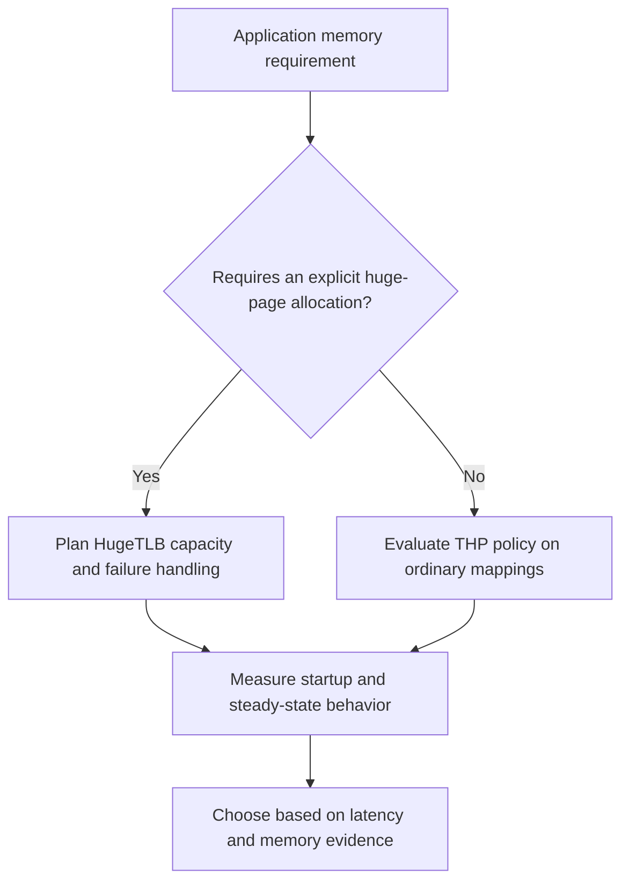

# Choose HugeTLB or Transparent Huge Pages for Your Workload

Author: [nawazdhandala](https://www.github.com/nawazdhandala)

Tags: Linux, HugePages, Performance

Description: Compare explicit HugeTLB pools with Transparent Huge Pages, inspect current policy safely, and evaluate capacity and tail-latency tradeoffs before tuning.

“Enable huge pages” is an incomplete operational instruction. Linux has explicit HugeTLB allocations and Transparent Huge Pages, usually abbreviated THP. Both can reduce address-translation overhead, but they have different allocation contracts and failure modes.

Choose based on what the application requests, what memory capacity you can commit, and what latency behavior you have measured. A dedicated database using an explicit huge-page allocator has different needs from a shared host running ordinary processes with changing memory footprints.

This guide uses **Linux 6.12** documentation as its baseline. Architecture, kernel configuration, distribution backports, and application behavior affect the controls available on a particular machine.

## Understand what the larger page changes

The processor translates virtual addresses into physical addresses. Its translation lookaside buffer, or TLB, caches those translations. A larger page lets one translation cover more memory. On a system with 4 KiB base pages and 2 MiB huge pages, a huge page spans 512 base pages. These sizes are illustrative, not universal. [HugeTLB overview](https://www.kernel.org/doc/html/v6.12/admin-guide/mm/hugetlbpage.html).

The potential benefit is fewer translation misses for suitable workloads. The cost includes allocating larger contiguous regions and potentially committing more memory than the application actively touches. The best choice depends on the working set and access pattern, not just total RAM.

## Compare the allocation contracts

| Question | Explicit HugeTLB | Transparent Huge Pages |
| --- | --- | --- |
| How does an application use it? | Explicit mapping or shared-memory mechanism | Ordinary eligible mappings, influenced by kernel and application policy |
| Is there a dedicated pool? | Persistent pools can be provisioned by page size | No equivalent dedicated HugeTLB pool |
| What if a large page is unavailable? | The explicit allocation contract can fail | Ordinary THP allocation can fall back to smaller pages |
| Can the memory be swapped? | HugeTLB pages cannot be swapped | THP participates in normal virtual-memory mechanisms |
| Who controls capacity planning? | Application and operator explicitly plan the pool | Kernel allocation policy works within general memory availability |
| Is performance guaranteed? | No | No |

HugeTLB applications can use `MAP_HUGETLB`, hugetlbfs mappings, or corresponding shared-memory interfaces. An allocator may implement its own fallback, but requesting an explicit huge-page mapping does not itself mean “use normal pages if necessary.” Check the application's actual behavior. [mmap interface](https://man7.org/linux/man-pages/man2/mmap.2.html).

THP can improve eligible anonymous-memory mappings without requiring a dedicated HugeTLB allocation path. Linux 6.12 also documents multiple THP sizes, including sizes below the traditional large page-table mapping size. Do not assume every THP is exactly 2 MiB. [Transparent Hugepage support](https://www.kernel.org/doc/html/v6.12/admin-guide/mm/transhuge.html).



## Interpret capacity guarantees narrowly

A HugeTLB pool makes capacity a visible planning decision. For example, 16,384 pages of 2 MiB represent 32 GiB. Reserving that persistent pool on a 64 GiB host leaves substantially less memory available for ordinary allocations, the kernel, page cache, and other processes. An idle pool is still a cost until its capacity is returned to ordinary memory.

Do not equate a pool's existence with an exclusive reservation for one application. Other users, page-size requirements, NUMA placement, permissions, and container limits can affect whether a particular allocation succeeds. NUMA means the machine has memory regions with different locality to different processors; free memory on the wrong node may not satisfy a placement policy.

HugeTLB reservations are also distinct from free pages and pages already faulted into a mapping. Options that skip reservation change the failure contract. Establish the application's reservation and first-touch behavior instead of promising that every successful mapping will always be safe to access. [HugeTLB reservation model](https://www.kernel.org/doc/html/v6.12/mm/hugetlbfs_reserv.html).

THP offers no matching promise that a future ordinary allocation will receive a huge page. That flexibility is often useful on shared hosts: capacity is not permanently set aside just to preserve a large-page pool. The tradeoff is that page size and allocation work can vary over time.

## Treat tail latency as an experiment

THP policy includes both eligibility and defragmentation behavior. Defragmentation, or compaction, tries to assemble suitable contiguous memory. Depending on policy, a fault may perform work synchronously or leave more work to background activity. An application's `MADV_HUGEPAGE` hint can influence which regions receive attention; it does not promise an immediate large-page mapping. [THP control details](https://www.kernel.org/doc/html/v6.12/admin-guide/mm/transhuge.html#sysfs).

Explicit HugeTLB can move some allocation planning earlier, especially when a pool is provisioned before fragmentation develops. It does not remove page-touch costs, NUMA effects, application pauses, or every source of latency. A fast warm benchmark is not evidence about a cold restart under pressure.

Measure the same workload with the same memory size, concurrency, placement, and warm-up procedure. Include startup time, throughput, p99 or p99.9 latency, CPU use, memory pressure, and allocation failures. Test sustained operation and a controlled restart. Record the effective policy with each result so an apparently better run can be reproduced.

## Inspect the current host without changing policy

Save this as `inspect-pages.sh` and run it with `sh inspect-pages.sh` on the Linux host. It needs readable procfs/sysfs files and standard shell tools; it does not change kernel settings or allocate memory:

```bash
#!/bin/sh
set -eu
uname -r
getconf PAGESIZE
awk '/^(AnonHugePages|HugePages_Total|HugePages_Free|HugePages_Rsvd|HugePages_Surp|Hugepagesize|Hugetlb):/ {print}' /proc/meminfo

for control in /sys/kernel/mm/transparent_hugepage/enabled \
               /sys/kernel/mm/transparent_hugepage/defrag \
               /sys/kernel/mm/transparent_hugepage/hugepages-*/enabled; do
    [ -r "$control" ] || continue
    printf '%s: ' "$control"
    cat "$control"
done

for pool in /sys/kernel/mm/hugepages/hugepages-*; do
    [ -d "$pool" ] || continue
    for counter in nr_hugepages free_hugepages resv_hugepages surplus_hugepages; do
        [ -r "$pool/$counter" ] || continue
        printf '%s: ' "$pool/$counter"
        cat "$pool/$counter"
    done
done
```

The first lines identify the kernel and base page size. The memory summary separates `AnonHugePages` from the HugeTLB counters. `Hugetlb` accounts for HugeTLB memory across sizes; it is not a total for all forms of transparent huge pages.

The THP policy files show available choices and the selected choice in brackets. Per-size controls may inherit the top-level setting or select their own behavior. Missing files can reflect kernel or architecture differences, so retain the whole inventory rather than treating one absent path as proof that all huge-page support is disabled.

The final loop prints each exposed HugeTLB pool separately. A global free-memory number cannot tell you whether the application has available pages of the required size. This inspection is a starting point, not a process-level accounting report.

Also avoid treating a policy string as proof of actual mapping size. Inspect the target process's mappings and relevant kernel counters during your experiment. Newer interfaces such as `MADV_COLLAPSE` can have behavior independent of ordinary THP enablement policy; `never` is not a universal statement about every explicit collapse request. [madvise semantics](https://man7.org/linux/man-pages/man2/madvise.2.html).

## Choose a rollout that matches the requirement

Prefer an explicit HugeTLB evaluation when the application requires it, documents a supported pool model, and you can reserve capacity per size and locality with an allocation-failure plan. Include the non-huge-page memory budget in the same capacity calculation.

Prefer a THP evaluation when the application uses ordinary mappings and you want large-page benefits without committing a dedicated pool. Follow the application's supported guidance, then measure the specific eligibility and compaction policy rather than assuming that the broadest setting is best.

Use a dedicated test host or a carefully scoped staging workload for policy changes. Keep the original settings, application options, and workload measurements as the rollback baseline. Do not alter a shared production host merely to run the comparison.

The inspection script was checked for shell syntax, and its memory-summary filter was tested with a synthetic fixture. No Linux allocation, latency benchmark, or kernel tuning was performed for this article. Your final choice should be backed by the application's allocation contract and measurements from the actual target environment.
