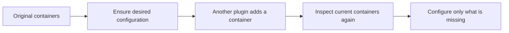

# Make Mutating Webhooks Idempotent Under IfNeeded Reinvocation

Author: [nawazdhandala](https://www.github.com/nawazdhandala)

Tags: Kubernetes, Reliability, Python

Description: Build repeatable Pod mutations that avoid duplicate environment variables, handle later container injection, and remain safe under IfNeeded reinvocation.

Your webhook adds configuration to a Pod and returns successfully. Another admission plugin then adds a container. Kubernetes may call your webhook again with the changed Pod. If your handler blindly appends its configuration, the original containers get duplicates. If it skips every Pod carrying an "already processed" annotation, the new container gets nothing.

Idempotence solves the first problem, but only if you check the current object rather than a historical marker. An idempotent mutation reaches its desired state once and leaves that state unchanged on a repeat call. It can still act when another component introduces new work.

The examples use **Kubernetes v1.35.0**, **Python 3.11**, and **python-json-patch 1.33** for local checks. They demonstrate a mutation builder for opt-in Pod CREATE requests, not a complete webhook server.

## Understand what IfNeeded promises

The default `reinvocationPolicy` is `Never`. Setting it to `IfNeeded` allows Kubernetes to invoke an eligible webhook again when later admission changes make that necessary. It does not promise exactly one extra call, stable webhook ordering, or another call after every subsequent change. See the [reinvocation policy documentation](https://kubernetes.io/docs/reference/access-authn-authz/extensible-admission-controllers/#reinvocation-policy).

In the existing entry under `webhooks`, the relevant fragment is:

```yaml
reinvocationPolicy: IfNeeded
```

This line does not replace the rest of your registration. Keep its narrow rules, namespace enrollment, service configuration, and accurate `sideEffects` declaration. Only enable reinvocation after the handler can safely inspect objects it has already changed.

Think in terms of current state, not call counts:



The diagram illustrates one possible sequence, not a scheduling guarantee. A final invariant that must hold after mutation belongs in validating admission; the [v1.35.0 API contract](https://github.com/kubernetes/kubernetes/blob/v1.35.0/staging/src/k8s.io/api/admissionregistration/v1/types.go) explicitly separates that role from reinvocation.

## Define ownership before writing the patch

For this example, the webhook ensures that every regular container in `spec.containers` has exactly one environment entry named `PLATFORM_DIAGNOSTICS` with the literal value `enabled`. The application's diagnostic feature must actually understand this variable; it is an illustrative application contract, not a Kubernetes setting.

The rule is deliberately narrow. It does not edit init containers, ephemeral containers, environment sources in `envFrom`, or other environment variables. Kubernetes defines those as distinct fields in its [container API types](https://github.com/kubernetes/kubernetes/blob/v1.35.0/staging/src/k8s.io/api/core/v1/types.go).

Agree on conflict behavior with workload owners. Here, an existing matching literal value is accepted. A different literal value, a `valueFrom` reference, or duplicate entries with the owned name is a conflict. The handler should return a clear admission denial rather than silently replace someone else's configuration. That choice is part of the feature contract; another product could choose a documented override policy instead.

## Build a patch from the current Pod

Save this function as `diagnostics_patch.py`. It uses only Python's standard library. The surrounding handler must first validate and route the AdmissionReview, enforce the opt-in scope, and pass the current Pod object to this function.

```python
from copy import deepcopy

NAME = "PLATFORM_DIAGNOSTICS"
DESIRED = {"name": NAME, "value": "enabled"}


def diagnostics_patch(pod):
    if not isinstance(pod, dict) or pod.get("kind") != "Pod":
        raise ValueError("expected a Pod object")
    if pod.get("apiVersion") != "v1":
        raise ValueError("expected core v1")
    spec = pod.get("spec")
    if not isinstance(spec, dict):
        raise ValueError("expected Pod spec")
    containers = spec.get("containers")
    if not isinstance(containers, list) or not containers:
        raise ValueError("expected regular containers")

    patch = []
    for index, container in enumerate(containers):
        if not isinstance(container, dict):
            raise ValueError("invalid container shape")
        path = f"/spec/containers/{index}/env"
        env = container.get("env")
        if env is None:
            patch.append({"op": "add", "path": path,
                          "value": [deepcopy(DESIRED)]})
            continue
        if not isinstance(env, list) or any(
            not isinstance(entry, dict) for entry in env
        ):
            raise ValueError("invalid env shape")
        matches = [entry for entry in env if entry.get("name") == NAME]
        if not matches:
            patch.append({"op": "add", "path": path + "/-",
                          "value": deepcopy(DESIRED)})
        elif len(matches) != 1 or matches[0] != DESIRED:
            raise ValueError(f"conflicting {NAME} in container {index}")
    return patch
```

An absent or null `env` member gets a new list. An existing list gets one appended entry only when the owned name is missing. An exact match generates no operation. Null handling is defensive for local input; do not assume every raw JSON shape survives API decoding unchanged.

The function never modifies its argument. It also returns only after checking every container: if a later container conflicts, the caller must discard the attempted result and deny, not apply partial operations. This is a focused shape check, not a full Pod schema validator.

Array indices refer to the current request's container ordering. Recompute them on each invocation instead of caching a patch. JSON Patch operations are evaluated against the supplied document, and `/-` appends to an existing array; see [RFC 6902](https://www.rfc-editor.org/rfc/rfc6902).

## Test state changes, not only successful responses

Create a Python 3.11 virtual environment and install `jsonpatch==1.33` for this local test. That package applies the returned JSON Patch operations to an in-memory document. Its [tagged implementation](https://github.com/stefankoegl/python-json-patch/blob/v1.33/jsonpatch.py) documents `apply_patch` and its copy behavior.

Save the following beside the builder and run it with that environment's Python:

```python
import jsonpatch
from diagnostics_patch import diagnostics_patch

pod = {
    "apiVersion": "v1", "kind": "Pod",
    "spec": {"containers": [{"name": "app", "image": "example.invalid/app:test"}]},
}
first = jsonpatch.apply_patch(pod, diagnostics_patch(pod), in_place=False)
assert "env" not in pod["spec"]["containers"][0]
assert diagnostics_patch(first) == []

first["spec"]["containers"].append(
    {"name": "helper", "image": "example.invalid/helper:test"}
)
patch = diagnostics_patch(first)
assert [operation["path"] for operation in patch] == ["/spec/containers/1/env"]
second = jsonpatch.apply_patch(first, patch, in_place=False)
assert diagnostics_patch(second) == []
print("Repeat calls are unchanged; the added container is configured.")
```

The image names are nondeployable fixture values. No containers are started. The expected output confirms both immediate idempotence and useful behavior after another mutation adds a container.

Expand the tests to cover empty environment arrays, unrelated variables, an already configured container before an unconfigured one, and reversed container ordering. Conflicting literal values, duplicate owned names, and `valueFrom` references should each raise the documented error. Preserve unrelated fields byte-for-byte where possible, and compare decoded objects where serialization order is irrelevant.

These examples were executed locally with the pinned patch library, including repeat application and conflict cases. They were not exercised through a Kubernetes API server.

## Keep request handling repeatable too

When the builder returns an empty list, send an allowed AdmissionReview response without a patch or patch type. For a nonempty list, serialize and encode the patch using the admission protocol. A handled ownership conflict should become a useful denial message, not an uncaught exception that looks like an unavailable service. Kubernetes' [mutating dispatcher](https://github.com/kubernetes/kubernetes/blob/v1.35.0/staging/src/k8s.io/apiserver/pkg/admission/plugin/webhook/mutating/dispatcher.go) distinguishes rejection, empty mutation, and patch application.

Avoid timestamps, random suffixes, and counters in the desired state. Each can create a new difference on every invocation. Avoid using an "injected" annotation as the only skip condition: it says nothing about a container added later. The desired fields themselves provide stronger evidence.

Finally, idempotence is not a substitute for coordination. Two individually repeatable webhooks can still disagree over the same field. Document ownership, test combined behavior, and use final validation where required. Kubernetes recommends checking the [idempotence of the complete mutation chain](https://kubernetes.io/docs/concepts/cluster-administration/admission-webhooks-good-practices/#mutating-webhook-ordering-and-idempotence), not just one handler in isolation.
