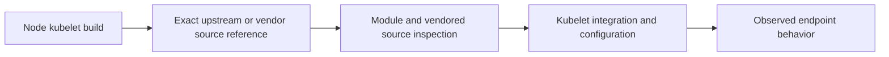

# Find the cAdvisor Version Embedded in a Kubernetes Release

Author: [nawazdhandala](https://www.github.com/nawazdhandala)

Tags: Kubernetes, Monitoring, Observability

Description: Trace a node's kubelet version to the exact Kubernetes dependency and vendored cAdvisor source, while accounting for patch releases, vendor builds, and runtime configuration.

You find a cAdvisor fix in an upstream release and want to know whether your Kubernetes nodes include it. Checking the newest standalone cAdvisor image does not answer that question. The kubelet embeds cAdvisor code as a dependency; it does not automatically pull the latest cAdvisor container image.

The reliable path starts with the node's kubelet build, moves to the matching Kubernetes source, and then examines its dependency and vendored implementation. Runtime metrics provide useful supporting evidence, but a version label alone is not a complete compatibility or security assessment.

This guide uses upstream Kubernetes v1.35.0 as a pinned example. Its dependency files identify cAdvisor v0.53.0. That mapping is scoped to that exact upstream tag, not every Kubernetes 1.35 patch or vendor distribution.

## Identify the kubelet version on each relevant node

With permission to list Nodes, run:

```bash
kubectl get nodes -o jsonpath='{range .items[*]}{.metadata.name}{"\t"}{.status.nodeInfo.kubeletVersion}{"\t"}{.status.nodeInfo.containerRuntimeVersion}{"\n"}{end}'
```

The output contains a node name, kubelet version, and container runtime version per line. This is a read-only API query. It does not require granting access to the kubelet's proxy endpoint or changing node configuration. [Node status fields](https://kubernetes.io/docs/reference/node/node-status/), [kubectl JSONPath](https://kubernetes.io/docs/reference/kubectl/jsonpath/).

Use the kubelet version rather than the kubectl client version or only the API server version. During a rolling upgrade, nodes can have different builds. Record each distinct kubelet version and distribution suffix rather than choosing one representative node and extrapolating to the entire cluster.

The runtime version is useful context because a metric can depend on both the embedded collector and the runtime integration. It is not a substitute for the cAdvisor dependency version.

## Read the exact upstream dependency files

For Kubernetes v1.35.0, the upstream `go.mod` file contains:

```text
github.com/google/cadvisor v0.53.0
```

The matching `vendor/modules.txt` includes the same module version and the vendored cAdvisor package paths. Read both files at the selected release tag. [Kubernetes v1.35.0 go.mod](https://github.com/kubernetes/kubernetes/blob/v1.35.0/go.mod), [vendored module inventory](https://github.com/kubernetes/kubernetes/blob/v1.35.0/vendor/modules.txt).

The following Python 3 example retrieves only those two text files and prints their cAdvisor module entries. It requires HTTPS access to GitHub's raw-content host and changes no cluster resources:

```python
import urllib.request

release = "v1.35.0"  # Replace with the exact upstream release to investigate.
base = f"https://raw.githubusercontent.com/kubernetes/kubernetes/{release}/"
module = "github.com/google/cadvisor"

for filename in ("go.mod", "vendor/modules.txt"):
    with urllib.request.urlopen(base + filename, timeout=20) as response:
        content = response.read().decode("utf-8")
    matches = []
    for line in content.splitlines():
        fields = line.strip().split()
        if filename == "go.mod" and fields and fields[0] == module:
            matches.append(line.strip())
        if filename == "vendor/modules.txt" and fields[:2] == ["#", module]:
            matches.append(line.strip())
    if not matches:
        raise SystemExit(f"No cAdvisor module entry found in {filename}")
    print(filename)
    for match in matches:
        print("  " + match)
```

For the pinned example, expect `v0.53.0` in both sections. The script is a focused text inspection, not a complete Go module resolver. A network error, missing tag, or unexpected file format should stop the investigation rather than become an assumed version.

Inspect the full `go.mod` for replacement directives and the repository for modifications to vendored code. A Go `replace` directive can redirect a dependency to another module version or local path; simply extracting the first version-looking string is not enough. [Go module replacement rules](https://go.dev/ref/mod#go-mod-file-replace).

## Follow the kubelet integration as well as the dependency

The dependency version establishes which upstream code Kubernetes selected. It does not tell you that every standalone cAdvisor feature is enabled in the kubelet. Kubernetes constructs and configures its embedded manager through its own integration code. [Pinned Linux kubelet cAdvisor integration](https://github.com/kubernetes/kubernetes/blob/v1.35.0/pkg/kubelet/cadvisor/cadvisor_linux.go).

When investigating a missing metric, inspect three layers:

| Layer | Question it answers |
| --- | --- |
| Dependency and vendored source | Is the implementation present in this build's source? |
| Kubelet integration | Is that feature or metric group selected and configured? |
| Running node and scrape path | Can the required data be collected and exposed here? |

A feature introduced in a newer standalone image may be absent from the embedded version. A feature already present in source may still be disabled, unavailable on that kernel, or hidden by the scrape configuration. Changing a standalone DaemonSet image does not upgrade the cAdvisor library inside the kubelet binary.

## Treat distribution builds as their own artifacts

A vendor kubelet may carry backported fixes without changing the dependency version to the newest upstream release. It can also contain downstream patches, different build options, or a version suffix that does not correspond directly to an upstream Git tag.

For those builds, obtain the vendor's source reference, software bill of materials, and relevant advisory or patch record. A software bill of materials is an inventory of software components included in an artifact. Keep the exact package or image identity alongside it.

Do not strip a distribution suffix, inspect the nearest upstream version, and report the result as proven for the vendor binary. The upstream mapping is a baseline until the downstream build record confirms it. For vulnerability investigations, verify whether the affected code and fix apply to that build rather than deciding solely from a version-number comparison.



## Cross-check the endpoint without confusing sources

Kubernetes exposes different metric endpoints, including the kubelet's cAdvisor endpoint. Confirm which endpoint and job your monitoring system actually scrapes before interpreting a version metric. A standalone cAdvisor job and a kubelet cAdvisor job can exist on the same node. [Kubernetes system metric endpoints](https://kubernetes.io/docs/concepts/cluster-administration/system-metrics/).

If a version-information metric is present, record its labels as supporting evidence and compare them with the build investigation. Empty, unexpected, or build-dependent version strings should prompt source and packaging review; they do not justify substituting the latest upstream version.

Keep normal authentication and TLS verification in place. This investigation does not require enabling an unauthenticated kubelet port or granting broad proxy privileges merely to obtain a version string.

## Keep the result reproducible

Record the node group, complete kubelet version, source tag or commit, dependency entry, vendored inventory, and any downstream patch evidence. When checking a particular fix, also record the relevant source function or patch and the runtime condition required to exercise it.

The lookup example was executed against the two pinned upstream files and returned cAdvisor v0.53.0 consistently. The node-list query was checked with synthetic Node data; no live cluster inspection is claimed. Repeat the mapping after node upgrades rather than maintaining a permanent assumption that all nodes share one cAdvisor version.

This evidence separates “the source includes this dependency” from “the running deployment provides this behavior,” which is the distinction needed for a useful monitoring compatibility check.
