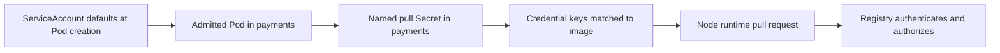

# Fix ImagePullBackOff When the Pull Secret Looks Valid

Author: [nawazdhandala](https://www.github.com/nawazdhandala)

Tags: Kubernetes, Container Registry, Troubleshooting

Description: Trace a pull secret from the Pod's namespace to registry credential matching, and separate missing references from wrong hosts, expired credentials, and TLS failures.

A Kubernetes Secret exists, its JSON parses, and the same account can pull an image from a laptop. Yet the Pod remains in `ImagePullBackOff`. Those observations prove different things. None proves that the node received a matching credential for the image it is trying to pull.

Follow the reference chain before replacing passwords. This guide checks matching and ServiceAccount behavior against **Kubernetes v1.34.1**, with kubectl1.34.0-style examples. Substitute your context, namespace, Pod name, and registry authority throughout.

## Read the failing Pod, not only its controller template

Admission components can add or change Pod fields. Start with the admitted Pod and its events:

```bash
kubectl --context CLUSTER_CONTEXT -n payments get pod POD_NAME -o json \
  | jq '{node: .spec.nodeName,
         serviceAccount: .spec.serviceAccountName,
         pullSecrets: .spec.imagePullSecrets,
         images: [.spec.initContainers[]?.image, .spec.containers[]?.image]}'

kubectl --context CLUSTER_CONTEXT -n payments describe pod POD_NAME
```

The first command prints references and image names without retrieving Secret contents. The second includes event messages; review them locally before sharing because they can contain internal addresses and other operational details.

`ImagePullBackOff` describes retry behavior, not one root cause. An earlier event may identify a missing Secret, rejected credentials, a certificate error, a missing manifest, or a network timeout. A failure to retrieve a named pull secret points to a different stage from an authentication rejection by the registry.

## Follow the namespace boundary

A Pod references pull secrets by name. The referenced Secret must exist in the Pod's namespace. A Secret called `registry-reader` in `default` is not the same object as `registry-reader` in `payments`.



The [private-registry task](https://kubernetes.io/docs/tasks/configure-pod-container/pull-image-private-registry/) documents namespace requirements and the `kubernetes.io/dockerconfigjson` Secret type. A correctly named Secret in another namespace is not a fallback.

Check existence and type using the same context and namespace as the Pod. Avoid diagnosing a production Pod with credentials accidentally inspected from a staging cluster. Where secret synchronization creates namespace-local copies, verify the copy's current contents and rotation status rather than assuming the source Secret and every copy are identical.

## Inspect registry keys without displaying credentials

An authorized operator can print the Secret type and only the top-level registry keys:

```bash
kubectl --context CLUSTER_CONTEXT -n payments get secret registry-reader -o json \
  | jq '{type: .type,
         registryKeys: (.data[".dockerconfigjson"] | @base64d | fromjson | .auths | keys)}'
```

This still requires permission to read the Secret and processes its contents locally. Do not enable shell tracing or capture the unfiltered JSON in shared logs. The output should contain the expected type and registry authorities, not passwords or encoded `auth` values.

Successful JSON parsing only proves structure. It does not prove that a password is current, that a token has permission to pull the repository, or that the node can reach the registry. Also check how the file was produced: a workstation Docker configuration relying on an external credential helper is not automatically a self-contained Kubernetes pull credential.

## Match the image authority and path

For `registry.example.internal:5000/team/widget:release`, the explicit registry authority is `registry.example.internal:5000`. These examples illustrate the pinned matching helper:

| Credential key | Matches that image? |
| --- | --- |
| `registry.example.internal:5000` | Yes |
| `registry.example.internal` | No; port differs |
| `registry.example.internal:5000/other/` | No; repository path differs |
| `*.example.internal:5000` | Yes for this one hostname level |

Kubernetes supports more than literal hostname matching, including glob patterns and path prefixes. Do not assume that every Docker client's matching behavior is identical. The [v1.34.1 keyring source](https://github.com/kubernetes/kubernetes/blob/v1.34.1/pkg/credentialprovider/keyring.go) compares ports, hostname parts, and path prefixes.

Use an explicit registry hostname and a narrowly scoped registry account when repairing a simple mismatch. Credential-key matching selects which credentials to try; it is not a substitute for repository authorization at the registry. In particular, do not treat a path prefix as a security boundary for the account itself.

Check the final admitted image again if a webhook rewrites images to a mirror. A valid credential for the original registry may no longer match the rewritten reference.

## Understand ServiceAccount inheritance

The [ServiceAccount admission code](https://github.com/kubernetes/kubernetes/blob/v1.34.1/plugin/pkg/admission/serviceaccount/admission.go) copies the ServiceAccount's pull-secret references when the incoming Pod has an empty pull-secret list. It does not append them to every explicit list.

This explains a subtle failure: a ServiceAccount has `registry-reader`, but a workload explicitly supplies only `another-registry`. That Pod does not automatically receive the missing reference. Inspect its actual `.spec.imagePullSecrets` instead of inferring it from the ServiceAccount.

Changing the ServiceAccount also does not retroactively rewrite existing Pods. After updating the intended configuration, use the workload's normal controlled rollout to create new Pods. Verify the resulting references before rolling broadly. See the [ServiceAccount configuration task](https://kubernetes.io/docs/tasks/configure-pod-container/configure-service-account/#add-imagepullsecrets-to-a-service-account).

## Repair the narrowest incorrect setting

If a namespace-local Secret is genuinely missing, create a new one from an approved, protected Docker configuration containing the intended credentials:

```bash
kubectl --context STAGING_CONTEXT -n payments create secret generic registry-reader \
  --type=kubernetes.io/dockerconfigjson \
  --from-file=.dockerconfigjson=/protected/registry-reader-config.json
```

This example is for staging and a new Secret; it fails if the name already exists. Existing Secret rotation should use your normal secret-management process. Do not overwrite an unrelated working credential to test a theory.

For a Deployment, the pull-secret reference belongs under the Pod template. Merge this fragment while preserving other references:

```yaml
spec:
  template:
    spec:
      imagePullSecrets:
        - name: registry-reader
```

The fragment is not a complete Deployment. It shows the field location; it does not demonstrate that the Secret exists or that authentication succeeds. Keep repository permission changes separate from fixing a missing reference.

## Prove a real pull, then stop changing credentials

Use an approved image digest that is not already cached on the test node, or a controlled fresh node. Repeat across relevant node pools. Cache hits can make an incomplete fix appear successful; image-pull policy and runtime configuration affect what is exercised.

If the credential matches and the registry rejects it, investigate expiry and repository permissions. If the error is an unknown CA, repair node runtime trust. A pull Secret does not install a certificate authority. If the manifest is missing or the architecture is unsupported, rotating credentials will not solve it.

Local checks executed the unchanged URL-matching functions extracted from Kubernetes v1.34.1 against host, port, path, and wildcard cases. They do not simulate kubelet Secret retrieval or prove a live pull. Completion means the admitted Pod references the intended namespace-local credential and its node successfully pulls the intended image.
