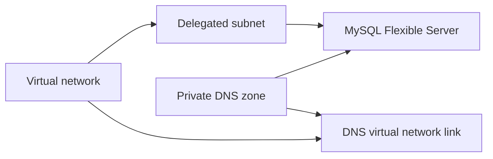

# Import Azure MySQL, VNet, and Private DNS into Terraform Safely

Author: [nawazdhandala](https://www.github.com/nawazdhandala)

Tags: Azure, MySQL, Terraform, Networking

Description: Adopt an existing Azure MySQL server and its private network into Terraform with explicit ownership, reviewed imports, and a no-change acceptance plan.

Importing an Azure MySQL server does not import the network that makes it reachable. The server, its virtual network, the delegated subnet, the private DNS zone, and each DNS link are separate Azure resources. Terraform needs a deliberate ownership decision for each one.

The first successful adoption should change Terraform's knowledge of those objects without changing their Azure configuration. Treat resizing, password rotation, network cleanup, and module refactoring as later changes. Combining them with import makes it much harder to explain an unexpected plan.

This example covers an existing **VNet-integrated** Azure Database for MySQL Flexible Server. A server using Private Link has a different resource graph, including private endpoints; do not invent a delegated subnet for that topology.

## Decide which state owns each object

Terraform **state** records the association between a resource address in code and an actual cloud object. One Azure object should have one managing Terraform address, not competing owners in several states. [Import ownership](https://developer.hashicorp.com/terraform/cli/commands/import)

Before writing code, confirm the subscription, tenant, resource groups, and existing automation owner. Search the relevant Terraform states and deployment repositories. If a networking team already manages the VNet or DNS zone, reference its approved outputs or data sources instead of importing it again.

For a stack owned entirely by your team, the intended relationship might be:



Copy resource IDs from Azure's resource properties. An ID is the full `/subscriptions/...` path, not the display name. The DNS link's name can differ from the VNet name, and the zone can belong to a different resource group.

| Object | Example Terraform address | Adoption check |
|---|---|---|
| Server | `azurerm_mysql_flexible_server.db` | Exact engine, SKU, storage, HA, zone, and networking |
| VNet | `azurerm_virtual_network.db` | All address spaces and existing subnet ownership |
| Delegated subnet | `azurerm_subnet.db` | Prefix, delegation, policies, and associations |
| Private DNS zone | `azurerm_private_dns_zone.db` | Existing zone name and other consumers |
| DNS link | `azurerm_private_dns_zone_virtual_network_link.db` | Correct VNet and registration setting |

Network security groups, route-table associations, peerings, additional DNS links, server parameters, and diagnostic settings need their own inventory. The five objects here are a bounded example, not recursive discovery of everything related to the database.

## Prepare an isolated adoption change

Use the approved backend and workspace, with state locking, access controls, and a current recoverable state version. Pause competing applies during adoption. Keep generated configuration, plan files, and state out of public repositories and unrestricted build artifacts; they can contain sensitive values. [Plan inspection and sensitive data](https://developer.hashicorp.com/terraform/cli/commands/show)

The syntax example pins **Terraform 1.11.4** and **AzureRM 5.14.0**. If an existing workspace uses another version, assess that compatibility separately rather than upgrading its provider merely to copy this example.

Put this in `versions.tf`, replacing the all-zero subscription ID with the confirmed one:

```hcl
terraform {
  required_version = "= 1.11.4"
  required_providers {
    azurerm = {
      source  = "hashicorp/azurerm"
      version = "= 5.14.0"
    }
  }
}

provider "azurerm" {
  features {}
  subscription_id                 = "00000000-0000-0000-0000-000000000000"
  resource_provider_registrations = "none"
}
```

Use an approved Azure authentication method and the intended tenant. Disabling automatic resource-provider registration keeps this adoption configuration from registering unrelated Azure services. Confirm required providers are already registered. Preserve the generated dependency lock file after initialization. [Pinned provider configuration](https://github.com/hashicorp/terraform-provider-azurerm/blob/v5.14.0/website/docs/index.html.markdown)

## Declare the five imports

Save the following as `imports.tf`. Every ID is an illustrative placeholder: replace it with the actual ID, including resource group and resource name. Do not create empty `resource` blocks yet; the next step will request generated configuration.

```hcl
import {
  to = azurerm_mysql_flexible_server.db
  id = "/subscriptions/00000000-0000-0000-0000-000000000000/resourceGroups/rg-db/providers/Microsoft.DBforMySQL/flexibleServers/orders-db"
}

import {
  to = azurerm_virtual_network.db
  id = "/subscriptions/00000000-0000-0000-0000-000000000000/resourceGroups/rg-net/providers/Microsoft.Network/virtualNetworks/db-vnet"
}

import {
  to = azurerm_subnet.db
  id = "/subscriptions/00000000-0000-0000-0000-000000000000/resourceGroups/rg-net/providers/Microsoft.Network/virtualNetworks/db-vnet/subnets/mysql"
}

import {
  to = azurerm_private_dns_zone.db
  id = "/subscriptions/00000000-0000-0000-0000-000000000000/resourceGroups/rg-dns/providers/Microsoft.Network/privateDnsZones/orders.mysql.database.azure.com"
}

import {
  to = azurerm_private_dns_zone_virtual_network_link.db
  id = "/subscriptions/00000000-0000-0000-0000-000000000000/resourceGroups/rg-dns/providers/Microsoft.Network/privateDnsZones/orders.mysql.database.azure.com/virtualNetworkLinks/db-vnet-link"
}
```

The provider documents these import ID shapes separately for the [server](https://github.com/hashicorp/terraform-provider-azurerm/blob/v5.14.0/website/docs/r/mysql_flexible_server.html.markdown), [VNet](https://github.com/hashicorp/terraform-provider-azurerm/blob/v5.14.0/website/docs/r/virtual_network.html.markdown), [subnet](https://github.com/hashicorp/terraform-provider-azurerm/blob/v5.14.0/website/docs/r/subnet.html.markdown), [zone](https://github.com/hashicorp/terraform-provider-azurerm/blob/v5.14.0/website/docs/r/private_dns_zone.html.markdown), and [link](https://github.com/hashicorp/terraform-provider-azurerm/blob/v5.14.0/website/docs/r/private_dns_zone_virtual_network_link.html.markdown).

From the initialized adoption directory, run:

```bash
terraform init
terraform plan -generate-config-out=generated.tf
```

The output path must not already exist. Terraform reads the resources and writes proposed `resource` blocks. This command does not apply the imports. Generation can also produce configuration that needs correction before planning succeeds; keep the diagnostic output and review the generated file. [Configuration generation](https://developer.hashicorp.com/terraform/language/import/generating-configuration)

## Resolve Azure-specific surprises before applying

First inspect the VNet's generated subnet representation. AzureRM does not support managing inline VNet subnets and standalone subnet resources together. Since this example uses a standalone subnet, remove its competing inline representation from the generated VNet configuration. Inventory every other subnet before deciding its ownership. **Do not set `subnet = []` as a cleanup shortcut**: the provider documents that as the explicit removal form. [VNet subnet behavior](https://github.com/hashicorp/terraform-provider-azurerm/blob/v5.14.0/website/docs/r/virtual_network.html.markdown)

Next, compare the server's `delegated_subnet_id` and `private_dns_zone_id` with the existing IDs. Changing either forces server replacement in the pinned provider. A replacement proposal is a reason to stop and fix the representation, not an expected part of import. [Server networking arguments](https://github.com/hashicorp/terraform-provider-azurerm/blob/v5.14.0/website/docs/r/mysql_flexible_server.html.markdown)

Once the imported addresses are established, use references to express relationships: the server's subnet ID can reference `azurerm_subnet.db.id`, for example. In AzureRM 5.14.0 the DNS link uses `private_dns_zone_id`; older examples may use different arguments. Check the pinned schema rather than mixing versions.

Review administrator credentials separately. Import cannot recover the current plaintext password from Azure. Do not fill a missing value with a sample password or trigger rotation just to silence a plan. Review the pinned provider's password and write-only password behavior with your credential-management policy; any intentional rotation deserves its own change.

A `prevent_destroy` lifecycle rule can add protection to important resource blocks, but it does not make in-place updates harmless or protect a resource whose configuration is removed. Avoid blanket `ignore_changes = all`, which can conceal the mismatch you are trying to understand. [Lifecycle behavior](https://developer.hashicorp.com/terraform/language/meta-arguments/lifecycle)

## Accept only the reviewed import plan

After editing generated configuration, run:

```bash
terraform fmt -check
terraform validate
terraform plan -out=adoption.tfplan
terraform show adoption.tfplan
```

For this five-object example, expect five imports and zero additions, changes, or destructions. Inspect the individual resource actions as well as the summary. Authentication failures, unavailable attributes, or a provider/schema mismatch are unresolved work, not permission to apply a partial guess.

After the normal approval for that exact saved plan, run `terraform apply adoption.tfplan`. A saved plan executes its recorded actions, so keep it protected and regenerate it if the infrastructure or configuration has changed. [Plan-and-apply import workflow](https://developer.hashicorp.com/terraform/language/import/single-resource)

Finally, run a normal plan and require no changes. Verify application DNS resolution and database connectivity through the existing network path. Retain the reviewed mapping, lock file, and state recovery point. You now have a documented starting point for future changes, with the existing database and network configuration accounted for.
