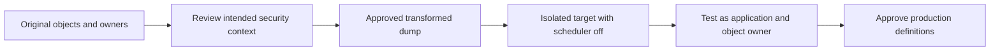

# Import Azure MySQL Stored Objects Without DEFINER or SUPER Errors

Author: [nawazdhandala](https://www.github.com/nawazdhandala)

Tags: Azure, MySQL, Database Migration, Security

Description: Migrate MySQL routines, triggers, and events into Azure by reviewing definers, binary-log restrictions, and the privileges objects need after import.

A schema can load successfully while its business logic fails later. A trigger might refer to an account that does not exist on the target. A procedure might work for the migration administrator but fail for the application. An imported event might start processing jobs before the migration is ready.

Treat stored objects as executable code with an owner and permissions. Fixing a `DEFINER` or `SUPER` error is only the first part of migrating that code safely.

This walkthrough uses a MySQL 8.0 target on Azure Database for MySQL Flexible Server and **MySQL Shell 26.10.0** for a schema-only staging rehearsal. It is not a complete data migration or a claim that the examples were executed against Azure.

## Identify which restriction caused the failure

A **definer** is the MySQL account recorded as an object's owner. For routines and views, `SQL SECURITY DEFINER` uses that owner's privileges, while `SQL SECURITY INVOKER` uses the caller's. Triggers and events execute in definer context; they do not offer the same invoker switch. [Stored-object access control](https://dev.mysql.com/doc/refman/8.0/en/stored-objects-security.html)

Several failures can look similar:

| Failure | Investigate first |
|---|---|
| Import names an old administrator as definer | Whether the target permits assigning that account and whether it exists |
| Error 1419 mentions binary logging and `SUPER` | The target's `log_bin_trust_function_creators` setting |
| Creation succeeds but execution reports an absent definer | The account recorded on the imported object |
| An application loses access after conversion to invoker security | The caller's actual underlying privileges |

Azure does not provide the unrestricted `SUPER` privilege. Asking for it is therefore not a migration plan. Identify the failed statement and error before changing either the object definition or the server configuration. [Azure migration errors](https://learn.microsoft.com/en-us/azure/mysql/flexible-server/how-to-troubleshoot-common-errors)

## Inventory owners before transforming the dump

Run this read-only query on the source and repeat it on the staging target after loading. Replace `appdb` with the intended schema. Use an account authorized to see all relevant objects; an empty or partial result under a restricted account is not a reliable inventory.

```sql
SELECT ROUTINE_TYPE AS object_type, ROUTINE_NAME AS object_name,
       DEFINER, SECURITY_TYPE AS security_context
FROM information_schema.ROUTINES
WHERE ROUTINE_SCHEMA = 'appdb'
UNION ALL
SELECT 'TRIGGER', TRIGGER_NAME, DEFINER, 'DEFINER'
FROM information_schema.TRIGGERS
WHERE TRIGGER_SCHEMA = 'appdb'
UNION ALL
SELECT 'EVENT', EVENT_NAME, DEFINER, 'DEFINER'
FROM information_schema.EVENTS
WHERE EVENT_SCHEMA = 'appdb'
ORDER BY object_type, object_name;
```

The metadata columns come from the documented [ROUTINES](https://dev.mysql.com/doc/refman/8.0/en/information-schema-routines-table.html), [TRIGGERS](https://dev.mysql.com/doc/refman/8.0/en/information-schema-triggers-table.html), and [EVENTS](https://dev.mysql.com/doc/refman/8.0/en/information-schema-events-table.html) tables. Also inventory views if the schema contains them, because the transformation below changes their security context too.

For each object, record its intended target owner, tables it accesses, who calls it, and whether callers deliberately lack direct table privileges. A procedure that provides controlled access to a sensitive table should not silently become an invoker-security procedure that requires broader application grants.

Keep the original definitions as the reference. Do not run a global text replacement over an unreviewed SQL dump: definitions, quoted strings, and executable comments deserve SQL-aware handling, and a syntactically valid rewrite can still change authorization.

## Choose whether stripping definers is appropriate

MySQL Shell's `strip_definers` compatibility option removes explicit definers from views, routines, events, and triggers. It also changes routines and views to invoker security. Objects acquire the default definer associated with the account creating them. This is a security-model change, not merely removal of an obsolete username. [Dump compatibility options](https://dev.mysql.com/doc/mysql-shell/26.10/en/mysql-shell-utilities-dump-instance-schema.html)

Use this option only when that resulting model is approved for the schema. If some procedures must retain definer security, prepare separately reviewed definitions and an approved owner account instead of applying this transformation indiscriminately. Create those objects under the intended account where possible, with narrowly scoped privileges, and verify the resulting ownership.

For triggers and events, do not leave a disposable migration account as the accidental long-term owner. Decide how the owner account will be maintained before loading. Equally, do not create everything as a highly privileged administrator merely because that avoids an import error.



## Create a schema-only rehearsal artifact

Prerequisites are an authorized source connection, a new protected output directory path, source privileges required by the dump utility, and sufficient local disk space. Connect MySQL Shell to the source using certificate and hostname verification, then run this in JavaScript mode:

```javascript
util.dumpSchemas(["appdb"], "/secure/export/appdb-schema-review", {
  ddlOnly: true,
  routines: true,
  triggers: true,
  events: true,
  compatibility: ["strip_definers"]
});
```

`ddlOnly` exports definitions without table data. The explicit object options make the intended scope visible. The result also contains schema and table definitions, so this is suitable for an empty isolated target, not for blindly loading over populated production tables. These options are present in the pinned [schema options](https://github.com/mysql/mysql-shell/blob/26.10.0/modules/util/dump/dump_schemas_options.cc) and [DDL options](https://github.com/mysql/mysql-shell/blob/26.10.0/modules/util/dump/ddl_dumper_options.cc).

Inspect the generated definitions against the originals and your ownership decisions. This artifact is not a data backup. A later production migration still needs its own consistent data-copy, cutover, and recovery plan.

## Check binary-log restrictions independently

On the target, inspect:

```sql
SELECT @@GLOBAL.log_bin AS binary_logging,
       @@GLOBAL.log_bin_trust_function_creators AS trust_function_creators,
       @@GLOBAL.event_scheduler AS scheduler_state;
```

Azure documents `log_bin_trust_function_creators=ON` as the Flexible Server default, but inspect the actual value. An override to `OFF` can cause function or trigger creation to fail with error 1419. If a change is justified, use Azure's server-parameter controls under the normal approval process. This setting does not repair an invalid definer or grant missing object privileges. [Azure parameter behavior](https://learn.microsoft.com/en-us/azure/mysql/flexible-server/concepts-server-parameters)

Review function declarations honestly. Do not mark a function deterministic just to bypass a restriction when its result can vary for the same inputs. Deterministic means that the same inputs produce the same result. Binary-log rules do not replace review of what the function actually does. [Stored programs and binary logging](https://dev.mysql.com/doc/refman/8.0/en/stored-programs-logging.html)

Keep the event scheduler off on the isolated target during loading and review. Creating an event definition and allowing scheduled execution are separate decisions.

## Load into staging, then test permissions

Reconnect MySQL Shell to the empty Azure staging target using the reviewed owner account and verified TLS. Confirm the hostname and current account before proceeding. Start with:

```javascript
util.loadDump("/secure/export/appdb-schema-review", {dryRun: true});
```

The dry run describes planned actions and detects issues available from the dump and options. It does not execute every routine or prove its runtime permissions. After reviewing it, run the actual staging import:

```javascript
util.loadDump("/secure/export/appdb-schema-review");
```

The second call creates objects. Do not point it at an existing production schema. Retain the loader's output and progress records; if loading fails partway through, inspect what exists before deciding whether to resume or recreate the disposable target. [Dump loading behavior](https://dev.mysql.com/doc/mysql-shell/26.10/en/mysql-shell-utilities-load-dump.html)

Compare object counts, definitions, owners, and security contexts. Populate only approved test fixtures. Call routines using the application account, exercise the table operations that fire triggers, and check both expected successes and expected denials. Administrator-only tests miss permission regressions.

Review event schedules, time zones, owners, and side effects before any controlled scheduler test. Ensure only the intended environment can perform each business job. Keep production scheduling disabled until the migration owner explicitly authorizes its activation.

The acceptance result should show more than a clean import log: every object has an intentional owner, required callers can use it, unauthorized callers remain denied, and scheduled work runs only where intended. That is the evidence that the stored logic survived the migration.
