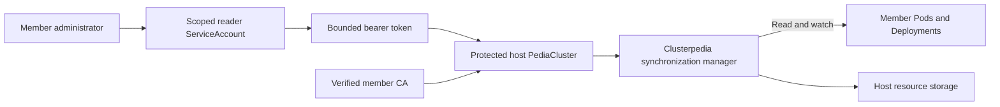

# Import a Cluster into Clusterpedia with a Scoped ServiceAccount

Author: [nawazdhandala](https://www.github.com/nawazdhandala)

Tags: Kubernetes, RBAC, ServiceAccount, Multi-Cluster

Description: Import Pods and Deployments into Clusterpedia using explicit read permissions, verified CA data and a bounded ServiceAccount token with a rotation plan.

Giving Clusterpedia a cluster-admin kubeconfig makes onboarding easy, but also grants far more access than a resource inventory needs. Start by deciding which resources to synchronize, then authorize that exact workload and the discovery calls its client requires.

This example targets **Clusterpedia v0.9.0** and imports **Pods and Deployments across all namespaces**. It is a scoped starting policy, not a claim that one role is the minimum for every Clusterpedia feature. The YAML and generated import were checked locally; no member cluster or live authorization service was tested.

## Separate the two clusters and identities

The **host cluster** runs Clusterpedia and stores the PediaCluster registration. The **member cluster** supplies resources. A host administrator creates the registration, while a dedicated member ServiceAccount supplies read access to the selected resources.

Use explicit context placeholders throughout: `HOST_CONTEXT` identifies the host, and `MEMBER_CONTEXT` identifies the member. Resolve them before applying any object. The account issuing ServiceAccount tokens needs separate authorization to request those tokens; the reader itself does not need that permission.



Clusterpedia's [import documentation](https://clusterpedia.io/docs/usage/import-clusters/) supports an API endpoint plus CA and token data. These fields carry credentials, even though the registration is a custom resource rather than a Secret. Restrict who can read PediaClusters, protect host storage and backups, and avoid writing complete registration objects to logs.

## Grant selected resource reads and discovery

Save the accompanying [member-rbac.yaml](member-rbac.yaml). It creates namespace `clusterpedia-reader`, ServiceAccount `resource-reader`, a ClusterRole and a binding to that account. The resource portion of the role is:

```yaml
rules:
- apiGroups: [""]
  resources: ["pods"]
  verbs: ["get", "list", "watch"]
- apiGroups: ["apps"]
  resources: ["deployments"]
  verbs: ["get", "list", "watch"]
- apiGroups: ["apiextensions.k8s.io"]
  resources: ["customresourcedefinitions"]
  verbs: ["get", "list", "watch"]
- apiGroups: ["apiregistration.k8s.io"]
  resources: ["apiservices"]
  verbs: ["get", "list", "watch"]
- nonResourceURLs: ["/api", "/api/*", "/apis", "/apis/*", "/version", "/readyz", "/healthz"]
  verbs: ["get"]
```

The last three rules support discovery and health checks, not synchronization of all custom resources. In v0.9.0, the [dynamic discovery manager](https://github.com/clusterpedia-io/clusterpedia/blob/v0.9.0/pkg/runtime/discovery/dynamic_discovery.go) creates controllers for custom resource definitions and APIService registrations. Its [health checker](https://github.com/clusterpedia-io/clusterpedia/blob/v0.9.0/pkg/synchromanager/clustersynchro/cluster_monitor.go) requests `/readyz`, falling back to `/healthz` on a missing endpoint.

The policy grants no writes, Secrets, Pod logs or execution access. It does expose the selected workload objects throughout the member cluster, including their specifications. Review that data exposure with the cluster owner. A namespace-scoped requirement needs a separately designed and tested synchronization arrangement; replacing this ClusterRoleBinding with a RoleBinding does not make cluster-wide list requests work.

Kubernetes [RBAC permissions are additive](https://kubernetes.io/docs/reference/access-authn-authz/rbac/). Ensure the new account has no other binding that expands its access. There is no deny rule in this manifest that cancels a broad existing grant.

After review, apply the complete file to the member:

```bash
kubectl --context=MEMBER_CONTEXT apply -f member-rbac.yaml
```

The ServiceAccount sets `automountServiceAccountToken: false`. That prevents automatic token mounting when Pods use the account; it does not prohibit explicitly requesting a token for this integration.

## Request a bounded credential and retain the CA

For an initial staging import, request a one-hour token and write it directly to a protected file:

```bash
set -euo pipefail
umask 077
kubectl --context=MEMBER_CONTEXT -n clusterpedia-reader \
  create token resource-reader --duration=1h > member.token
```

The API server can return a duration different from the requested duration. Record the actual expiration and plan renewal before it. The [kubectl token command](https://kubernetes.io/docs/reference/kubectl/generated/kubectl_create/kubectl_create_token/) uses the TokenRequest API; this example does not create a permanent token Secret.

Obtain the verified member API CA chain from your cluster administrator and save it as `member-ca.crt`. Confirm the API hostname matches the server certificate and that the host's synchronization Pods can reach it. Do not omit the CA to work around a trust problem: the v0.9.0 [connection builder](https://github.com/clusterpedia-io/clusterpedia/blob/v0.9.0/pkg/utils/rest.go) enables insecure TLS when direct CA data is absent.

A short-lived token copied into a PediaCluster is static data. It will not refresh itself. Before treating this as a durable production integration, implement and test a renewal process that requests a replacement and updates the host registration before the previous credential expires.

## Generate the registration without printing credentials

Save [make-import.py](make-import.py) beside the token and CA files. This Python 3 helper builds the JSON registration, base64-encodes the raw CA and token once, and creates `member-a.json` with owner-only permissions. It rejects an empty or unparsable CA, a whitespace-containing token, an HTTP endpoint and an existing output file.

Set the endpoint placeholder to the real member API address:

```bash
export MEMBER_API='https://member-api.example.internal:6443'
python3 make-import.py
```

The helper's synchronization selection is explicit:

```yaml
syncResources:
- group: ""
  versions: ["v1"]
  resources: ["pods"]
- group: apps
  versions: ["v1"]
  resources: ["deployments"]
```

Its generated API version is `cluster.clusterpedia.io/v1alpha2`, with kind `PediaCluster` and name `member-a`. Rename deliberately for each member. Base64 is an encoding, not encryption; the output file is sensitive and must stay outside source control.

The generated object was validated against the pinned chart's PediaCluster schema using a local test CA and synthetic token. That verifies structure and encoding, not token acceptance, certificate hostname validation or network connectivity.

Apply the registration to the host only after reviewing the intended member identity and credential handling:

```bash
kubectl --context=HOST_CONTEXT apply -f member-a.json
kubectl --context=HOST_CONTEXT get pediacluster member-a
```

The selected `syncResources` and member RBAC work together. The selection limits intended collection; the member API authorizer limits what a compromised credential can request. Expanding either one deserves an explicit review of the other.

## Test the boundaries and renewal path

Use the issued credential in a separate protected client configuration for acceptance testing. Verify that Pod and Deployment list/watch operations succeed, while reading Secrets and creating or deleting workloads are denied. Test discovery and health endpoints too. Administrator impersonation checks can help diagnose RBAC, but they do not prove that the real token, its audience and its CA configuration work.

Inspect the PediaCluster conditions and per-resource synchronization status. A healthy API connection is not enough if one selected resource repeatedly returns forbidden. Confirm that a known member object becomes searchable and that updates propagate.

Finally, rehearse credential replacement and expiration in staging. Confirm the new token restores synchronization, retain monitoring for authorization failures, and remove expired credential files under your secret-handling policy. Clusterpedia v0.9.0 also contains a Secret-reference authentication feature, but its [`ClusterAuthenticationFromSecret` gate](https://github.com/clusterpedia-io/clusterpedia/blob/v0.9.0/pkg/synchromanager/features/features.go) is alpha and disabled by default; do not assume adding a Secret reference alone enables it.

Keep the role narrow as the inventory grows. Add a resource group deliberately, verify the expected reads and denied writes, and document why the additional data belongs in the host's searchable store.
