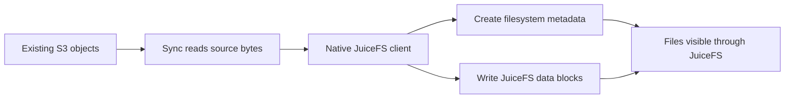

# Import Existing S3 Objects into JuiceFS with a Verified Sync Workflow

Author: [nawazdhandala](https://www.github.com/nawazdhandala)

Tags: JuiceFS, S3, Storage

Description: Import an existing S3 prefix into JuiceFS without confusing raw objects with filesystem data, and verify paths, content, and cutover boundaries.

Pointing a newly formatted JuiceFS volume at a bucket containing photographs or reports does not make those objects appear as files. JuiceFS needs filesystem metadata and its own data representation. Existing S3 objects have neither merely because they live in the selected bucket.

The migration is an explicit copy through a JuiceFS client. This guide uses **JuiceFS Community Edition 1.4.2** and `juicefs sync`, with a separate destination filesystem and a dedicated import directory. It preserves the source while you verify the result.

## Understand the two storage layouts

An ordinary object such as `reports/2026/summary.csv` is addressed by a bucket and key. JuiceFS files are described by metadata that maps names and file offsets to stored data. Copying a raw CSV into JuiceFS's backing object prefix bypasses that metadata and does not create a readable filesystem file.

The [JuiceFS FAQ](https://github.com/juicedata/juicefs/blob/v1.4.2/docs/en/faq.md) explicitly directs existing-object migrations to `juicefs sync`.



Use a destination bucket or namespace reserved for the new filesystem. Keeping source and backing storage separate makes permissions, capacity accounting, and rollback easier to reason about. Never format over an existing JuiceFS volume to make missing raw objects visible.

## Define the migration boundary

Choose one source prefix and one new destination directory for the first run. For example:

| Item | Example | Meaning |
| --- | --- | --- |
| Source | `s3://source-bucket.s3.us-east-2.amazonaws.com/reports/` | Existing objects below `reports/` |
| Destination | `jfs://importfs/imports/reports/` | New directory inside the destination volume |
| Metadata alias | Environment variable `importfs` | Connection to the already formatted JuiceFS filesystem |

The names are placeholders. Replace the region, bucket, prefix, metadata endpoint, and import directory before execution. Keep the trailing slashes in this directory-copy example and verify the resulting paths with a small sample before copying the full prefix.

S3 keys are a flat namespace. Keys such as `a` and `a/b` can coexist there, but a filesystem cannot make `a` both a regular file and a directory. Inventory naming collisions, unusual path components, directory-marker objects, and application assumptions before migration. AWS describes the distinction between keys and inferred folders in its [object naming documentation](https://docs.aws.amazon.com/AmazonS3/latest/userguide/object-keys.html).

Also define what is outside scope. A filesystem copy does not automatically reproduce bucket version history, lifecycle rules, IAM permissions, or every object tag and HTTP metadata field. Preserve any application-required attributes in a separate manifest or supported migration mechanism.

## Prepare credentials and the destination

Create and validate the destination JuiceFS filesystem first. The copying process needs source listing and reading permissions, plus the destination's metadata and data-storage permissions. If either side uses encryption keys, ensure the process can access the required keys through an approved secret mechanism.

For Amazon S3, the client can use the AWS SDK credential configuration when credentials are not embedded in the URL. Use an approved role or securely supplied credentials; do not put access keys in the command line. The [tagged S3 implementation](https://github.com/juicedata/juicefs/blob/v1.4.2/pkg/object/s3.go) uses the SDK's default configuration loading path.

Set the alias and paths in Bash:

```bash
export importfs='rediss://metadata.example.internal:6379/9'
SRC='s3://source-bucket.s3.us-east-2.amazonaws.com/reports/'
DST='jfs://importfs/imports/reports/'
```

The alias is looked up by the native `jfs://` backend. It is not a bucket name, mountpoint, or new formatting request. Supply metadata authentication using the deployment's secure configuration. Avoid shell tracing or logging secret-bearing connection strings.

The native path accesses JuiceFS without a FUSE mount. That is useful for an import worker and avoids accidentally copying into an ordinary local directory when an expected mount is missing. Use the Community Edition client for a Community Edition destination; the editions' native metadata integrations are different. See the [versioned synchronization guide](https://github.com/juicedata/juicefs/blob/v1.4.2/docs/en/guide/sync.md#sync-without-mount-point).

## Preview, then copy a controlled prefix

First inspect the selection:

```bash
juicefs sync --dry --threads 4 "$SRC" "$DST"
```

Dry mode previews copying decisions. It is not a substitute for checking credentials, naming compatibility, or available capacity, and it does not prove that every object can be successfully read and written. Review the selected paths and summary before proceeding.

For the actual copy:

```bash
juicefs sync --threads 4 --check-new "$SRC" "$DST"
```

Four workers are a conservative staging example, not a throughput recommendation. `--check-new` verifies newly copied content. Review failed-object counts and the command's exit status, not just its last progress line. Retain logs and the source inventory with the migration record.

This command can overwrite destination files selected by the synchronization rules. Use a new import directory with no application writers. Do not add `--delete-src`, `--delete-src-after`, or `--delete-dst` to the initial migration. These options introduce source removal or destination pruning and deserve a separate retention decision.

## Verify content, including same-size changes

Default incremental copying uses size differences to decide whether an existing destination needs replacement. Equal size is not equal content. A source object can change while keeping the same byte count.

After stopping source writers for the final reconciliation window, run:

```bash
juicefs sync --threads 4 --check-all "$SRC" "$DST"
```

This is a synchronization operation that checks content and can copy replacements. It is **not a read-only comparison**. Keep destination writers stopped too, and retain the source until verification and cutover are accepted. The synchronization guide documents byte-by-byte checks and the difference between default incremental behavior and checksum options.

Compare object counts and total logical bytes for the agreed selection, then validate representative file hashes and application reads. Include empty files, nested paths, large files, non-ASCII names used by your application, and known naming edge cases. Counts alone cannot detect one wrong file replacing another.

`--check-all` does not make a changing source transactional. If writers continue during enumeration and copying, the result can combine different moments in time. Use a controlled write pause or an independently defined immutable source dataset for a reliable cutover boundary.

## Test the workflow before scaling it

Local validation for this guide used JuiceFS 1.4.2 with disposable SQLite metadata and local object storage. A native `jfs://` import preserved nested paths, an empty file, and binary content. A dry run copied no files. Changing a source file to different bytes of the same length and rerunning `--check-all` updated the destination correctly.

Those tests did not exercise an S3 service, network authentication, or cloud transfer costs. Run a small real-prefix rehearsal to measure those factors. Check that the import worker has enough memory, metadata capacity, and bandwidth, and that destination backups cover the newly created files.

## Cut over with a clear writer boundary

Finish the final checked pass while the source remains stable. Start controlled application reads against JuiceFS, confirm permissions and expected paths, and only then move normal writers to the new filesystem. Retain the original S3 data for the agreed recovery period.

Once new writes land in JuiceFS, switching applications back to the old bucket is no longer a complete rollback: it would omit those changes. Plan how to capture or reconcile them before making that switch. The migration is complete when applications use the verified filesystem and the recovery plan accounts for new writes, not merely when the copy command exits successfully.
