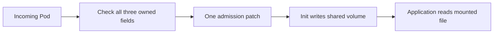

# Inject an Init Container, Volume, and Mount with One JSON Patch

Author: [nawazdhandala](https://www.github.com/nawazdhandala)

Tags: Kubernetes, Python, Automation

Description: Build one admission patch for an init container and shared volume, preserve existing Pod fields, and test conflicts before injecting a mount.

An init container that prepares files needs somewhere to put them. The application needs a mount pointing at the same volume. Injecting only one of these pieces can leave a Pod invalid or leave the application looking at an empty directory.

Treat the three changes as one mutation contract: a preparation container, a shared volume, and a mount in a specifically selected application container. Plan the complete change before returning a single JSON Patch in the admission response. Do not make three separate API requests from the webhook.

This walkthrough uses the **Kubernetes v1.35.0** Pod API and tests patch behavior with **Python 3.11** and **jsonpatch 1.33**. Its image names are explicit placeholders for approved images; the example does not claim that those images exist or have been run.

## Define what the helper actually prepares

Suppose an application reads an optional profile file from `/run/platform-profile/profile.txt`. An ordinary init container writes that file and exits. Kubernetes runs ordinary init containers to completion before starting application containers; this is different from a restartable sidecar. See the [init container lifecycle](https://kubernetes.io/docs/concepts/workloads/pods/init-containers/) and [sidecar distinction](https://kubernetes.io/docs/concepts/workloads/pods/sidecar-containers/).



The arrows after admission describe runtime dependencies, not actions performed by the webhook. Admission cannot prove that the image will pull, its command will succeed, or the application will read the file.

Use an `emptyDir` volume for this temporary exchange. It belongs to the Pod's lifetime and is not a durable configuration backup. Both containers mount the same named volume, while the application receives a read-only mount. Kubernetes documents the [storage lifetime and sharing behavior](https://kubernetes.io/docs/concepts/storage/volumes/#emptydir).

## Start with a deliberately small fixture

Save this as `pod.json`. Replace the application image before using the fixture with an actual cluster. The application must understand the profile path; merely adding a file does not configure an arbitrary program.

```json
{
  "apiVersion": "v1",
  "kind": "Pod",
  "metadata": {"name": "profile-demo"},
  "spec": {
    "containers": [{
      "name": "app",
      "image": "registry.example.internal/demo/app:REPLACE_ME"
    }]
  }
}
```

For this fixture only, there are no existing volumes, init containers, or application mounts. That lets the following patch create each missing array. Save it as `patch.json`.

```json
[
  {
    "op": "test",
    "path": "/spec/containers/0/name",
    "value": "app"
  },
  {
    "op": "add",
    "path": "/spec/volumes",
    "value": [{"name": "platform-profile", "emptyDir": {}}]
  },
  {
    "op": "add",
    "path": "/spec/initContainers",
    "value": [{
      "name": "platform-profile-init",
      "image": "registry.example.internal/platform/profile-writer:REPLACE_ME",
      "command": ["/bin/sh", "-ec"],
      "args": ["printf '%s\\n' standard > /work/profile.txt"],
      "volumeMounts": [{"name": "platform-profile", "mountPath": "/work"}]
    }]
  },
  {
    "op": "add",
    "path": "/spec/containers/0/volumeMounts",
    "value": [{
      "name": "platform-profile",
      "mountPath": "/run/platform-profile",
      "readOnly": true
    }]
  }
]
```

The helper image must contain `/bin/sh` and `printf`, and its configured user must be allowed to write to `/work`. Choose a verified digest and suitable permissions in your real injection contract. Do not solve a permissions failure by silently adding privileged access. Apply the namespace's [Pod Security requirements](https://kubernetes.io/docs/concepts/security/pod-security-standards/) to the helper as well as the application.

The name test documents which container index this particular patch targets. A real planner must locate `app` by name in the current request instead of assuming it is always index zero.

## Understand what atomic means here

JSON Patch operations run in order against one document. A failed operation stops evaluation. Kubernetes admission accepts a patch in a single response and evaluates the resulting object before persistence; this is not a transaction across multiple Pods or external services. The [JSON Patch standard](https://www.rfc-editor.org/rfc/rfc6902) defines operation and failure semantics.

A library may mutate an in-memory object before raising an error if asked to operate in place. Keep the original input intact during planning and local tests. Never send a partial patch merely because the first two changes were easy to construct.

Return the complete operation array through the documented [AdmissionReview response format](https://kubernetes.io/docs/reference/access-authn-authz/extensible-admission-controllers/#response): matching request UID, `patchType: JSONPatch`, and the correctly encoded patch. That response envelope is separate from the raw array shown here.

## Adapt array paths without erasing user configuration

The fixture patch is intentionally not a general injector. JSON Patch `add` at an existing object member replaces that member's value. Applying this patch blindly to a Pod with volumes would overwrite its volume list.

A production planner should make these decisions from the current incoming object:

| Incoming state | Planner action |
|---|---|
| Array absent or null | Add the complete new array at its field path |
| Array exists, including an empty array | Append the new item using the `/-` path |
| Owned name or target mount path conflicts | Stop and report the conflict before returning any patch |
| All owned fields already satisfy the contract | Return no patch |
| Only part of the contract exists | Use an explicit repair policy or report a conflict |

For example, append to `/spec/volumes/-` when `spec.volumes` is already an array. Do the corresponding check independently for `initContainers` and the selected container's `volumeMounts`. An append requires an existing array; it cannot create a missing parent.

Check container names across ordinary and init containers. Check volume names across all volumes, and check the application's mount path as well as the volume name. The [v1.35 API definitions](https://github.com/kubernetes/api/blob/v0.35.0/core/v1/types.go) describe these fields and uniqueness constraints.

An existing volume called `platform-profile` might be a Secret volume, not your scratch space. An existing mount at `/run/platform-profile` might expose application configuration. Neither is permission to replace it. Also review nested or parent mount paths that could hide the intended file location.

## Test patch mechanics locally

In an isolated Python 3.11 environment with `jsonpatch==1.33` installed, this script applies the fixture without modifying its original dictionary:

```python
import json
import jsonpatch

with open("pod.json") as stream:
    original = json.load(stream)
with open("patch.json") as stream:
    operations = json.load(stream)

mutated = jsonpatch.apply_patch(original, operations, in_place=False)
assert "volumes" not in original["spec"]
assert mutated["spec"]["volumes"][0]["name"] == "platform-profile"
assert mutated["spec"]["containers"][0]["volumeMounts"][0]["readOnly"] is True
print(json.dumps(mutated, indent=2))
```

Expect the printed Pod to contain all three additions and the original application image. This exercises the [library's patch implementation](https://github.com/stefankoegl/python-json-patch/blob/v1.33/jsonpatch.py), not Kubernetes admission or container startup.

Before deploying a general planner, add fixtures with existing arrays, reordered application containers, conflicting volume sources, duplicate names, and partial injection. Reapply the planner to its own result and to API-defaulted objects: harmless defaults must not trigger duplicate helpers. Reinvocation can expose changes made by another webhook, so inspect actual fields rather than trusting an annotation saying injection happened earlier.

Finally, use staging admission requests and a real Pod lifecycle test. Verify the resulting fields, the helper's successful exit, the file contents, and the application's read access. A valid patch establishes object structure; a working startup sequence requires those additional checks.
