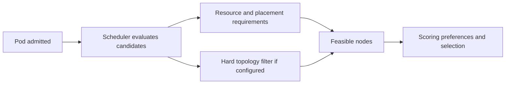

# Inject Topology Spread Without Unexpected Pending Pods

Author: [nawazdhandala](https://www.github.com/nawazdhandala)

Tags: Kubernetes, DevOps

Description: Design opt-in topology-spread defaults with correct selectors, preserve existing constraints, and test hard scheduling boundaries before rollout.

A webhook adds a zone-spreading rule to every Pod. The configuration passes admission, but a deployment stalls because its eligible nodes occupy fewer zones than the policy assumes. The webhook has changed scheduling requirements without checking whether the workload can satisfy them.

Topology spread should be an explicit workload policy. A webhook can apply that policy consistently, but it cannot promise that capacity, volume placement, node affinity, and other scheduling conditions will all cooperate. Start with a clear distinction between a preference and a requirement.

## Choose the availability tradeoff deliberately

Kubernetes [topology spread constraints](https://kubernetes.io/docs/concepts/scheduling-eviction/topology-spread-constraints/) use a topology key, such as `topology.kubernetes.io/zone`, to group nodes into domains. A domain is a particular value of that label: for example, one zone.

`whenUnsatisfiable: ScheduleAnyway` expresses a spreading preference. `DoNotSchedule` can prevent placement when the hard skew condition is not satisfied. Skew measures imbalance among the relevant domains. Neither option guarantees that the application will have enough capacity or achieve a particular placement under every condition.

For a general opt-in default, a soft preference can be a reasonable starting point when scheduling availability is more important than strict separation. For a workload whose recovery design requires hard separation, keep the hard rule and plan capacity for it. Do not silently downgrade a hard requirement merely to make Pending Pods disappear.

## Make the selector describe the actual workload

A topology constraint counts matching Pods in the same namespace. If its selector matches nothing, it does not describe the replica group you intended. If it matches several unrelated services, their placements influence one another.

Use stable labels that identify the workload instance, and ensure the incoming Pod matches them. This example uses `app.kubernetes.io/instance: checkout-prod`, which must be unique to the intended replica group within its namespace. It is an application convention, not an automatic Kubernetes uniqueness guarantee.

The following Kubernetes v1.35-compatible fragment belongs in a Deployment's Pod template. Merge it with the application's existing container configuration; it is not a complete Deployment:

```yaml
spec:
  template:
    metadata:
      labels:
        app.kubernetes.io/instance: checkout-prod
    spec:
      topologySpreadConstraints:
        - maxSkew: 1
          topologyKey: topology.kubernetes.io/zone
          whenUnsatisfiable: ScheduleAnyway
          labelSelector:
            matchLabels:
              app.kubernetes.io/instance: checkout-prod
```

A Pod-mutating webhook writes the equivalent constraint under the admitted Pod's `spec`, not under `spec.template.spec`. The template contains the desired configuration for future Pods; the created Pod has a different object shape.

The [v0.35 API definitions](https://github.com/kubernetes/api/blob/v0.35.0/core/v1/types.go) document the constraint fields and their relationships. Avoid adding `minDomains` to a soft preference: it is associated with `DoNotSchedule`. Also decide deliberately whether rollout revisions should count together before adopting revision-based matching fields such as `matchLabelKeys`.

## Inject only within a narrow contract

This Python 3.11 helper generates a default for an eligible Pod. The surrounding handler must select approved namespaces or workload profiles before calling it. Existing nonempty constraints are left untouched, including hard constraints. The helper returns JSON Patch operations, not an AdmissionReview response.

```python
def default_spread_patch(pod):
    spec = pod.get("spec")
    if not isinstance(spec, dict):
        raise ValueError("expected Pod spec")
    constraints = spec.get("topologySpreadConstraints")
    if constraints is not None and not isinstance(constraints, list):
        raise ValueError("topologySpreadConstraints must be a list")
    if constraints:
        return []

    labels = pod.get("metadata", {}).get("labels") or {}
    instance = labels.get("app.kubernetes.io/instance")
    if not isinstance(instance, str) or not instance:
        raise ValueError("eligible workload needs an instance label")
    constraint = {
        "maxSkew": 1,
        "topologyKey": "topology.kubernetes.io/zone",
        "whenUnsatisfiable": "ScheduleAnyway",
        "labelSelector": {"matchLabels": {
            "app.kubernetes.io/instance": instance,
        }},
    }
    return [{
        "op": "add",
        "path": "/spec/topologySpreadConstraints",
        "value": [constraint],
    }]
```

Absent, null, or empty constraint lists receive the default. If users need an explicit opt-out, define it in your platform policy; an empty list is not an opt-out for this helper. Validate the label's permitted meaning when selecting the workload profile rather than treating any user-supplied instance string as authorization.

Calling the helper again on the patched object returns no operations. It does not append a second constraint, remove a user's rule, or perform node lookups during admission. Those properties make the transformation predictable, but they do not prove that the scheduler can place a Pod.

## Understand the hard-rule failure case

Consider a different policy using `DoNotSchedule`, `maxSkew: 1`, and `minDomains: 3`. Suppose only two eligible zones are represented, each already containing one matching Pod. The new Pod also matches the selector.

In the [Kubernetes v1.35 filter implementation](https://github.com/kubernetes/kubernetes/blob/v1.35.0/pkg/scheduler/framework/plugins/podtopologyspread/filtering.go), fewer eligible domains than `minDomains` makes the global minimum zero. Placing the new Pod in either existing zone produces:

```text
existing matching Pods + incoming matching Pod - global minimum
                       1 + 1 - 0 = 2
```

That exceeds a maximum skew of one. The rule is doing what it was asked to do; adding a webhook retry does not create the missing domain. With the same simplified counts and `minDomains: 1`, the global minimum is one, so the calculated skew becomes one instead. This arithmetic isolates the topology filter only, not the whole scheduling decision.



## Inspect eligible placement, not just zone names

With read access to the staging cluster, inspect node labels:

```bash
kubectl get nodes -L topology.kubernetes.io/zone,kubernetes.io/hostname
```

This inventory shows labels, not a guarantee that each node is usable by the Pod. [Node affinity and selectors](https://kubernetes.io/docs/concepts/scheduling-eviction/assign-pod-node/) restrict placement. [Taints and tolerations](https://kubernetes.io/docs/concepts/scheduling-eviction/taint-and-toleration/) impose additional conditions. Resource shortages and volume restrictions can narrow the usable set further.

Topology-domain counting and actual node feasibility are related but not identical. Review the constraint's node-inclusion policies and the installed scheduler configuration rather than treating every advertised zone as available capacity.

For a stalled staging Pod, replace the namespace and name below and inspect its scheduling events:

```bash
kubectl describe pod POD_NAME -n WORKLOAD_NAMESPACE
```

The [`describe` command](https://kubernetes.io/docs/reference/kubectl/generated/kubectl_describe/) helps expose scheduling messages alongside the stored Pod configuration. Read the reported combination of constraints before changing policy. A memory shortage will not be solved by editing a spread selector.

## Test the policy before broad activation

Locally, verify that the patch preserves unrelated fields, matches the incoming Pod's instance label, and becomes a no-op after application. Include preexisting soft and hard constraints and missing-label cases. The helper and schema checks for this article ran locally; no scheduler or cluster placement test was executed.

In staging, exercise normal placement, reduced eligible domains, constrained capacity, and a rolling update. Observe where Pods actually land and whether failures match the chosen tradeoff. Expand injection only after the workload owner understands both the preference it adds and the hard conditions it preserves.
