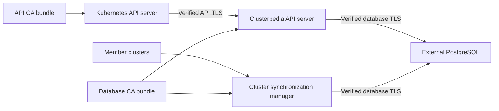

# Install Clusterpedia with Helm and an External Database

Author: [nawazdhandala](https://www.github.com/nawazdhandala)

Tags: Kubernetes, Helm, PostgreSQL, MySQL

Description: Configure Clusterpedia chart 2.7.0 with an external database, Secret-based credentials, verified TLS and locally reviewed deployment manifests.

Clusterpedia collects Kubernetes resources from member clusters into a searchable store. Its API server answers queries from that store, while the cluster synchronization manager keeps the stored resources current. An external database lets your database team manage persistence, backups and capacity independently of the Helm release.

This walkthrough pins **Clusterpedia chart 2.7.0**, application **v0.9.0**, and uses **Helm 3.17.3** for local rendering. PostgreSQL is the concrete example; the chart also supports MySQL. The manifests and customization were tested locally, but no Kubernetes installation or database connection was executed.

## Prepare the database and trust material

Provision a dedicated database and application account before installation. Allow the schema creation and migration operations required by the selected Clusterpedia release, without granting unrelated administrative access. Agree on backups, connection limits and network access from the Clusterpedia namespace.

The [storage documentation](https://clusterpedia.io/docs/installation/configuration/configure-internalstorage/) identifies PostgreSQL and MySQL as supported backends. Check compatibility against your chosen release and database service rather than assuming every server version works.

For the PostgreSQL example, prepare a protected local file named `database.dsn` containing the real connection string. Its shape is:

```text
host=db.example.internal port=5432 user=clusterpedia password='REPLACE_LOCALLY' dbname=clusterpedia sslmode=verify-full sslrootcert=/etc/database-ca/ca.crt
```

This is a placeholder, not a working credential. Use the driver's quoting rules for special characters, keep the file out of version control, and restrict its permissions. The v0.9.0 [storage implementation](https://github.com/clusterpedia-io/clusterpedia/blob/v0.9.0/pkg/storage/internalstorage/config.go) reads `DB_DSN` and passes PostgreSQL connection strings to pgx. The [pgx 5.7.5 TLS implementation](https://github.com/jackc/pgx/blob/v5.7.5/pgconn/config.go) supports hostname verification and the supplied root certificate file.

Prepare these Kubernetes objects in `clusterpedia-system` using your approved secret and certificate provisioning process:

| Object | Required content |
| --- | --- |
| Secret `clusterpedia-database` | Key `dsn`, containing the complete connection string |
| ConfigMap `clusterpedia-database-ca` | Key `ca.crt`, containing the database CA chain |
| TLS Secret `clusterpedia-api-tls` | Keys `tls.crt` and `tls.key` for the Clusterpedia API server |

The API serving certificate must cover `clusterpedia-apiserver.clusterpedia-system.svc` in its Subject Alternative Names, the certificate field used to match DNS names. Retain its issuing public CA chain locally as `api-ca.pem`. It need not be the same CA as the database CA.

For an existing namespace, an administrator can create the database Secret from the protected file without placing its value in command arguments:

```bash
kubectl -n clusterpedia-system create secret generic clusterpedia-database \
  --from-file=dsn=./database.dsn
```

This follows Kubernetes' [file-based Secret creation](https://kubernetes.io/docs/reference/kubectl/generated/kubectl_create/kubectl_create_secret_generic/). It is a first-install command; it intentionally fails if the Secret already exists. Handle rotations through your established secret-management process.

## Disable both bundled databases

Save this as `external-values.yaml`:

```yaml
storageInstallMode: external
installCRDs: true
persistenceMatchNode: None
postgresql:
  enabled: false
mysql:
  enabled: false
externalStorage:
  type: postgres
  createDatabase: false
  dsn:
    secretKeyRef:
      name: clusterpedia-database
      key: dsn
storageConfig:
  connPool:
    maxIdleConns: 5
    maxOpenConns: 20
    connMaxLifetime: 30m
```

External mode selects an existing service; disabling both subcharts prevents Helm from deploying an unwanted database. `createDatabase: false` assumes the database already exists. The connection-pool limits apply to each process, so budget for the API server, synchronization manager and any additional replicas together.

These keys come from the [versioned chart values](https://github.com/clusterpedia-io/clusterpedia-helm/blob/clusterpedia-2.7.0/charts/clusterpedia/values.yaml). This release accepts the DSN Secret reference. Do not assume older charts do too.

## Keep database TLS and API TLS separate

Database TLS protects Clusterpedia's connection to storage. Kubernetes API aggregation is another connection: the main Kubernetes API server forwards Clusterpedia requests to its API service.

Chart 2.7.0's [APIService template](https://github.com/clusterpedia-io/clusterpedia-helm/blob/clusterpedia-2.7.0/charts/clusterpedia/templates/apiserver-apiservice.yaml) sets `insecureSkipTLSVerify: true` by default. The database settings above do not correct that. This example uses an explicit post-renderer to install the serving certificate and enable APIService certificate verification before installation.



Save the accompanying [post-render.py](post-render.py) beside your values file. It requires Python 3 and **PyYAML 6.0.2** in the Python environment selected by its executable. It is deliberately scoped to release `clusterpedia` and namespace `clusterpedia-system`.

The script mounts the database CA into both storage consumers and their init containers. It mounts the API serving Secret, adds the API server's certificate flags, and sets the APIService CA bundle with verification enabled. It rejects missing expected objects rather than silently producing an incomplete configuration. Review it before use and keep the same renderer on every upgrade, as required by Helm's [post-rendering workflow](https://helm.sh/docs/topics/advanced/).

## Render the pinned chart before installing

Run these commands from the directory containing the values, renderer and public API CA file:

```bash
helm repo add clusterpedia https://clusterpedia-io.github.io/clusterpedia-helm/
helm pull clusterpedia/clusterpedia --version 2.7.0
chmod +x ./post-render.py
export CLUSTERPEDIA_API_CA_FILE="$PWD/api-ca.pem"
helm template clusterpedia ./clusterpedia-2.7.0.tgz \
  --namespace clusterpedia-system \
  --values external-values.yaml \
  --post-renderer ./post-render.py > rendered.yaml
```

The official archive's SHA-256 was checked against the repository index during this article's review. Retain your own downloaded archive and integrity evidence for repeatable deployment.

Inspect `rendered.yaml` before applying anything. Expect three Clusterpedia Deployments and no bundled database StatefulSet, PersistentVolumeClaim or local PersistentVolume. Confirm the two storage consumers reference `clusterpedia-database/dsn`, the CA mounts exist, and the APIService contains the intended public CA bundle with verification enabled.

External mode still renders database-check init images. The reviewed defaults included `bitnamilegacy/postgresql:11.15.0`, plus a CRD-management hook image `ghcr.io/cloudtty/cloudshell:v0.4.0`. Those are additional dependencies, not the external database server version. Review their availability and security suitability; select and test approved replacements through the chart's image settings where needed.

Helm 3.17.3 emitted a coalescing warning when merging the DSN object over the default empty string. The resulting Secret references were checked and correct. A warning is a reason to inspect output, not a substitute for doing so.

After certificate, credentials, image and manifest review, install the same archive and renderer:

```bash
helm install clusterpedia ./clusterpedia-2.7.0.tgz \
  --namespace clusterpedia-system \
  --values external-values.yaml \
  --post-renderer ./post-render.py \
  --wait --timeout 10m
```

## Verify readiness and choose MySQL deliberately

Check application logs, database connections and APIService availability. The chart's PostgreSQL init check uses `pg_isready`; passing that check alone does not prove application authentication, schema permissions or verified database TLS. Exercise an authorized Clusterpedia query after importing a deliberately scoped member cluster. An empty store before cluster import is expected.

For MySQL, change `externalStorage.type` to `mysql` and supply a DSN using the Go MySQL driver's syntax. PostgreSQL's keyword string and `sslmode` are not portable to MySQL. Review the [driver's TLS configuration](https://github.com/go-sql-driver/mysql/blob/v1.9.3/README.md#tls), trusted roots and the rendered MySQL init image before deploying. The database CA file mount alone does not configure the MySQL driver's trust settings.

Keep the external database, credentials and backups under separate lifecycle control. Test schema changes and take an appropriate database backup before application upgrades. A successful Helm rollback does not reverse database migrations, and deleting a Helm release should never be your database recovery strategy.
