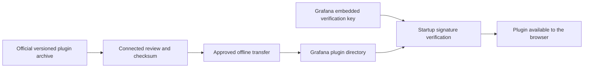

# How to Install Grafana Plugins in an Air-Gapped Environment

Author: [nawazdhandala](https://www.github.com/nawazdhandala)

Tags: Air-Gapped, Grafana, Monitoring, Security

Description: Install versioned Grafana plugin archives offline, preserve signature verification, inspect compatibility, and test the result without the public catalog.

Installing an offline Grafana plugin has three separate success conditions. The archive must arrive unchanged, Grafana must accept and load it, and the plugin must work with the services available inside your network. A successful unzip proves only part of the first condition.

This tutorial uses **Clock panel 3.2.5** as a small, concrete example and checks configuration against **Grafana 13.3.1**. Clock is useful for a rehearsal because a basic clock panel does not require a separate database service. The [official Clock catalog page](https://grafana.com/grafana/plugins/grafana-clock-panel/) identifies the plugin and its supported Grafana version range. Treat these versions as a reproducible example, not an instruction to upgrade an existing installation.

## Decide what crosses the boundary

Use a connected preparation machine to obtain an approved release ZIP. Transfer that ZIP, its recorded checksum, release information, and deployment instructions through your organization's normal process. Keep the checksum in a separately approved record as well; a checksum file beside an archive cannot establish who supplied it.



Grafana supports extracting a plugin ZIP into its configured plugin directory. You do not need the online catalog UI for this workflow. The [official installation guide](https://grafana.com/docs/grafana/latest/administration/plugin-management/plugin-install/) also explains how to discover versioned download URLs through the Grafana plugin API.

## Download an exact release

On the connected machine, use curl and a SHA-256 tool. SHA-256 produces a fingerprint of the file's contents. The following URL names a specific plugin version rather than whatever happens to be latest:

```bash
curl --fail --location \
  https://grafana.com/api/plugins/grafana-clock-panel/versions/3.2.5/download \
  --output grafana-clock-panel-3.2.5.zip
shasum -a 256 grafana-clock-panel-3.2.5.zip > plugin.sha256
unzip -l grafana-clock-panel-3.2.5.zip
```

The downloaded archive inspected for this article contains a top-level `grafana-clock-panel/` directory, including `plugin.json`, JavaScript assets, and `MANIFEST.txt`. Its recorded SHA-256 is:

```text
a5210820c4e735d2fb8d546ed9be72a30728a62749fad4e96510d7dbd1b919b9
```

Compare against your own approved download record before transfer. If a future retrieval differs, investigate the difference rather than automatically accepting a newly calculated checksum.

## Inspect compatibility before installing

`plugin.json` describes the plugin. This read-only Python 3 example prints the identity and dependencies directly from the ZIP, without running its code:

```python
import json
import zipfile

with zipfile.ZipFile("grafana-clock-panel-3.2.5.zip") as archive:
    metadata = json.loads(archive.read("grafana-clock-panel/plugin.json"))
    print("ID:", metadata["id"])
    print("Version:", metadata["info"]["version"])
    print("Grafana:", metadata["dependencies"]["grafanaDependency"])
    print("Other plugins:", metadata["dependencies"]["plugins"])
    print("Backend:", metadata.get("backend", False))
```

For this archive, the expected output identifies `grafana-clock-panel`, version `3.2.5`, the Grafana range `>=11.0.0-0`, no additional plugin dependencies, and no declared backend component. The metadata range is a prerequisite check, not evidence that every feature works in every later Grafana release.

For other plugins, inspect `backend` and `executable` as well. A backend plugin runs a server-side executable; its operating system and CPU architecture must match the Grafana host. A ZIP containing only an AMD64 executable will not become an ARM64 plugin when copied to another node. The [plugin metadata reference](https://grafana.com/developers/plugin-tools/reference/plugin-json) documents these fields and executable naming rules.

Also record the plugin's license and any product entitlement it requires. Offline availability of an archive does not establish permission to use a commercial integration. Review its destination services: a plugin intended solely for a public API may load correctly but still be unsuitable for your isolated network.

## Install into a clean directory

The example below assumes a Linux package installation, a `grafana` service account, and an explicitly configured plugin path of `/var/lib/grafana/plugins`. Adapt those assumptions to your deployment before executing it. Use a staging instance first, with `unzip` and `shasum` already available offline.

After transfer, validate the checksum and extract into a new temporary directory:

```bash
shasum -a 256 -c plugin.sha256
plugin_stage=$(mktemp -d)
unzip -q grafana-clock-panel-3.2.5.zip -d "$plugin_stage"
test -f "$plugin_stage/grafana-clock-panel/plugin.json"
test -f "$plugin_stage/grafana-clock-panel/MANIFEST.txt"
```

The checksum check should report `OK`; both file checks should exit successfully. Keep the plugin directory structure intact. This archive already contains its plugin folder, so extracting it into another folder with the same name would introduce an unnecessary nested directory.

For a **first installation only**, the guarded copy below refuses to merge into an existing Clock plugin directory. Run the block in the same shell so `plugin_stage` still exists:

```bash
sudo install -d -o grafana -g grafana /var/lib/grafana/plugins
if sudo test -e /var/lib/grafana/plugins/grafana-clock-panel; then
  printf '%s\n' 'Plugin already exists; use a reviewed upgrade procedure.'
else
  sudo cp -a "$plugin_stage/grafana-clock-panel" /var/lib/grafana/plugins/
  sudo chown -R grafana:grafana /var/lib/grafana/plugins/grafana-clock-panel
fi
```

Do not merge new assets into an old release: obsolete files can remain behind. For an upgrade, retain the previous complete directory outside the scanned plugin path, back up relevant configuration, and replace the release during a controlled maintenance window.

In containers, use an approved custom image or persistent plugin volume that recreates the same reviewed files after replacement. Copying files manually into one running container is not a reproducible deployment. Ensure every Grafana replica receives the same release.

## Keep signature checks enabled offline

A plugin signature authenticates the plugin's files. TLS certificates authenticate a network endpoint. Installing your internal certificate authority does not make an unsigned plugin trusted.

For this manually installed example, merge these settings into the active Grafana configuration. Do not overwrite unrelated settings or edit Grafana's distributed `defaults.ini`:

```ini
[paths]
plugins = /var/lib/grafana/plugins

[plugins]
preinstall_disabled = true
public_key_retrieval_disabled = true
public_key_retrieval_on_startup = false
```

The keys exist in the [Grafana 13.3.1 defaults](https://github.com/grafana/grafana/blob/v13.3.1/conf/defaults.ini). Disabling public-key retrieval makes Grafana use its embedded key; it does **not** turn off signature verification. Disabling startup retrieval alone would not prevent later retrieval. This behavior is documented in the [configuration reference](https://grafana.com/docs/grafana/latest/setup-grafana/configure-grafana/#public_key_retrieval_disabled).

An old Grafana build may not contain the key required by a newer signed plugin. Rehearse the exact Grafana/plugin pair offline. If verification fails, investigate key compatibility, archive integrity, and release support rather than enabling unsigned plugins or development mode. A `MANIFEST.txt` file's presence alone proves neither signature validity nor trust. Grafana checks signatures when loading plugins; see its [signature documentation](https://grafana.com/docs/grafana/latest/administration/plugin-management/plugin-sign/).

## Verify startup and actual use

For the assumed systemd package installation, restart the staging instance and inspect its status using Grafana's [documented service commands](https://grafana.com/docs/grafana/latest/setup-grafana/start-restart-grafana/):

```bash
sudo systemctl restart grafana-server
sudo systemctl status grafana-server
```

Inspect server logs for plugin loading and signature errors. In Grafana's plugin administration page, confirm the expected ID, version, and signed status. Add a Clock panel to a disposable dashboard and verify its time display, timezone, save, and reload behavior.

Repeat with public egress blocked in staging while preserving necessary internal services. Use a fresh browser session and inspect browser network requests as well as server traffic. A plugin can load an external font or script from the browser even when Grafana itself has no Internet route.

For backend data sources, add a query against the actual internal service and check its certificate validation and authentication. Finally, recreate the Grafana instance using your deployment procedure. The plugin should return without a catalog download. Record that result alongside the release and checksum; this is the evidence that the installation survives more than a single successful restart.
