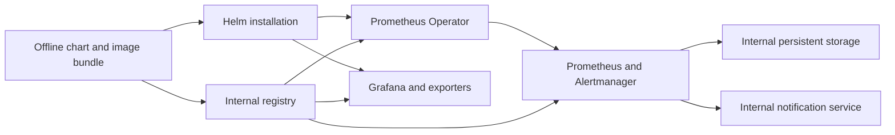

# How to Install kube-prometheus-stack in an Air-Gapped Kubernetes Cluster

Author: [nawazdhandala](https://www.github.com/nawazdhandala)

Tags: Air-Gapped, Kubernetes, Prometheus, Grafana, Monitoring

Description: Prepare an offline kube-prometheus-stack installation with mirrored images, local storage, internal notifications, and checks for Operator-created workloads.

An offline installation can get surprisingly far with an incomplete image bundle. Helm creates the Operator successfully, but Prometheus never starts because its image was missing. Alternatively, the installation waits for an admission job whose small helper image nobody remembered to mirror.

The solution is to prepare the final configuration first, then inventory everything it can create. This walkthrough uses **kube-prometheus-stack 93.6.0**, whose Operator version is **v0.95.2**. It is a reproducible example for a fresh installation, not an upgrade procedure or a recommendation to adopt a release without your normal review. The chart package and defaults are available in the [official release](https://github.com/prometheus-community/helm-charts/releases/tag/kube-prometheus-stack-93.6.0).

## Understand the two deployment stages

Helm installs ordinary workloads and custom resources. A custom resource is a Kubernetes object understood by an additional controller. Here, the Prometheus Operator reads the Prometheus and Alertmanager resources and creates their workloads afterward. Their images therefore matter even though those Pods do not appear directly in Helm's output. See the [Operator API reference](https://prometheus-operator.dev/docs/api-reference/api/).



Plan for internal DNS, a trusted registry, storage provisioning, and a notification destination before transferring artifacts. Node-level registry certificate trust and image credentials are separate requirements: trusting a certificate does not grant permission to pull an image.

## Download the complete chart on a connected machine

Use an approved Helm installation. These preparation commands download a pinned package and produce a checksum for later transfer verification:

```bash
helm pull kube-prometheus-stack \
  --repo https://prometheus-community.github.io/helm-charts \
  --version 93.6.0
shasum -a 256 kube-prometheus-stack-93.6.0.tgz > chart.sha256
tar -tzf kube-prometheus-stack-93.6.0.tgz
```

The package inspected for this article includes its dependent charts, including Grafana, kube-state-metrics, and node-exporter. Preserve the complete archive. Do not depend on running `helm dependency update` inside the disconnected environment. Record the package's approved checksum separately from the transfer medium; a checksum stored alongside an altered file is not proof of origin.

## Set the offline configuration before inventorying images

Save the following as `offline-values.yaml`. Replace `registry.internal.example` and `INTERNAL_STORAGE_CLASS`. The registry layout must preserve each upstream repository path: for example, `quay.io/prometheus/prometheus` becomes `registry.internal.example/prometheus/prometheus`.

Before installation, create the `monitoring` namespace and provision two Secrets through your approved secret-management process: `monitoring-pull` with registry credentials, and `grafana-admin` with `admin-user` and `admin-password` keys. Never put their values in a checked-in file. Image pull Secrets must be available in the workload's namespace, as described in the [Kubernetes private registry guide](https://kubernetes.io/docs/tasks/configure-pod-container/pull-image-private-registry/).

```yaml
global:
  imageRegistry: registry.internal.example
  imagePullSecrets:
    - name: monitoring-pull
grafana:
  admin:
    existingSecret: grafana-admin
    userKey: admin-user
    passwordKey: admin-password
  persistence:
    enabled: true
    storageClassName: INTERNAL_STORAGE_CLASS
    size: 5Gi
  grafana.ini:
    analytics:
      reporting_enabled: false
      check_for_updates: false
      check_for_plugin_updates: false
    plugins:
      preinstall_disabled: true
prometheus:
  prometheusSpec:
    retention: 7d
    storageSpec:
      volumeClaimTemplate:
        spec:
          storageClassName: INTERNAL_STORAGE_CLASS
          accessModes: [ReadWriteOnce]
          resources:
            requests:
              storage: 20Gi
alertmanager:
  alertmanagerSpec:
    storage:
      volumeClaimTemplate:
        spec:
          storageClassName: INTERNAL_STORAGE_CLASS
          accessModes: [ReadWriteOnce]
          resources:
            requests:
              storage: 2Gi
```

The storage sizes are starting values for a rehearsal, not capacity estimates. Persistent volume claims ask your storage system for durable volumes. Prometheus retention limits how long samples are kept; it does not replace disk sizing, monitoring free space, or backups. Alertmanager also needs persistent state for features such as silences.

Grafana's settings turn off reporting, update checks, and automatic plugin preinstallation. They do not promise that arbitrary dashboards, plugins, or authentication providers avoid the Internet. This example uses bundled dashboards and no additional plugins. Review the [Grafana configuration reference](https://grafana.com/docs/grafana/latest/setup-grafana/configure-grafana/) when adding integrations.

## Inventory the final render, including hidden dependencies

Render the package with the same values you intend to install:

```bash
helm template monitoring ./kube-prometheus-stack-93.6.0.tgz \
  --namespace monitoring --include-crds \
  -f offline-values.yaml > rendered.yaml
```

This is a local rendering check, not Kubernetes API validation. Helm explicitly distinguishes these in its [template documentation](https://helm.sh/docs/helm/helm_template/). Inspect container images, init-container images, hook Jobs, Prometheus and Alertmanager `spec.image`, and the Operator's `--prometheus-config-reloader` argument. A search limited to Deployments misses important entries.

For the exact configuration above, my local render produced these upstream dependencies, rewritten to the internal hostname:

| Purpose | Upstream image to retain |
| --- | --- |
| Operator | `quay.io/prometheus-operator/prometheus-operator:v0.95.2` |
| Configuration reloader | `quay.io/prometheus-operator/prometheus-config-reloader:v0.95.2` |
| Prometheus | `quay.io/prometheus/prometheus:v3.16.0-distroless` |
| Alertmanager | `quay.io/prometheus/alertmanager:v0.35.0` |
| Admission certificate Jobs | `ghcr.io/jkroepke/kube-webhook-certgen:1.11.1` |
| Kubernetes object metrics | `registry.k8s.io/kube-state-metrics/kube-state-metrics:v2.20.0` |
| Node exporter | `quay.io/prometheus/node-exporter:v1.13.1-distroless` |
| Grafana | `docker.io/grafana/grafana:13.3.1-distroless` |
| Grafana configuration sidecar | `quay.io/kiwigrid/k8s-sidecar:2.14.3` |
| Grafana volume initialization | `docker.io/library/busybox:1.38.0` |
| Grafana Helm test | `docker.io/bats/bats:1.14.0` |

This is a configuration-specific inventory, not every image the chart supports. Enabling Windows monitoring, Thanos, dashboard downloads, an image renderer, or CRD upgrade Jobs changes it. A CRD defines a custom resource's schema. The optional upgrade Jobs are disabled in this fresh-install example; they require additional images if enabled. Rerender after every configuration change.

## Transfer and import images deliberately

Use approved image-transfer tooling and retain a manifest recording source references, resolved digests, destination references, and supported CPU architectures. Tags identify the example versions; digests identify the actual content you approved. Check architecture availability for every image before scheduling onto mixed-architecture nodes.

For example, with Skopeo installed and source access available, this command saves all available architectures for the Operator image in an OCI archive. OCI is a standardized container-image format:

```bash
skopeo copy --all \
  docker://quay.io/prometheus-operator/prometheus-operator:v0.95.2 \
  oci-archive:operator-v0.95.2.tar:operator
```

After approved transfer, import that archive from a machine that trusts and can authenticate to your internal registry:

```bash
skopeo copy --all \
  oci-archive:operator-v0.95.2.tar:operator \
  docker://registry.internal.example/prometheus-operator/prometheus-operator:v0.95.2
shasum -a 256 -c chart.sha256
```

Repeat image export/import for the full inventory using distinct archive names. These commands follow the [Skopeo copy documentation](https://github.com/containers/skopeo/blob/main/docs/skopeo-copy.1.md); the image transfers were not executed for this article. An OCI archive is not an instruction to run `docker load`. Verify transferred files against your approved manifest and inspect destination images before installation. Do not bypass registry TLS verification to solve certificate errors.

## Install and prove local operation

Use a staging cluster first. Confirm its Kubernetes version meets the chart requirements and your platform's support policy. Review permissions, especially node-exporter's host access; this example is not a restricted-security-policy profile.

With the namespace, Secrets, internal registry, and storage class ready:

```bash
helm install monitoring ./kube-prometheus-stack-93.6.0.tgz \
  --namespace monitoring -f offline-values.yaml \
  --wait --timeout 10m
kubectl -n monitoring get pods,jobs,pvc
kubectl -n monitoring get prometheus,alertmanager
kubectl -n monitoring get events --sort-by=.metadata.creationTimestamp
```

A successful Helm command is the beginning of acceptance testing. Check the Operator-created StatefulSets and their actual Pods. On clean staging nodes with empty image caches, verify that every image pull uses the internal registry. Keep required internal traffic available while your staging egress controls block public destinations.

Open Grafana through your approved internal access path and confirm its Prometheus data source answers queries. Check `up` in Prometheus and investigate missing targets individually: some managed clusters do not expose every control-plane endpoint assumed by the bundled monitoring configuration.

Configure Alertmanager with an approved internal SMTP relay or webhook and protected credentials. The chart's default null receiver does not deliver operational notifications. Trigger a clearly labeled rehearsal alert, confirm receipt at the destination, and verify resolution. Then restart the monitoring workloads in staging and confirm expected data and silences survive.

If a Pod cannot start, distinguish missing images, registry trust failures, denied credentials, policy rejection, and unbound storage claims before changing configuration. If metrics work but notifications fail, examine Alertmanager routing and destination reachability. Keep the approved bundle, final values, image manifest, and acceptance evidence together so the next clean-node installation is repeatable.
